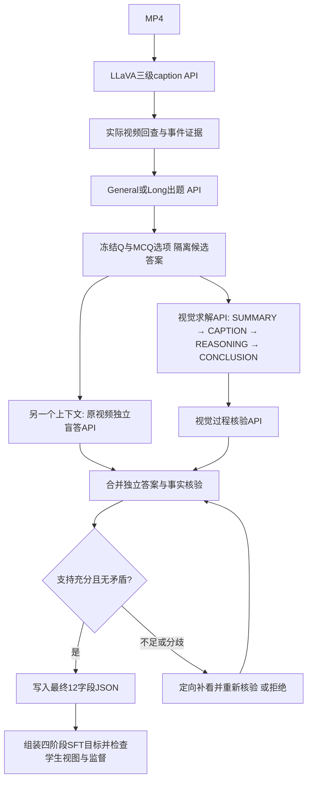

> 当前配置与v1流程以 [decisions.md](decisions.md) 为准；本文中的旧默认值、演示模型/数量或历史方案不覆盖最新用户决定。

# 视频 SFT 数据构造：先生成 CoT，再得到答案的可行性评估

日期：2026-10-20。范围：MP4 + 模型 API，General 参考 Academic2M、Long 参考 LV116K；最终题型为 OE、单选 MCQ（3/4/6 选项）。

状态：**文献与官方代码已核对；本项目方法为 Proposed，尚未实现、调用真实视频 API 或验证训练收益。** 本文评估一个变更建议，不自动替换现有方案，不更改最终 12 字段 JSON 合同。此处是 GLM 项目设计，不声明符合 UniMoE 交付模板。

## 0. 结论与决策问题

**有条件赞成：把“依据视频、不接收预设答案，先生成 CoT，再输出答案”作为本项目优先试验的构造方式。最终标签仍须经过独立视觉核验。**

你的项目从无标注 MP4 开始，前序 QA 生成器给出的答案本身也是模型候选。把这个候选先当成标准答案再要求教师解释，可能把错误标签固化；在这种前提下，你提出的顺序有合理的工程动机。但目前没有本项目数据证明它一定优于答案条件化生成。

应采用的完整命题是：

> 固定问题（MCQ 同时固定选项），教师根据实际视频证据生成任务相关观察和推导，再形成候选答案；独立求解与视频事实检查通过后，才将该答案作为训练标签。

不能采用的命题是：“答案由 CoT 生成，因此 CoT 和答案必然正确。”文本先后顺序也不能证明文字忠实反映模型内部计算。

本轮决策问题：在固定视频、问题、学生视图和教师配置时，隐藏候选答案的 CoT 生成，能否比现有答案条件化方法提高**每单位预算产出的、证据与答案均正确的可训练样本数**？

最便宜的反证试验：固定一批题，比较两种生成方式，经盲审发现前者的事实错误/错误答案没有减少，或正确样本产出成本明显恶化。此时应放弃“顺序本身提升质量”的主张，保留四阶段结构与视觉核验。

## 1. 预期成果及不构成成果的指标

本轮是工程方案评估，不以发表论文为目标；将成果分为以下三级。

| 层级 | 应交付的成果 | 成立所需证据 |
|---|---|---|
| 最小可用 | 不泄露候选答案的四阶段生成接口、视觉核验、可追溯失败记录 | 固定题集的成对比较，报告错误与拒绝，不只展示成功案例 |
| 较强结果 | General/Long、OE/MCQ 分组均达到预定质量门槛 | 独立参考判断、成本及产出率、学生实际可见证据检查 |
| 扩展结果 | 用所产数据做相同预算的 SFT，改善未见视频上的答案与证据质量 | 视频级隔离评测、相同训练预算和解码配置、重复实验 |

以下不能单独算成功：四个标签齐全、CoT 很长、结论等于自己生成的答案、多次调用同意、只看通过样本的高分、教师表现提升但学生未获益。

## 2. 理论边界：支持你的判断，但没有正确性保证

### 2.1 定义与两种条件分布

记 V 为实际送入模型的有序视觉证据，Q 为问题，O 为 MCQ 选项（OE 为空），R 为前三阶段公开标注，A 为最终答案，A₀ 为前序出题器的候选答案。

```text
答案条件化增强：R ~ P(R | V, Q, O, A₀)，随后输出与 A₀ 对齐的结论。
你的方案：    (R, A) ~ P(R, A | V, Q, O)
                     = P(R | V, Q, O) × P(A | V, Q, O, R)。
```

第二种移除了外部候选答案 A₀ 对生成器的直接提示。这是其合理性所在；上述分解只是生成顺序的表达，**不是正确性或因果忠实性的证明**。尤其不能把第二项简化成只读 R 的 `P(A | R)`，让最终回答丢失视频和题干。

### 2.2 必要前提与不足以保证质量的条件

最低前提包括：关键事件确实被采样；问题可由视觉回答；选项语义明确；教师能处理相应视频长度；推导引用的观察经过检查；学生视图包含解题所需证据。任一项不满足，都可能让正确顺序产生错误样本。

“先 R 后 A”“R 和 A 自洽”“第二次调用同意”均不是充分条件。相同教师、相同漏帧与相同 caption 会产生相关错误；换一个会话可减少直接提示影响，但不等于统计独立。

### 2.3 最小反例

原视频中人物依次拿起杯子、短暂搅拌、放下杯子；低帧率采样漏掉搅拌。三级 caption 只记下拿起和放下。问：“拿起杯子后紧接着做什么？”

模型可先写“拿起后直接放下”的观察与推导，再输出“放下”。顺序完全符合你的想法，答案仍错误。若只让验证器读相同 caption，甚至会通过；需要补看相应原视频窗口。

因此主要质量瓶颈仍是**证据覆盖、任务可答性和核验能力**，顺序解决的是答案提示的一类风险。

### 2.4 三种不同的正确性

| 层面 | 可以检查什么 | 不能据此推出什么 |
|---|---|---|
| 结构正确 | 四段存在；MCQ 单个合法选项；结论字段相等 | 视频事实正确 |
| 任务正确 | 观察受视频支持；推导有效；最终答案正确 | 文本就是模型真实内部思维 |
| 训练有效 | 四阶段进入监督；结论未截断；学生有证据 | 学生实际收益，仍需 SFT 评测 |

## 3. 与原方法、相关研究的关系

| 工作 | 来源状态 | 已有机制与本问题的联系 | 迁移边界及应保留的对照 |
|---|---|---|---|
| LLaVA-CoT-100k | 公开论文与生成代码；本轮复核固定代码 | 四阶段输出；构造时给教师原始答案，筛除结论不符的输出 | 图像与已有答案的场景；本项目改为视频、答案未知。应保留答案条件化基线 |
| STaR | NeurIPS 2022 | 先生成推导和答案，按已知答案筛选；另用已知答案提示来补充推导 | 两种方式可并用，不支持“答案条件化一定无效”；其正确性筛选依赖已有标签 |
| Turpin 等 | NeurIPS 2023 | 研究了回答偏置影响解释、但解释未披露这种影响的情况 | 支持检查答案提示与选项偏置，不能直接量化本项目视频错误率 |
| Lanham 等 | 2023 公开研究论文 | 用改动/截断等干预考察模型是否依赖 CoT | 支持把 CoT 自洽与忠实性区分；不是视频标注效果的直接证据 |

LLaVA-CoT 的四阶段结构与附录 B 数据构造描述见[原论文 §3.1 与附录 B](https://arxiv.org/html/2411.10440v2)。固定版本 [generate.py](https://github.com/PKU-YuanGroup/LLaVA-CoT/blob/081cc3fe3670fbff7b30fa22cbcafe031a2077bc/dataset_generation/generate.py) 约 86–96 行把 `standard_answer` 放入生成请求；后续 judge 比较结论和原答案，并不回看图像。

所以：**参考其四阶段监督形式，与原样复用其带答案生成方式，是两件事。你的提议属于后者的改造。** 原代码的文本一致性 judge 不能直接变成 MP4-only 管道的事实裁判。

STaR 的 §3.1/3.2 同时介绍了前向生成和答案提示补充，见[论文方法部分](https://arxiv.org/html/2203.14465v2#S3)。它表明答案条件化合成可以有训练价值，前提与收益需具体评估。相关的解释偏置和 CoT 依赖性实验分别见 [Turpin 等](https://arxiv.org/abs/2305.04388)、[Lanham 等](https://arxiv.org/abs/2307.13702)。

本项目可以主张“把已有方法组合成可追溯的视频标注管道”，尚不能主张“CoT 先行是新方法”或“已证明能得到忠实推理”。真实视频上的收益、长视频适配和可复现错误分析仍待验证。

## 4. 三种顺序的取舍与实际价值

| 方法 | 适合什么场景 | 主要收益 | 主要风险 | 本项目位置 |
|---|---|---|---|---|
| 已有可信答案 → CoT | 人工标注/高可信外部标签 | 保留正确标签，补推导监督 | 可生成错误依据；仍要检查过程 | 有可信标签时的备选，并非一律否决 |
| 问题 + 视频 → CoT → 答案 | 当前没有人工答案的 MP4 合成 | 减少对出题器候选答案的直接迎合 | 早期视觉错误会进入推导和答案 | 推荐优先试验 |
| 视频 → 直接答案 → 独立核验 | 简单属性、直接动作题 | 成本低、强基线 | 本身不提供 CoT 训练标注 | 质量基线/核验分支；最终交付仍需生成 CoT |

这里的受益者是数据构造与 SFT 训练环节，实际目标是可学的正确样本。无需把每个简单感知题强行写成长推导；仍可满足四阶段合同，每段只写必要内容。复杂时序、跨片段比较更值得分配推导与复查预算，但收益同样是待检验假设。

即使顺序比较结果为负，仍能复用证据账本、错误分类、四阶段解析与核验模块。不要为了维护某一种顺序而继续扩大有错标签。

## 5. 成本、产出与何时值得采用

对固定 N 道候选题，定义：

```text
C总 = C视频处理与caption + C出题 + C求解/CoT
     + C独立盲答 + C过程核验 + C补看/重试 + C导出检查

每条有效样本成本 ≈ C总 / (N × 放行率 × 放行样本真实合格率)
```

真实合格率应来自独立抽审/可信参考，而不是生成器给自己的评分。小样本时这个比值有很大不确定性，应同时报告分子、分母与区间。对比实验共享的 caption 成本只做一次，但正式总成本要把它计入。

默认用**一次调用顺序输出四阶段**，不需要因为有四段而调用四次 API。若拆成“前三段 → 冻结 → 结论”，会重复传输视频/上下文、增加请求延迟，也可能让结论受到错误 R 的锚定；是否更值必须单独比较。

本轮不提出速度加速主张，因此不套用 Amdahl 加速上限或硬件内核等价性指标。仍需记录从视频准备到样本放行的耗时、p50/p95、限流重试、上下文长度/截断、API 输入输出计费及可获得的媒体传输成本。模型服务端显存、编译与能耗不可观测时写“不可观测”，不编造。

经济上成立的条件：在达成相同质量下限时，新路线提高正确样本产量，或把错误率降到项目愿意支付的成本范围。不能只用单次调用价或更低的拒绝率判断。

## 6. 质疑清单与否决条件

下表均是本项目需验证的风险，不是声称已经发生的结果。

| # | 质疑 | 失败信号 | 检查 | 应对与停止/转向条件 |
|---:|---|---|---|---|
| 1 | 三级 caption 漏掉关键动作 | CoT 与 caption 一致但违背视频 | 抽查关键窗口，比较采样密度 | 补看/改采样；持续覆盖不到则停止该类出题 |
| 2 | 问题依赖音频或不可见信息 | 纯视觉无法确定 | 看原片视觉证据，标注可答性 | 拒绝/重建问题，不猜旁白 |
| 3 | 生成器仍收到候选答案 | 盲答提示含 key、hint 或前序回答 | 审计完整请求及上下文 | 隔离上下文；泄露记录不能计为盲生成 |
| 4 | 自洽掩盖共错 | 多次同答但事实错误 | 独立观察，换采样/教师或人工抽审 | 把一致性降为信号，不能独自放行 |
| 5 | MCQ 多个正确/没有正确项 | 两个选项都受支持 | 逐项语义及视觉检查 | 重建选项；有限重试后拒绝 |
| 6 | 选项位置决定答案 | 换序后语义答案改变 | 置换选项并重新盲答 | 平衡位置、改干扰项；未解决则剔除 |
| 7 | 推导看似合理但不支持结论 | 引用无关事实、偷换先后 | 检查关键前提与结论支持关系 | 重新求解；不只把结论改成指定字母 |
| 8 | 长视频题实际局部可解 | 单个片段即可得到全部答案 | 单片段及证据遮挡对照 | 改任务标签/重建题，不计跨段专项 |
| 9 | 教师看到但学生看不到 | 训练输入漏关键动作 | 审查学生实际采样视图 | 调整视图或移除样本；不靠教师密帧答案硬教 |
| 10 | 冗长 CoT 提高成本和截断 | 结论丢失，简单题多写无关事实 | 真实模板与 labels 检查 | 缩短必要推导；无益则降低长度预算 |
| 11 | 过滤只剩简单题 | 平均分升高、难题放行率塌陷 | 按任务/时长报告完整漏斗 | 调整采样配额；不宣称全分布提升 |
| 12 | 相似片段跨训练评测泄漏 | 同源视频不同裁片分散 | 原视频/近重复组级隔离 | 重做划分；受污染结果不采用 |
| 13 | 同时换模型/核验造成假收益 | 无法归因于顺序 | 固定除答案可见性外的因素 | 单因素比较；不把组合收益归因给 CoT 先行 |
| 14 | OE 只比文本一致 | 同义判错或同错判对 | 按事实点和时间顺序核验 | 语义核验+抽审，不用字符串相等代替正确 |
| 15 | API 升级/重试造成漂移 | 相同配置产出变化、成本尾部变大 | 记录服务版本、请求、视图与重试 | 固定可固定项；重跑小基准后再扩量 |
| 16 | 数据更漂亮但 SFT 没收益 | 未见视频上无改善或退化 | 相同 token 预算的学生对照 | 保留高质量事实/答案；回退长度或监督配置 |

## 7. 推荐的产出链路与 API 边界

以下为 Proposed，优先试验方向；保留现有答案条件化路线作为比较基线。



图中补看必须有限重试；预算耗尽、事实仍不足或无法唯一解题时退出为 review/reject，不能无限循环。前序已经做过等价的独立视觉盲答时可复用其记录，但不能复用一个已看过当前 CoT/答案的回答冒充盲答。

### 7.1 每个调用看什么、不看什么

| 环节 | 输入 | 输出与用途 |
|---|---|---|
| 三级 caption | 有序视频帧/片段及时间 | 多粒度描述；用于覆盖与出题，不直接充当真值 |
| 证据回查 | 实际片段、待核实事件 | supported / contradicted / insufficient 及实际支持位置 |
| 出题 | 视频证据账本、目标任务 | 问题；MCQ 选项；可有内部候选答案，用于构题检查 |
| CoT 求解 | Q、固定 O、实际视频视图；可用已核查事件 | 四阶段公开训练标注与候选结论；不提供 A₀/出题器 key |
| 独立盲答 | 同一 Q、O，实际视频；独立上下文 | 答案或不足；不展示 CoT、候选结论、出题器 key |
| 过程核验 | Q、O、CoT、结论和原片窗口 | 检查事实与推导；可见候选，因为职责是审核而非盲答 |
| 分歧处理 | 盲答分歧、可核查位置、实际片段 | 定向补看与最终裁定；证据不足则拒绝 |

只提供一个视觉 API 也能由它承担多个角色，使用隔离会话与不同审核指令即可启动；这不消除模型共错。第二种模型是可选增强，不是强制额外服务。纯文本 API 可做结构/语义检查，不能替代核对视频事实。

### 7.2 OE 的具体顺序

1. 出题器根据证据形成 Q；任何 seed answer 都只是候选。
2. 求解器不知道 seed answer，依据视觉证据依次生成 SUMMARY、CAPTION、REASONING、CONCLUSION。
3. 独立盲答和视觉过程核验检查事实、时序、问题覆盖及答案。
4. 通过后冻结最终 OE 文本，同步保存到 `cot.conclusion` 与 `gpt.value`。一致文本是导出约束，不是正确性证据。

OE 可以有多个同义的正确表达，不要求与出题器 seed 逐字相同；不要把文本不同自动视为推导错误。

### 7.3 MCQ 的具体顺序

**MCQ 必须先有题干与选项，才能完成针对该题的最终求解。** 出题时可以先得到 provisional OE 语义答案，再生成干扰项；这并不要求把它交给求解器。

```text
已核查事件 → Q + 内部候选语义答案 → 生成3/4/6个选项
→ 检查选项、固定顺序 → 隐藏内部key
→ 视频+Q+选项 → CoT → 唯一选项字母
→ 独立盲答+逐项排查+视觉过程核验 → 最终key
```

默认 4 选 1，少量 3 选 1、6 选 1；不产生多选题。干扰项可变更动作、对象、先后或片段，但要检查“干扰项恰好也在视频里发生”等歧义。

求解结果与出题器内部 key 不同，不能简单强制求解器改成 key；也不能默认求解器正确并改 key。应回看证据，必要时重建题/选项。最终训练样本必须唯一可答；内部不足/歧义状态留在外部审计，不新增第三种训练题型。

顺序应在正式 CoT 生成前固定。置换测试可作为独立诊断：比较对应选项的**语义**是否保持，字母应随位置变化；不要期待字母不变。若将置换版本也发布为训练数据，需要同步生成/核验其 CoT 与结论。

### 7.4 General 与 Long 的区别

两类采用同一顺序、同一 JSON。General 重点核对题目窗口；Long 额外检查：关键片段是否都看过、时间基准是否一致、跨段关系是否确实由多个片段共同支持。全局 L3 可做检索与规划，不应单独支撑精确动作顺序/次数。

上下文容不下整片时，可按事件账本取相关窗口；选择窗口的过程和覆盖失败需外置记录。无法支持问题时补看或拒绝，不能从全局摘要补写不存在的细节。涉及“总共”“第一次/最后一次”等全局量词时，还需检查相关候选事件的覆盖，几个局部正例不能证明全局结论。

### 7.5 一次四段输出与两次调用

| 方案 | 实现 | 判断 |
|---|---|---|
| 一次调用 | 不给答案，按四阶段输出；解析后审核 | 推荐 v1 默认，简单、成本较低；可称“输出顺序为 CoT→答案” |
| 两次调用 | 第一次只产前三段；保存后，第二次用视频+Q+O+已冻结前三段生成结论 | 可作为审计/消融方案；更容易核查分阶段流程，但无内部忠实性保证，且可能重复输入和放大错误 R |

不必为了“由 CoT 得答案”强制拆为两个 API。若采用两阶段，第二阶段发现前三段事实错误时应标记失败/新版本重生成，不能为凑一致悄悄改已冻结内容。

CoT 指要求教师公开输出的结构化标注，不依赖获取未公开内部推理。SUMMARY 是本题求解目标；CAPTION 是与题目有关的可见事实；REASONING 是这些事实如何支持回答；CONCLUSION 是 OE 文本或单个选项。前三阶段不是再次复制完整三级 caption。

### 7.6 最终 JSON 与外部记录

生成顺序不要求改变现有 12 字段：`id/source/conversations/task/question_type/media_info/media/modal_mask/quality/cot/language/tokens`。

通过样本维持：

```text
OE:  cot.conclusion == gpt.value
MCQ: cot.conclusion == gpt.value == question_type.correct_option_id
cot: summary、caption、reasoning、conclusion 四项非空
```

MCQ key 在审核通过后才是最终标签。`cot.supervised=true` 时，训练适配器把四段组装进 assistant 监督目标；若只读取 `gpt.value`，仍只训练答案。token、mask 与截断检查必须针对组装后的真实目标，不能按一个字母估算。

在训练 JSON 外，以 `sample_id=id` 关联存储：生成模式、候选 seed、完整教师请求/响应、是否暴露答案、提示/模型版本、时间与采样视图、事实支持、盲答与审核结果、补看/重试、拒绝原因、调用成本。不得把候选 seed 放进学生提示、文件名暗示或共享会话而破坏隔离。

## 8. 对照实验：先测标注，再决定是否训练

### 8.1 固定题目的标注实验

建议先做 200 道题的预算可控试验：General/Long × OE/MCQ 四组各约 50 题，优先来自不同原视频，少量包含 3/6 选项。这个规模只能发现较大的问题，不能支持细分组的高精度结论；若置信区间过宽，再按实际效应与预算追加。

所有路线共享原视频、Q、O、原视频分组、学生视图、教师版本、采样配置和同一审核协议。主比较只改变是否给 CoT 教师候选答案；若改变教师/采样/核验策略，另作消融。

| 路线 | 求解方式 | 要回答的问题 |
|---|---|---|
| A：现有方案 | 给已审核 seed，生成四段 | 当前答案条件化方案的质量/成本基线 |
| B：推荐试验 | 不给 seed，一次顺序生成四段 | 隐藏答案是否减少错误及迎合 |
| C：直接答题 | 不给 seed，只输出答案 | 推导生成相对简单方案是否值得；不是最终 CoT 交付 |
| D：可选 | B 拆两次，冻结前三段后产结论 | 两阶段额外调用是否有独立价值 |

A 所用 seed 的来源、准确率及获取成本必须单列；若 seed 由其他模型生成，不冒称 GT。为分辨顺序与 seed 错误的影响，按独立参考判断将 seed 正确/错误分层统计。可在少量只用于诊断的题上提供刻意错误 seed，测试是否出现迎合，但这些记录不得混入正式训练数据。

### 8.2 参考判断与指标

先用原视频制作小规模可信审核参考，审核者不知路线与 seed，分别评答案和过程；有分歧时复审。不要求每条生产数据都人工标注，但若小试也完全由同一模型自评，只能得出“代理核验通过率”，不能声称测得真实正确率。

核心指标包括：答案正确率、CAPTION 关键事实支持率、REASONING 支持充分性、MCQ 唯一可答率、Long 跨段必要性、学生证据可见性、放行率、每候选及每有效样本成本、监督截断率。分别报告审核前与审核后质量，并纳入失败/拒绝记录。

同一原视频的多题并非独立：以原视频为单位做配对 bootstrap 置信区间，并保留逐题结果；小样本分组只作探索。初试可每题每路线一次，另对预先选定的 40 题重复两次检查波动；不把多次重试后最好的结果当成单次效果。

### 8.3 反证、边界与迁移

检查：选项置换；无视频/遮掉关键片段对照；遗漏短动作；相似人物/对象；多次重复事件；尾部事件；跨镜头先后；只靠常识可猜的问题；中英文表达迁移。对遮挡实验先确认没有其他冗余线索，才能解释模型保持正确是否说明题目不需要该证据。

若 B 仍持续受错误 caption 锚定，或只在简单题上提高放行率，不能声称改善长视频推理。若 B 与 C 质量相同但显著更贵，应缩短 CoT；因用户要求最终生成 CoT，可保留它作为精简监督产物，但不宣称生成它提升答题质量。

### 8.4 后续 SFT 实验

仅在标注门禁通过后，比较相同训练 token 预算、视频划分和学生输入协议下的 A/B 数据；另做同一批已验证 B 样本的答案监督/四阶段监督对照。它们分别检验“构造方式”和“监督目标”的作用，不能混在一个比较中。

报告答案表现、事实支持、输出长度、推理成本和任务/时长分组；独立验证集不得与训练原视频或近重复组交叉。当前没有执行这些实验，不给出 GLM 训练收益数字。

## 9. 逐级门禁与停止规则

以下数值均为**项目建议阈值，非论文结论或已达指标**。正式小试前可按容错与预算调整并冻结，不在见到结果后挑阈值。

| 门禁 | 建议通过条件 | 失败后动作 |
|---|---|---|
| G0：流程正确 | 所有放行记录无答案提示泄露；格式/结论一致/学生监督检查全通过 | 修接口与导出，暂不扩量 |
| G1：标注有价值 | 小试放行样本的独立抽审：答案正确率点估计≥95%，实质事实/推导错误≤5%；报告区间且任一子组明显失效不得用总体掩盖 | 查证据、题型与核验；这些小样本点值不是规模化质量保证 |
| G2：顺序值得采用 | B 在相同审核标准下，相对 A 错误更少且成本可接受；建议每有效样本成本≤1.25倍，或有明确值得支付的质量改进 | 不把 B 升为唯一默认；保留可信标签条件化路径/精简 CoT |
| G3：规模稳健 | 更大、不同领域/长度批次维持门槛，置信区间足以支持所声称的质量；重试与拒绝无失控 | 分任务限用；修改视觉覆盖与核验后再试 |
| G4：学生受益 | 固定预算 SFT 在未见视频上改善目标指标，关键任务不明显退化 | 回退长度/混合比例/监督配置，不以教师指标替代 |

更严谨的 G2 决策应使用预先定义的可接受退化幅度及配对区间；200 题未检出差异不等于证明两者相等。扩量前需要有证据表明收益覆盖统计噪声和工程成本。

## 10. 替代路线与资产复用

| 路线 | 触发条件 | 可复用资产 | 新颖性判断 | 价值 / 风险 |
|---|---|---|---|---|
| 可信答案条件化 CoT | 已有人审标签或高可信事实型答案 | 四段解析、证据账本、视觉审核 | 已有范式 | 实现低风险；仍可能编造依据 |
| 盲生成 + 定向补看 | 错误主要来自遗漏短事件 | 全部现有模块，增加窗口调度 | 工程增强待验证 | 可能直接改善根因；IO/API 成本上升 |
| 简短证据化 CoT | 长推导无收益、截断/成本高 | 相同 JSON 与标签、精简提示 | 工程取舍 | 降成本且满足构造要求；复杂题需单独预算 |
| 任务分流 | 部分领域/长度持续不达标 | 任务分类、错误统计、General/Long 划分 | 工程取舍 | 可靠性更可控；覆盖范围缩小 |

不建议的修复：发现答案不一致后，只改 conclusion/key；让模型反复解释到符合 seed；只删掉最难样本后宣称整体提升；为完整四段填无证据套话。

## 11. 评分与最终判断

分数 1–5，为当前证据下的判断，不代表实测效果；任何致命质量问题都优先于平均分。

| 维度 | 分数 | 依据 |
|---|---:|---|
| 理论可靠性 | 3 | 移除答案提示的动机明确，没有通用正确性证明 |
| 方法新颖性 | 1 | CoT 先于答案和答案条件化合成已有研究；本轮主要是迁移设计 |
| 科学可检验性/价值 | 4 | 可以成对检验顺序、证据、错误与训练收益 |
| 工程价值 | 4 | 匹配无人工标签的输入，能避免把合成 seed 当绝对真值 |
| 可实施性 | 4 | 支持视觉和足够上下文的 API 可承担角色；长视频覆盖是主要难点 |
| 可评估性 | 4 | 小规模可信审核可启动；全自动同模型自评可信度有限 |
| 可复现性 | 3 | 可保存输入/提示/视图与版本；闭源 API 存在服务漂移 |

**决策：Conditionally continue，有条件推进。** 推荐优先验证“视频证据 → 问题/固定选项 → 无答案提示的 CoT → 候选答案 → 独立视觉审核 → 最终标签”。有真实可信答案时保留原式增强，不把它一概判错。

## 12. 下一步

信息量最高的下一项工作是：**在同一批固定视频题上做 A/B 配对小试，只改变 CoT 教师是否看 seed，重点审查 seed 错误时谁更容易产生错误依据和错误答案。** 先得到这个结果，再决定是否替换当前答案条件化主链路。

当前最终 JSON 无需因此改格式；现有 [四阶段 CoT 构造文档](llava_cot_video_construction_2026-10-20.md) 记载的是答案条件化版本，本文是它的评估性替代建议。未执行 API、未制作新训练样本、未改写该主方案。

## 13. 一手来源与本地证据

1. [LLaVA-CoT 原论文 v2](https://arxiv.org/html/2411.10440v2)：§3.1 四阶段；附录 B 已有答案参与数据构造。
2. [LLaVA-CoT 固定版本生成代码](https://github.com/PKU-YuanGroup/LLaVA-CoT/blob/081cc3fe3670fbff7b30fa22cbcafe031a2077bc/dataset_generation/generate.py)：输入标准答案、生成及文本 judge 的实际逻辑。GitHub 网页本轮读取失败，使用前序已下载的同版本文件逐行复核；缓存来源与校验和见本地 `x_temp/llava_cot_video_2026-10-20/source_manifest.json`，未据网页失败断言代码不存在。
3. [STaR: Bootstrapping Reasoning With Reasoning](https://arxiv.org/html/2203.14465v2)：§3.1/3.2 前向生成、正确答案筛选与 rationalization；NeurIPS 2022。
4. [Language Models Don't Always Say What They Think](https://arxiv.org/abs/2305.04388)：答案提示/选项偏置与解释不忠实；NeurIPS 2023。
5. [Measuring Faithfulness in Chain-of-Thought Reasoning](https://arxiv.org/abs/2307.13702)：CoT 干预与任务差异；2023 公开研究。
6. [当前最终 JSON 格式](video_sft_final_json_format_2026-10-20.md)：12 字段、OE/单选 MCQ、四阶段 cot 与训练目标约束。本轮未修改。

本文检查范围为公开材料、现有本地方案与静态代码；没有真实视频上的运行证据，实验门槛、模型角色拆分与默认选择均为本项目建议。
