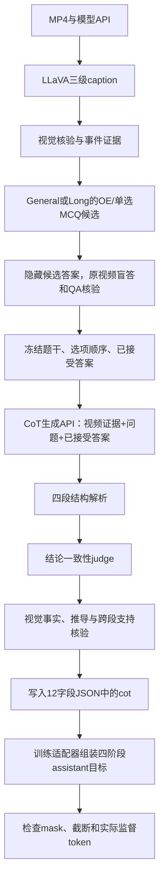

> 当前配置与v1流程以 [decisions.md](decisions.md) 为准；本文中的旧默认值、演示模型/数量或历史方案不覆盖最新用户决定。

# 参考 LLaVA-CoT-100k 的视频 CoT 构造方案

日期：2026-10-20。结论：**CoT 是构造管道的正式产物，OE 和单选 MCQ 都生成。** 参考 LLaVA-CoT 的四阶段结构，接在已核实 QA 之后；撤销此前“MCQ 默认没有 CoT、cot 只作可选占位”的设计。当前仍仅两类题型 `oe/mcq`，MCQ 仍以四选一为主，少量三选一和六选一。

状态：已静态读取官方生成器、训练数据加载器和一条官方标注；没有运行教师/API、处理视频、实现正式 CoT 生成器或验证 GLM 训练适配器。本文的视频迁移、附加核验和存储合同均为项目设计。

## 1. 官方方法和代码入口

| 证据 | 本轮核实范围 |
|---|---|
| [LLaVA-CoT 论文 §3.1、附录 B](https://arxiv.org/html/2411.10440v2#S3.SS1) | 四阶段设计；用已有图像 QA 和答案构造标注，再做格式与结论过滤 |
| [官方 generate.py](https://github.com/PKU-YuanGroup/LLaVA-CoT/blob/081cc3fe3670fbff7b30fa22cbcafe031a2077bc/dataset_generation/generate.py) | 真实请求内容、参考答案输入、结论 judge、JSONL 写出 |
| [官方 cot_dataset.py](https://github.com/PKU-YuanGroup/LLaVA-CoT/blob/081cc3fe3670fbff7b30fa22cbcafe031a2077bc/train/datasets/cot_dataset.py) | 将 gpt 回答作为 assistant 文本，屏蔽用户/媒体/填充等位置后监督回答 |
| [Xkev/LLaVA-CoT-100k](https://huggingface.co/datasets/Xkev/LLaVA-CoT-100k) | 原发布为图像 QA；抽样的 gpt.value 内直接包含四阶段标签，不是单独一个空 cot 字段 |

GitHub 固定 revision：`081cc3fe3670fbff7b30fa22cbcafe031a2077bc`。下载清单、大小与 SHA256 见 [source_manifest.json](C:/Users/Tiachi/Documents/Dataset/x_temp/llava_cot_video_2026-10-20/source_manifest.json)。只取小型文本和一条 rows API 样例，未下载图像或全量数据。

原始路径可概括为：图像 + 问题 + 原答案 → GPT-4o 输出四段 → 提取结论 → 文本 judge 比较原答案并识别拒答 → 保留或重试。原代码的一次生成请求返回全部四段，随后另发结论判定请求；**不是必须分四次 API 调用**。论文的 stage-level beam search 是另一项推理时方法，首版构造管道不必实现。

## 2. 四个阶段到底产出什么

| 原标签 | 意义 | 迁移到视频后的内容 | 不应混淆的对象 |
|---|---|---|---|
| `SUMMARY` | 题意与解题目标概述 | 说明本题需要判断/比较/聚合什么 | 不是 LLaVA-Video 的 L2 累计摘要 |
| `CAPTION` | 本题相关的视觉事实 | 对应原片时间范围中的可见对象、动作、状态或可读文字 | 不是机械粘贴整份三级 caption，也不是完整视频故事 |
| `REASONING` | 用事实支持结论的显式推导 | 对比前后、组合多段事实、排除不匹配选项等 | 不能只复述已给答案或靠常识编造依据 |
| `CONCLUSION` | 直接答案 | MCQ 是唯一选项字母；OE 是最终自然语言答案 | 不是全部四段混成一个未经解析的答案 |

这些是要求教师明确输出的训练标注，不依赖访问 API 未公开的内部推理通道。简单题可以四段都很短，不用“足够长”替代事实与逻辑正确性。

## 3. 官方实现能复用什么、还缺什么

以下是固定代码的静态观察，尚未运行：

| 位置 | 已实现行为 | 视频管道中如何处理 |
|---|---|---|
| `process_line`，约第 34 行起 | 输入含 id、image、conversations，可选 hints；逐 gpt 回答增强 | 增加视频视图适配；仍建议一题一条样本 |
| 约第 86–96 行 | 把原回答作为 standard answer 放入生成请求 | 使用经视频盲答/核验的 seed，不冒称它是人工 GT |
| 约第 111 行 | 调 gpt-4o 一次生成完整四阶段 | 封装为用户提供的视觉 API，给有序帧/时间及已验证证据 |
| 约第 117–150 行 | 正则提取结论；文本 judge 比较原答案 | 复用结论一致性思想，改为严格结构化 verdict |
| 约第 150 行 | 判断返回文本是否含 invalid；其他输出可能被当通过 | 只接受精确的合法通过状态，未知/格式错误不放行 |
| 格式处理 | 脚本显式匹配 CONCLUSION，不等于逐项严格验证全部四段 | 本项目检查四段完整、顺序、非空及无嵌套冲突 |
| 质量处理 | judge 不看图像，仅比较结论 | 新增 CAPTION/REASONING 的原视频回查，不能只看结论是否相同 |
| 批处理 | 固定 256 线程；个别异常可触发全局停止；遍历时删除对话 | 并发/预算按 API 限额配置，失败隔离，重新组装保留的对话 |

一条官方 rows 抽样的结论是自然语言包装的选项，而不是严格裸字母。这只能说明该抽样的实际格式；不能据此假定原数据每条都满足本项目单字母规则。我们应规范化出单个选项，并校验题干/选项映射。

原方法依赖已有答案；你的 MP4-only 路线先合成 QA，再校验 seed。参考答案参与生成可能造成“为了答案编理由”，所以**盲答在先、带答案的 CoT 合成在后**，且新增视觉核验不能省略。

## 4. 接入现有 General / Long 链路



### 4.1 模型调用位置

| 调用 | 输入 | 输出 | 与前序步骤的关系 |
|---|---|---|---|
| CoT 生成：视觉 API | 实际视频证据视图、问题、固定选项、已接受答案；可加已验证事件 | summary、caption、reasoning、conclusion 四段 | 新增阶段；同一个 API 可以承担 |
| 结论判定：文本 API | 解析后的 conclusion、已接受答案、选项语义 | pass/fail/unknown | 借鉴官方 judge；MCQ 先做确定性标签一致检查 |
| 过程核验：视觉 API | 原片相关窗口、问题及生成的事实/推导 | 支持/矛盾/不足、失败位置 | 对本项目必需的增强；可复用前序视图和核验结果 |

只有结论一致性不需要图像；检查视频中是否真有对应动作、跨段事实能否支持答案时必须看实际帧。调用审计、证据 ID、提示与模型版本仍外置。

### 4.2 General 的 CoT

针对本题相关窗口生成四段。Academic2M 风格“证据化增强”的内容可以落实在 CAPTION 和 REASONING 中，CONCLUSION 保持清楚的答案，不必再附加一遍冗长解释。

对单选题，先确定 3/4/6 个选项及其顺序，再生成 CoT。若之后打乱选项，推导里提到的字母也可能失效，必须同步改写并重新核验；不能只修改 correct_option_id。

### 4.3 Long 的 CoT

SUMMARY 写明全局判断目标；CAPTION 按原片时间列出问题相关的多处可见事实；REASONING 体现为什么需要这些片段共同支持答案；CONCLUSION 给最终回答。

时间戳必须来自实际视图/事件账本，不由教师凭空编造。若候选只有一个孤立窗口就可解，则不计作跨段 CoT。L3 可以帮助规划，但不能独自充当所有视觉依据；教师上下文不足时对相关窗口补看，而不是截掉长视频尾部。

## 5. `cot` 字段及训练目标：分别说明

仍保留原 12 个顶层字段，只把第 10 项改为正式结构化 CoT：

```json
{
  "summary": "判断倒水结束后紧接着发生的动作。",
  "caption": "约10–20秒可见水流入杯中；约20–30秒可见勺子在杯内转动。",
  "reasoning": "后一个窗口中的勺子转动发生在倒水之后，与选项B的搅拌动作对应。",
  "conclusion": "B",
  "supervised": true
}
```

以上是虚构的 `cot` 子对象，不是真实视频生成结果。正式通过的样本四段均非空；不能再用 null/false 作为“已完成 CoT”的占位。

存储时保留以下对应关系：

```text
MCQ：cot.conclusion = conversations中该题gpt.value = correct_option_id
OE：cot.conclusion = conversations中该题gpt.value
```

完整四段输出不改变“单选”的含义：最终结论仍只允许一个选项。OE 和 MCQ 两类不变，不新增 cot 题型。

**推荐监督配置为 `cot.supervised=true`。** 这表示训练适配器应组装并监督四阶段，而不是要求把四段重复复制到当前存储 JSON 的 gpt.value。实际 assistant 目标如下，由适配器生成：

```text
<SUMMARY>{cot.summary}</SUMMARY>
<CAPTION>{cot.caption}</CAPTION>
<REASONING>{cot.reasoning}</REASONING>
<CONCLUSION>{cot.conclusion}</CONCLUSION>
```

这与官方把四阶段文本直接存进 gpt.value 的物理存储方式不同，但提供同类四阶段监督目标。当前分字段存储便于筛选/核验；需要通用 conversations 训练器时，另行导出时写入其 assistant 文本。不得同时又自动追加原 gpt 结论，导致结论重复。

**若训练器只读取现有 gpt.value 而忽略 cot，最终只训练答案，没有训练 CoT。** 因此必须用一次真实目标预处理检查四段都在 labels 中且未被掩掉/截断。本轮尚未实现或验证此适配器。

`cot.supervised=false` 仅作为 answer-only 对照：CoT 仍要在构造时生成和保存，只是不进入该次训练目标。该开关不是“是否生成 CoT”。

`tokens.text_output/supervised/total` 以组装后的实际目标计算；不得只数单字母 B。若摘要/推导过长导致结论被截断，该样本必须调整长度或拒绝。四段文本作为模型公开结构化输出，不保证它等价于某个模型的不可观察内部计算。

MCQ 评测时从 CONCLUSION 解析唯一选项；不能把整个四段输出直接与单字母标签做字符串全等。答案监督对照则仍比较裸答案，评测适配器需区分两种输出形式。

## 6. 质量门禁与新增外部记录

| 检查 | 放行规则 |
|---|---|
| 格式 | 四段存在、顺序正确、非空；标签保留字不在内容内造成解析冲突 |
| 结论 | 单选能规范化为唯一合法选项；与 accepted seed 和 gpt.value 一致；OE 做语义复核后冻结一致文本 |
| 视觉事实 | CAPTION 每项关键事实可回指实际视频，音频/旁白不是视觉证据 |
| 推导 | 不矛盾、不偷换问题、不仅复述标准答案；能由已支持事实导出 |
| 长视频 | 对应片段实际存在，时间基准正确，跨段题的证据需要联合 |
| 学生视图 | 学生实际看见的帧包含关键证据，不只教师高密度视图能答 |
| 训练目标 | 四阶段正确组装、只出现一次、监督 mask 有效、结论未截断 |

若事实不足，记录 insufficient 并补看/拒绝，不要求教师强行给已指定答案写依据。生成或核验失败不得以空 CoT 放行；重试有限、失败隔离。模型 judge 的同意是代理判断，不等于事实正确率。

CoT 原始响应、逐段核验结果、帧/事件支持、anchor 身份、教师/提示版本与调用成本放外部 `cot_generation.jsonl`、`verification.jsonl` 等文件，通过 sample_id 关联训练 id，不增加顶层字段。

## 7. 小样本验证与决策

先以同一批视频、同一问题和同一学生输入视图比较 answer-only 与四阶段 CoT 监督；另比较“只核验结论”与“增加视觉/过程核验”。报告答案正确性、CAPTION 事实错误、推导支持率、输出长度/成本及实际截断率，而不是仅看格式通过率。

| 决策 | 依据/状态 | 迁移边界与替代 | 改变判断的条件 |
|---|---|---|---|
| CoT 为正式构造产物，沿用四阶段 | 用户要求、官方代码和数据抽样；项目迁移方案 | 原数据是图像 QA；视频需多段证据，不能宣称原论文证明视频收益 | 四阶段不提高本项目可验证推理质量，则缩短/重构阶段而非凑长度 |
| 先核验 seed，再带答案合成 | 原代码用 standard answer；自有视频没有人工原标签 | 可用独立直接答题 CoT 作为对照；不能默认合成 anchor 永远正确 | 发现 anchor 系统性错误时回退重建 QA，不能只修结论 |
| 原视频过程核验加入强门禁 | 官方结论 judge 仅文本；附加项目设计 | 同 API 共错仍存在；第二教师/人工校准是增强项 | 视觉核验无法识别主要错误时调整后端/采样/任务范围 |
| 分字段保存、训练时组装四段 | 保留12字段及单选结论合同；尚未实现 | 直接四段写入 gpt.value 为等价导出替代 | 目标训练框架难以可靠组装时采用直接 assistant 导出，并明确最终答案解析 |

下一步应在已有 QA 管道后新增 CoT 合成/解析/核验模块和训练目标组装器。当前已更新 [最终 JSON 格式表](video_sft_final_json_format_2026-10-20.md)，该表仍仅包含“一个完整例子 + 字段候选表”两部分。
