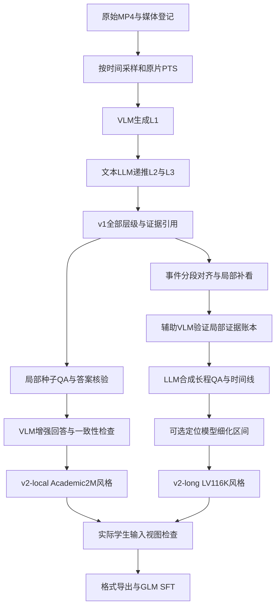

> 历史研究文档，不是当前流程；最新用户决定以[decisions.md](decisions.md)为准。

# 仅有 MP4 时：LLaVA 三级 Caption → Academic2M / LV116K 双路线的可行性与代码审计

核查日期：2026-10-20（Asia/Shanghai）

> **同日二次检索更正：已找到 LLaVA-Video-178K 官方三级 caption 和 OE/MCQ 生成脚本，位于 HF 数据集仓库的 `gpt4o_caption_prompt/`、`gpt4o_qa_prompt/`。上一轮漏查这些目录。本文关键结论已修正；具体文件、函数、真实中间 JSON、运行缺陷及 VideoChat3 扩大检索证据，见 [代码二次检索报告](llava_video_videochat3_pipeline_code_search_2026-10-20.md)。**

目标：用自有原始 MP4 构造三级 caption 的 v1，再构造 Academic2M 风格与 LV116K 风格两版 v2，最终服务 GLM-5.3-Flash SFT。

状态：完成官方代码快照、论文方法、数据配置和少量真实标注的静态核查；尚未实现正式生成器、处理用户 MP4、调用教师或运行训练。

## 1. 结论：方法可行，但不是三套现成生成框架直接串联

你的总体方向可行：**用同一份原视频及可追溯的三级描述作为公共底座，再构造“局部问答增强”和“长视频证据整合”两个任务分支。** 需要修正三个前提：

1. **目前不能按“三套完整生产框架”直接拼接，但 LLaVA 阶段确有官方生成代码。** [HF caption 脚本](https://huggingface.co/datasets/lmms-lab/LLaVA-Video-178K/blob/6d8c562dc26d70042a0d9704d1cae58c94b89098/gpt4o_caption_prompt/GPT4o_description_prompt.py) 实现三级描述；同仓 `gpt4o_qa_prompt` 实现 OE/MCQ。它们需修复并封装。VideoChat3 已公开训练、推理、评测和成品标注；扩大检索后仍未定位 Academic2M 增强/判定、LV116K 全链路合成生产入口，后两段需要按方法补实现或取得作者明确代码。
2. **Academic2M 不等于“caption 转 QA”的原生框架。** 它主要对已有 caption/QA 增强，并用原答案约束改写。只有 MP4 和 v1 caption 时，可以复用本次找到的 LLaVA QA 脚本生成种子，再新增视觉核验。自己生成的种子答案不能当作人工原标签。
3. **Academic2M 与 LV116K 不是两套互斥的 JSON 外壳。** 当前发布抽样均采用 `id + messages`，区别主要是任务、监督内容、时长、时间证据和数据配方。将同一批答案写两份 JSON 不会得到两套能力互补的数据。

推荐把产物命名为 **`v2-local-evidence`（Academic2M-inspired）** 和 **`v2-long-evidence`（LV116K-inspired）**，并明确由自有 MP4 合成，不冒称官方数据集或严格复现。

## 2. 本轮核查基线与证据范围

### 2.1 固定版本

| 对象 | 本轮核实的版本 | 取得的证据 |
|---|---|---|
| [LLaVA-VL/LLaVA-NeXT](https://github.com/LLaVA-VL/LLaVA-NeXT) | `bce12e479bc4dfee2b9c50c88137b01ff51bd483` | 未截断文件树（467 个条目）；视频文档、demo、训练数据加载和数据 YAML |
| [MCG-NJU/VideoChat3](https://github.com/MCG-NJU/VideoChat3) | `015f52eb2ea70b5abda30192aee18034f2c5f13b` | 未截断文件树（2,565 个条目）；训练 README、stage2/3 配置、消息 schema、视频读取/分词、JSONL loader |
| [LLaVA-Video-178K](https://huggingface.co/datasets/lmms-lab/LLaVA-Video-178K) | 元数据查询 revision：`6d8c562dc26d70042a0d9704d1cae58c94b89098` | 数据卡/API；公开 rows API 的 caption、OE 各 1 行。rows API 的转换版本不能等同于已对该 SHA 原文件逐字节核验 |
| [VideoChat3-Academic2M](https://huggingface.co/datasets/MCG-NJU/VideoChat3-Academic2M) | `fb79513cbbbaf402d321926ce9227f066d774746` | 固定 SHA 的 README、`acadmic2M.json`、caption 与 OE 各 1 个原 JSONL 首行 |
| [VideoChat3-LV116k](https://huggingface.co/datasets/MCG-NJU/VideoChat3-LV116k) | `e32b78d3eb5ac5d1bf28b55a2ba295e99432be62` | 固定 SHA 的 README、`lv116k.json`、长描述/QA/定位各 1 个原 JSONL 首行 |
| LLaVA 论文 | [arXiv 2410.02713v1](https://arxiv.org/html/2410.02713v1) | §3.2–3.3 及相关附录；方法与训练代码分别核查 |
| VideoChat3 论文 | [arXiv 2607.14935v2](https://arxiv.org/html/2607.14935v2) | §3.2 Academic2M、§3.3 LV116K 方法全文；网络工具可读，单独的本地 HTML 下载失败 |

代码文件和小样本保存在 本轮审计目录（原Dataset工作区外部证据：`../x_temp/video_pipeline_audit_2026-10-20/identities.json`，未迁移），已下载资料的 URL/大小/SHA256 见 source_manifest.json（原Dataset工作区外部证据：`../x_temp/video_pipeline_audit_2026-10-20/source_manifest.json`，未迁移）。没有克隆或运行第三方训练环境，也没有下载数据集媒体。

“未定位生成脚本”现在仅指 VideoChat3 的目标合成链路，不能再用于概括 LLaVA。二次检索增加了 HF 代码文件、VideoChat3 40 条提交、历史文件树、附加数据仓库及作者仓库清单，见补充报告。未定位不表示已证明作者所有历史或其他仓库都不存在。项目主页与论文的开放声明，也不能替代已核实的运行入口及 I/O 合同。[VideoChat3 官方入口](https://mcg-nju.github.io/VideoChat3/)

### 2.2 本地已有代码能做什么

本项目已有 academic2m_tool.py（原Dataset工作区外部证据：`../VideoChat3-Academic2M/script/academic2m_tool.py`，未迁移） 和 convert_training_format.py（原Dataset工作区外部证据：`../VideoChat3-Academic2M/script/convert_training_format.py`，未迁移），分别侧重下载/引用检查，以及现成 Academic2M 标注到统一训练格式的转换。**它们不是“原 MP4 → 新 caption/QA”的教师生成器。**

转换器当前对六个原始来源、映射、字段等有数据集专用约束，不能直接把新生成的数据冒充其中一个来源喂进去。可抽取路径、时长、原件保护和导出验证能力，另建通用输入适配器。

本地旧 `x_temp/RESEARCH_PREP_INDEX.md` 描述过早期“转换器尚不存在”的状态；当前文件已经存在，本轮依据现有代码而不是旧索引判断。没有重验旧服务器报告或推断服务器当前状态。

## 3. LLaVA-Video 代码：在哪里、有什么、缺什么

### 3.1 实际仓库结构与阅读顺序

**优先阅读 HF 数据仓库，而非下面的模型训练目录：** `gpt4o_caption_prompt/GPT4o_description_prompt.py` 是三级描述控制器；`gpt4o_qa_prompt/gen_sft_data.py` 和 `gen_sft_data_mc.py` 是 caption-to-QA。三个文件均已下载并做静态检查，详细说明在二次检索报告 §2–4。下面保留 LLaVA-NeXT 入口，供理解推理/训练接入。

以下均是本轮固定 SHA 的真实路径，链接可直接定位：

| 路径 | 作用与关键入口 | 对本任务的复用价值 |
|---|---|---|
| [docs/LLaVA_Video_1003.md](https://github.com/LLaVA-VL/LLaVA-NeXT/blob/bce12e479bc4dfee2b9c50c88137b01ff51bd483/docs/LLaVA_Video_1003.md) | LLaVA-Video 推理、训练与评测说明；含取帧、加载模型及 `model.generate` 示例 | 理解视觉模型单次描述接口；不是三级描述调度器 |
| [playground/demo/video_demo.py](https://github.com/LLaVA-VL/LLaVA-NeXT/blob/bce12e479bc4dfee2b9c50c88137b01ff51bd483/playground/demo/video_demo.py) | `parse_args`、`load_video`、`run_inference`；支持文件/目录输入，生成单 prompt 回答 | 可参考解码、预处理和调用位置；需要重构生产容错与输出 |
| [llava/model/builder.py](https://github.com/LLaVA-VL/LLaVA-NeXT/blob/bce12e479bc4dfee2b9c50c88137b01ff51bd483/llava/model/builder.py) | 视频文档/demo 引用的 `load_pretrained_model` | 若选择 LLaVA 权重作教师，这是本地模型加载入口；本轮未完整审计该文件 |
| [llava/train/train.py](https://github.com/LLaVA-VL/LLaVA-NeXT/blob/bce12e479bc4dfee2b9c50c88137b01ff51bd483/llava/train/train.py) | `LazySupervisedDataset`、`_get_item`、`DataCollatorForSupervisedDataset`；读已有 JSON/JSONL/YAML 后取视频、分词和打包 | 用于理解已有标注怎样进训练，不会产生新标签 |
| [scripts/video/train/exp.yaml](https://github.com/LLaVA-VL/LLaVA-NeXT/blob/bce12e479bc4dfee2b9c50c88137b01ff51bd483/scripts/video/train/exp.yaml) | 现成训练集文件路径与采样配置 | 数据混合清单，不是 caption 生成配置 |
| `scripts/video/train/*.sh` | 模型训练启动器 | 你只做数据构造时无需启动 |

### 3.2 真实 demo 的输入输出与模型接入

`video_demo.py` 的主要输入是命令行参数：`--video_path`、`--prompt`、`--model-path`、`--output_dir`、`--output_name`，并非某个“三级 caption 输入 JSON”。它读 MP4/目录，完成采样和视觉预处理，再在 `run_inference` 调模型。

本地权重路径：`load_pretrained_model(...) → image_processor.preprocess(...) → model.generate(...)`。脚本还含 `gpt4v` 分支，通过旧式 OpenAI 客户端及 `gpt-4-vision-preview` 调用；这是代码中的历史实现，不是本项目建议照用的当前服务合同。需要换成你实际可用后端的客户端和模型 ID，不要把“换名字”视为完成 API 兼容。

demo 对每个视频写一个对象，字段为 `Q`、`video_name`、`pred`；输出文件扩展名虽为 `.json`，实现按行写对象，实际上是 JSONL 风格。结构如下，文字为本报告自拟示例：

```json
{"Q":"Describe the visible actions.","video_name":"/input/demo.mp4","pred":"A person places a cup on the table."}
```

该输出没有 L1/L2/L3、依赖关系、帧时间戳谱系、QA 校验报告或全局样本 ID。不能把它当作论文的完整数据合成器。文档示例还存在参数类型/函数签名需校对的问题；本轮没有运行示例，不给出“复制即跑”的结论。

### 3.3 论文中的三级逻辑，应如何还原

作者方法使用 GPT-4o。LLaVA-Video 是最终训练模型/数据集名称，**不意味着原数据就是用 LLaVA-Video-7B 教师生成的**。原论文的三级逻辑为：[§3.2](https://arxiv.org/html/2410.02713v1#S3.SS2)

| 层级 | 原方法观察/上下文 | 生成含义 | 实现要点 |
|---|---|---|---|
| L1 | 约 1 FPS 的当前 10 秒片段帧，尚未汇总的近期 L1，以及最近 L2 | 当前片段的详细事件描述 | 必须保留当前观察窗口；历史仅辅助身份/情境连续性，不能编入当前新事件 |
| L2 | 最近三个 L1 + 上一个 L2，每约 30 秒更新 | **截至此刻的累计剧情摘要** | 第 60 秒的 L2 范围是 `[0,60]`，不是 `[30,60]` 的独立标签 |
| L3 | 最新 L2 + 尚未汇入 L2 的末尾 L1 | 全视频整体描述 | 是总结，不能恢复已经丢掉的精确时间边界 |

因此 v1 必须保存全部 L1、各次 L2 及 L3，而不只保存最后长文本；再额外保存所见帧时间和依赖记录。固定的 10/30 秒窗口便于首版近似还原，但不一定与动作边界重合，后续 LV 分支仍需场景/动作边界处理。

“同视频递推”限制了并行方式：可以并行不同视频，同视频的有上下文 L1/L2 不能随意全部独立发出后宣称等价。若改成独立局部标注再汇总，应将其标成自定义改进并做对照。

### 3.4 官方发布 JSON 与你要做的 v1 不同

公开数据卡分 caption/OE/MCQ 等 split；本轮读取 `0_30_s_academic_v0_1` 的 caption 与 OE 各一行，均有 `id`、`video`、`data_source`、`conversations`，`from` 为 `human/gpt`。caption 抽样为 2 轮消息，OE 抽样为 10 条消息，即 5 组 QA。[数据卡](https://huggingface.co/datasets/lmms-lab/LLaVA-Video-178K)、[caption 行 API](https://datasets-server.huggingface.co/rows?dataset=lmms-lab%2FLLaVA-Video-178K&config=0_30_s_academic_v0_1&split=caption&offset=0&length=1)

以下保留发布字段形状，但 ID、文本与路径是自拟的：

```json
{
  "id": "demo_001",
  "video": "own_source/demo_001.mp4",
  "data_source": "own_video_caption_v1",
  "conversations": [
    {"from": "human", "value": "Describe the visible events in this video."},
    {"from": "gpt", "value": "A person places a cup, pours water, and stirs it."}
  ]
}
```

**三级中间 JSON 与上述训练成品不同，但其 schema 已在官方生成代码中找到。** 成功路径保存 `clip_description`、`summary_description`、`video_description`，以及 token/prompt 数组。其中 `summary_description=sum_ret[:-1]`、`video_description=sum_ret[-1]`，最后汇总被移作全片总结。官方原始中间 JSON 没有精确时间戳/父依赖记录；§6 是在其上建议增加的项目内部证据合同，不是对官方未知格式的猜测。完整 I/O 见二次检索报告 §3。

## 4. VideoChat3：代码主要负责消费标注，不负责从零合成标注

### 4.1 真实代码结构与调用链

| 模块 | 真实作用 | 是否生成教师标签 |
|---|---|---|
| [xtuner-videochat3/README.md](https://github.com/MCG-NJU/VideoChat3/blob/015f52eb2ea70b5abda30192aee18034f2c5f13b/xtuner-videochat3/README.md) | 训练、检查点准备、训练数据路径与启动说明 | 否 |
| [training_configs/stage2/VideoChat3_4B_train_stage2.py](https://github.com/MCG-NJU/VideoChat3/blob/015f52eb2ea70b5abda30192aee18034f2c5f13b/xtuner-videochat3/training_configs/stage2/VideoChat3_4B_train_stage2.py) | 读 collection JSON，把 `anno_path`/`media_root`/采样配置传给 dataset 和 tokenize fn | 否 |
| [training_configs/stage3/VideoChat3_4B_train_stage3.py](https://github.com/MCG-NJU/VideoChat3/blob/015f52eb2ea70b5abda30192aee18034f2c5f13b/xtuner-videochat3/training_configs/stage3/VideoChat3_4B_train_stage3.py) | 长/流式训练阶段的数据混合、模型与预算配置 | 否；也不是 LV116K 合成入口 |
| [xtuner/v1/datasets/vlm_jsonl.py](https://github.com/MCG-NJU/VideoChat3/blob/015f52eb2ea70b5abda30192aee18034f2c5f13b/xtuner-videochat3/xtuner/v1/datasets/vlm_jsonl.py) | `VLMJsonlDataset.__getitem__` 读取原标注一行，调用 tokenize fn | 否 |
| [xtuner/v1/data_proto/messages/chat.py](https://github.com/MCG-NJU/VideoChat3/blob/015f52eb2ea70b5abda30192aee18034f2c5f13b/xtuner-videochat3/xtuner/v1/data_proto/messages/chat.py) | `VideoContentItem_videochat3`、`ChatMsg`、`ChatMessages` 定义内容、角色与模板/监督 token | 否 |
| [videochat3_tokenize_fn.py](https://github.com/MCG-NJU/VideoChat3/blob/015f52eb2ea70b5abda30192aee18034f2c5f13b/xtuner-videochat3/xtuner/v1/datasets/mllm_tokenize_fn/videochat3_tokenize_fn.py) | `_my_load_video`、`_process_video`、`video_get_item`：读帧、processor、视觉 token、labels | 否；输出训练 tensor |
| [video_utils.py](https://github.com/MCG-NJU/VideoChat3/blob/015f52eb2ea70b5abda30192aee18034f2c5f13b/xtuner-videochat3/xtuner/v1/datasets/mllm_tokenize_fn/video_utils.py) | `VideoChat3VideoMetadata`；`VIDEO_READER_MAP` 支持 `decord`、`av`、`frame`、`frame2` 等 | 否 |
| `demo/`、`vlmevalkit-videochat3/` | 标准/在线推理与评测 | 不是已核实的两类数据合成生产工具 |

已读代码显示的实际训练链：

```text
collection.json
  → DatasetConfig(anno_path, media_root, sample_ratio)
  → VLMJsonlDataset 读取已有 id/messages
  → VideoChat3TokenizeFunction
  → _process_video / VIDEO_READER_MAP
  → processor + ChatMessages.tokenize
  → input_ids / labels / pixel_values / image_grid_thw
  → VideoChat3 模型训练
```

这里的 data pipeline 是**训练输入处理管道**。`input_ids`/`labels`/`pixel_values` 等是训练期内存对象，不是新生成的 Academic2M/LV116K 答案文件。你的目标是 GLM SFT，也不需要为了构造数据先训练一次 VideoChat3。

### 4.2 Academic2M 的生成机制及你缺少的输入

官方论文与[数据卡](https://huggingface.co/datasets/MCG-NJU/VideoChat3-Academic2M)描述：汇集已有学术 caption/QA；规范化题目；将选项字母恢复成正确选项文字；用 **Qwen3-VL-235B-A22B** 结合视频把短答案改为带视觉依据的完整回答；再用同型号模型检查与原标注是否语义一致。[论文 §3.2](https://arxiv.org/html/2607.14935v2#S3.SS2)

原路线输入大致是：

```text
视频 + 原问题/描述指令 + 原答案（或选项及正确项）
    → 视频条件下的回答增强
    → 与原答案的一致性检查
    → 保留的 instruction responses
```

对你的 MP4-only 起点，v1 的 caption 可以充当描述任务的待增强答案；**QA 所需的题目、标准答案和选项不会凭三级 caption 的字段转换自动产生**。补充链路应是：

```text
v1 局部描述/可见证据 + 原 MP4 时间窗
    → 新增种子 QA/MCQ 生成
    → 原视频视觉核验，必要时人工修正
    → 锁定已验证 seed answer
    → Academic2M 式证据增强与一致性检查
```

如果 seed answer 和 caption 来自同一个教师、同一次推断，之后的“一致性通过”可能只是重复同一错误。首版应把“保留 seed 语义”与“seed 本身是否被视频支持”分成两个检查，不能用前者代替后者。

### 4.3 LV116K 的生成机制及 v1 的接入位置

原论文将其组织为候选过滤、边界分段、局部标注、质量检查和全局任务合成。局部描述教师明确为 **Qwen3-VL-235B-A22B**；质量检查采用辅助 MLLM；全局合成描述为 frontier LLM；时间定位另用 expert grounding model。[论文 §3.3](https://arxiv.org/html/2607.14935v2#S3.SS3)、[数据卡](https://huggingface.co/datasets/MCG-NJU/VideoChat3-LV116k)

论文没有在这些段落为每个角色给出可直接部署的完整 checkpoint、提示词文件和生产脚本路径。发布文件名中虽有 Gemini、Qwen 或阈值信息，也不能仅凭名字推断整条精确配方。

你的 v1 可以用于复用粗粒度观察，但应接入**局部证据账本**，而不是仅把 L3 当作输入：

```text
原 MP4 + v1 全部 L1/时间戳
    → 镜头/时长约束下的事件段对齐
    → 必要的局部补看与独立质量检查
    → 经验证的 timestamped evidence ledger
    → 时间线 / 摘要 / 跨片段 QA / 查询与候选区间
    → 定位专家细化边界 + 语义核验（定位任务）
```

三类关键监督不同：时间线要合并连续事件；长 QA 要依赖多个片段；grounding 要从粗候选中确定可验证的精确区间。**固定 10 秒 caption 的起止时间是观察窗，不是动作真实起止时间。** 没有定位细化时，只能诚实标为粗粒度定位数据，不能称为完整 LV116K 级精确定位。

原片若只有十几秒，即便可以输出相同 `messages`，也不能产生真正的长程证据任务；不要为了匹配名字把短视频拼接成长视频。长分支的候选条件应由实际时长和事件跨度决定。

## 5. 两套 VideoChat3 成品的实际 JSON

### 5.1 公共外层结构

本轮 Academic2M caption 首行与 OE 首行均只有 `id/messages` 顶层字段。首个 user 的 `content` 是数组，内含 `video_url` 和 `text`；assistant 的 `content` 是字符串。后续 user 也可以是纯字符串，OE 抽样为 5 组问答。

LV116K 的三条抽样同样使用这套外层：长描述的 assistant 是含结构化 JSON 的 Markdown 字符串；QA 为普通回答字符串；定位回答是序列化的多区间列表。**单行样本检查不等于全库 schema/质量验收。**

下面是按已观察字段形状制作的 MP4 版示例。内容完全虚构、元数据仅为自洽演示，未运行媒体读取。它可以用于解释 Academic2M-style QA 外层；不是某个真实发布行：

```json
{
  "id": "own_v2_local_demo_001_q1",
  "messages": [
    {
      "role": "user",
      "content": [
        {
          "type": "video_url",
          "video_url": {"url": "demo_001.mp4"},
          "video_metadata": {
            "total_num_frames": 1500,
            "duration": 60.0,
            "fps": 25.0,
            "width": 1280,
            "height": 720,
            "video_backend": "decord",
            "clip_start_time": 0.0,
            "clip_end_time": 20.0
          }
        },
        {"type": "text", "text": "What does the person do before pouring water?"}
      ]
    },
    {
      "role": "assistant",
      "content": "The person places the cup on the table before pouring water into it."
    }
  ]
}
```

`video_url.url` 在这里是相对 `media_root` 的路径，并不要求互联网 URL。`video_metadata` 是 `content` 中视频项的同级字段，不在 `video_url` 对象里面。

### 5.2 LV116K 的内层回答并不是唯一固定 JSON

实际读取的长描述行，回答内含 `title`、`parts`、`start_timestamp`、`end_timestamp`、`summary`、`key details` 等字段，并以 Markdown JSON 代码块包装。另一个实际定位行的答案是 `[[start,end], [start,end]]` 的字符串，不带上述标题字段。

因此可以让 v2-long 与 v2-local **复用上面的外层**，仅替换问题、可见窗口和 assistant 答案。比如定位任务的关键字段变成下面这样；为避免冗长，这是一对拟议的 question/serialized answer，不是完整训练行：

```json
{
  "question": "Return all intervals in seconds when the person stirs the cup. Use the original-video timebase.",
  "assistant_content": "[[22.4, 28.1], [42.2, 48.0]]"
}
```

工程上建议在内部存原生 `intervals` 数组、结构化 timeline 和 QA；最后 exporter 再序列化为字符串。不要先把所有内容塞进 Markdown 再反向解析；也不要在没有明确训练需求时，因某发布样本有代码块就强制所有答案都输出代码块。

### 5.3 collection 配置与样本 JSONL 要分清

`acadmic2M.json`（官方文件名确实是这个拼法）与 `lv116k.json` 是**数据混合/路径配置**，不是逐条训练样本。前者本轮有 45 个配置项；后者有 16 个配置项、对应 14 个不同 `anno_path`，存在同一文件的重复引用。不能把配置项数当作独立 shard 数或独立数据数。[Academic2M 映射](https://huggingface.co/datasets/MCG-NJU/VideoChat3-Academic2M/blob/fb79513cbbbaf402d321926ce9227f066d774746/acadmic2M.json)、[LV116K 映射](https://huggingface.co/datasets/MCG-NJU/VideoChat3-LV116k/blob/e32b78d3eb5ac5d1bf28b55a2ba295e99432be62/lv116k.json)

配置可有 `anno_path`、`media_root`、`sample_ratio`、`data_augment`，也可有 `video_max_frames`、`frame_max_pixels` 等训练读取预算。示意如下，路径和预算是自拟，**不是 GLM 默认值**：

```json
{
  "own_local_qa": {
    "anno_path": "v2_local.jsonl",
    "media_root": "/data/own_mp4",
    "sample_ratio": 1.0,
    "data_augment": false
  },
  "own_long_qa": {
    "anno_path": "v2_long.jsonl",
    "media_root": "/data/own_mp4",
    "sample_ratio": 1.0,
    "data_augment": false
  }
}
```

配置层的绝对媒体根与样本里的相对路径不冲突。该 collection 只是 VideoChat3 读法参考，GLM 未必使用它。

### 5.4 仅有 MP4 时，必须修正的三个适配问题

1. **不要沿用帧目录元数据。** 本轮两条 LV 抽样的 `video_url.url` 为目录，`video_backend=frame/frame2`，`fps=2` 是该帧表示的采样频率。你的 MP4 应使用实际视频后端和原片参数；不能把原 MP4 写成 2 FPS 元数据来套现成行。
2. **不要把 ffprobe 元数据直接视为 VideoChat3 一定接受。** `VideoChat3VideoMetadata.__post_init__` 静态代码要求 `fps * duration` 与 `total_num_frames` 误差不超过 `1e-6`。任意 MP4 的容器时长、平均 FPS、解码帧数未必满足，尤其 VFR。应保留真实各口径，并验证/适配读取器；不要伪造数据来绕过断言。该严格关系是上游代码行为，不是本项目认可的普适媒体定律。
3. **时间窗代码存在不等于 GLM 已支持。** 上游 tokenizer/metadata 有 `clip_start_time/clip_end_time`，并且部分预计算按 `t * fps` 取索引；精确时基、VFR、末帧越界与 GLM processor 仍需专门检查。保留 PTS 及原片时间基准，首版使用 `[start,end)` 的内部约定，导出到特定读取器时再显式转换。

另外，`VLMJsonlDataset` 捕获读取/处理异常后可生成 labels 全为 `-100` 的替代样本。这是训练容错，**不能拿“训练没报错”证明你的数据已加载且被监督**。验收时应统计替代/跳过数量以及实际有监督的答案 token。

## 6. 建议的 v1 数据合同：三级文本与证据元数据一起保存

这部分是**拟议的项目内部 schema**，不是官方 LLaVA 格式，也不是正式训练 JSONL。所有值均为虚构示例，用于展示依赖关系。

```json
{
  "schema_version": "own.caption.v1.proposed",
  "media_id": "own_demo_001",
  "video": "demo_001.mp4",
  "duration_sec": 35.0,
  "timebase": "original_video_seconds",
  "l1": [
    {"id": "c01", "observed_span": [0.0, 10.0], "text": "A person places a cup on the table."},
    {"id": "c02", "observed_span": [10.0, 20.0], "text": "The person pours water into the cup."},
    {"id": "c03", "observed_span": [20.0, 30.0], "text": "The person stirs the water."},
    {"id": "c04", "observed_span": [30.0, 35.0], "text": "The person puts the spoon down."}
  ],
  "l2": [
    {
      "id": "s01",
      "summary_scope": [0.0, 30.0],
      "parents": ["c01", "c02", "c03"],
      "text": "A person places a cup, pours water, and stirs it."
    }
  ],
  "l3": {
    "summary_scope": [0.0, 35.0],
    "parents": ["s01", "c04"],
    "text": "A person prepares a cup of water and puts the spoon down."
  },
  "verification_state": "illustration_only"
}
```

实际 v1 还应有旁路记录：媒体 SHA256/来源、真实帧 PTS、抽样/缩放配置、教师型号与 revision、prompt hash、调用状态、schema 校验、质量结果、错误码、生成依赖和版本。API key/认证头绝不写入这些产物。

为什么保留 L1 和原帧引用：

- L2/L3 更适合全局生成计划和跨事件组织，不能作为新增细节的唯一事实源。
- L1 的观察窗并不意味着其中的每个动作都持续整个窗口；定位任务要补事件边界。
- 若判断某个 caption 错误，可沿父依赖重算受影响的摘要/QA，而不重跑所有视频。
- 必须允许 `unknown`、`not_visible` 和无有效 caption 的失败状态，不能对每段硬生成“完整故事”。

只有 MP4 时，最低需要自己产生的非模型元数据包括：稳定媒体 ID、路径、时长、解码参数、音轨存在性、时间窗和实际抽帧时间。没有字幕、网页标题或人工注释不会阻止视觉 v1；它们也不应被偷偷假设为必需输入。

## 7. 推荐实现：公共 v1，加两个真正不同的任务分支

### 7.1 数据流和模型接入点



图中把定位作为可选分支：QA/摘要/时间线可先发布，精确 grounding 未就绪时不伪造对应样本。

| 模型角色 | 接入输入 | 接入输出 | 必须多模态吗 | 原论文身份与项目实现建议 |
|---|---|---|---|---|
| M1 局部 caption 教师 | 原片窗口帧 + 时间戳 + 允许的历史摘要 | L1 及可见事实 | 是 | LLaVA 原数据用 GPT-4o；项目可封装可用 VLM，换模型后称方法迁移 |
| M2 递推汇总 | L1/上次 L2/依赖时间范围 | L2、L3 | 否，文本能力足够执行此接口 | 原方法也可用同一多模态服务，仅送文本；严禁汇总补编新事实 |
| M3 种子 QA 生成 | v1 局部证据、任务定义；可加视频观察 | question、seed answer、可选 options、证据引用 | 可先文本提议，再视觉核验 | 可适配 LLaVA 官方 OE/MCQ 脚本；视觉核验仍需新增，不是原 Academic2M 已有标签输入 |
| M4 局部回答增强 | 原 MP4 窗口 + question + 已核验 seed answer | evidence-grounded answer | 应使用视频 | 原 Academic2M 使用 Qwen3-VL-235B-A22B；改写不能改变已核实语义 |
| M5 一致性/视觉验证 | 原答案、改写答案；以及相应视频视图 | 通过/拒绝/需修正及原因 | 标签一致性可文本；视觉支持检查必须看视频 | 原 Academic2M 的 judge 为同型号 Qwen；项目建议单列视觉核查，不能把两者混为一谈 |
| M6 LV 片段复核 | 边界对齐后的原 MP4 窗口 + L1/事件描述 | validated event ledger | 是 | 原文为局部 Qwen3-VL + 辅助 MLLM；尽可能与生成提示/模型独立 |
| M7 长任务合成 | 有序时间戳、已验证片段、任务规范 | 长 QA、timeline、summary、grounding query/候选区域 | 文本可合成；成品仍回查视频 | 原文 frontier LLM，具体全链配置未核实；不能自行标为某唯一 Gemini 版本 |
| M8 定位专家（可后置） | query + 候选视频区域 | 细化区间、置信/匹配结果 | 是，或视频-文本定位模型 | 原文提及 expert grounding model；本轮未取得明确可复用生产 checkpoint/接口 |
| M9 最终学生 | 原视频或窗口 + question | 训练目标 answer | GLM 多模态训练路径 | GLM-5.3-Flash 是最终学生，不必兼任前面所有教师；需要独立数据适配器 |

这些是**职责角色**，不是要求部署九套不同权重。首版可以用一个生成 VLM 服务、一个文本生成服务和一个验证 VLM 服务复用多个角色；是否采用同模型的不同提示或不同模型，应通过人工盲审错误率决定。

### 7.2 建议模块结构：以下全部尚待实现

```text
projects/video-caption-sft/                # 拟议，不是官方已有目录
  configs/
    pipeline_v1.yaml
    tasks_local.yaml
    tasks_long.yaml
  prompts/
    l1_caption.txt
    l2_prefix_summary.txt
    l3_global_summary.txt
    seed_qa.txt
    answer_enhance.txt
    visual_verify.txt
    long_qa_timeline.txt
  src/
    media_manifest.py                    # 探测/PTS/原件映射
    sampling.py                          # 原片虚拟窗口取帧
    model_clients.py                     # 教师接口与错误分类
    caption_hierarchy.py                 # L1→L2→L3有向依赖
    local_qa.py                          # 种子QA→核验→增强
    event_ledger.py                      # 边界对齐、事件和局部复核
    long_tasks.py                        # QA/时间线/摘要
    temporal_grounding.py                # 可选精确定位
    validators.py
    exporters.py                         # VC3兼容 / 统一交付 / GLM
    state_store.py                       # 断点续跑、不可覆盖产物
  scripts/run.sh                         # 短入口，阶段化PASS/FAIL
  tests/
```

数据和状态数据库放数据盘，不进入代码仓库。每个阶段采用输入清单、模型/提示版本、产物 hash 和状态；失败可从具体视频/窗口重试，输出 staging 校验后发布。原始 MP4 不裁剪、不重编码；“片段”在内部表示成时间窗。

### 7.3 为什么推荐“双分支共用证据”，不推荐“同答案两次排版”

| 分支 | 真正需要的生成目标 | 主要证据 | 可先做什么 |
|---|---|---|---|
| v2-local | 细节、动作、属性、顺序、局部计数的 QA；必要时增强短答案 | L1 + 原视频局部观察，seed 真值需核验 | 描述增强与 OE，随后单选 MCQ |
| v2-long | 多段证据 QA、事件时间线、全局摘要、多区间检索定位 | 全部局部账本、事件关系和真实时间轴 | 摘要/时间线/跨段 QA；精确定位单独后置 |

允许同一个视频出现在两个训练分支，但样本应有不同任务与 ID，并共享来源家族。训练/验证/确认集按原视频及近重复家族切分，不能把同视频的局部题放训练、长程题放测试后声称泛化。

若只是将同一批 QA 分别导出到 LLaVA 与 VideoChat3 的不同 schema，应称为“同数据双导出”，不是双数据配方实验。你的两个目标在 VideoChat3 内本就共享外层 schema，更应区分任务机制。

## 8. 难度、工作量与成本评估

### 8.1 难度分解

| 工作 | 难度 | 主要难点 | 可复用部分/缺口 |
|---|---|---|---|
| MP4 manifest、元数据与相对路径 | 低–中 | VFR、损坏、同名、真实时基、共享盘 IO | 既有项目安全治理思路可复用 |
| 单窗口视觉 caption 调用 | 中 | 模型输入限制、抽帧/缩放、API 失败、输出解析 | 官方 HF caption 脚本已有客户端；需适配后端和修复解析 |
| 可恢复三级 caption v1 | 中 | 同视频递推、尾窗、上下文长度、依赖失效重算 | 官方 HF 控制器已找到；需修复全局变量、恢复、时间轴与持久化 |
| Academic2M 外层 JSON 导出 | 低 | 字段/角色/路径/元数据一致 | 官方 schema 与小样本已核实 |
| Academic2M 式高质量 QA | 中–高 | 你没有原 QA；seed 真值、改写共错、选项歧义 | seed 可复用 LLaVA 官方生成器，视觉核验和增强编排仍需补 |
| LV 摘要与时间线 | 中–高 | 镜头/动作边界、人物一致性、跨窗事件合并 | v1 L1 可复用，边界与事件账本需新增 |
| LV 跨段推理 QA | 高 | 证据确实跨段、避免常识题/单帧题、错误传播 | 不能只使用 L3；需视觉复核及分层审计 |
| LV 精确多区间 grounding | 高 | 定位模型选择、边界真实值、语义匹配、评估 | 论文角色明确，完整生产代码/模型接口仍缺 |
| 任意 MP4 到官方 VC3 loader 实测兼容 | 中 | 元数据严格断言、VFR、帧目录与视频差别 | 静态支持 MP4，但未做端到端加载 |
| 最终 GLM SFT 适配 | 独立的中–高任务 | processor、chat template、实际视频预算、监督 mask | VC3 外壳可中转，不表示 GLM 已直接接收 |

**工程判断：** 格式导出容易，事实可靠性和精确时序标签难。按公开配方重建方法可行；严格复现原数据质量及模型收益，缺少完整生产脚本/提示/模型/阈值和相同上游数据，不能承诺。

### 8.2 条件化的工期估计

以下是设计估计，不是作者结论或实测：假设 1 名熟悉 Python/视频处理的工程师、已有可用教师服务、只做离线单视频，不含新模型训练、采购或审批。

| 交付阶段 | 估计工程工作量 | 不包含的时间 |
|---|---|---|
| 小规模可续跑 v1、元数据、三级输出与基本人工预览 | 约 3–5 个工作日 | 全库教师排队、海量读盘与返修 |
| v2-local 种子 QA、视觉核验、增强与导出 | 再约 4–7 个工作日 | 人工标签大规模生产 |
| v2-long 摘要/时间线/跨段 QA 首版 | 再约 5–10 个工作日 | 精确 grounding、系统性领域专家审查 |
| 精确 grounding、正式大规模生产和全面质量校准 | 需单独评估，常成为最长阶段 | 当前无法可靠给出统一天数 |

模块共享使工期不能机械相加；若需自建大教师推理服务、长视频数量很多或领域内容难验证，时间会明显增加。未获得视频时长分布和后端吞吐前，不给出“多少天跑完多少万视频”的虚假精度。

### 8.3 教师调用量如何估算

按新核实的官方代码，设非空视频产生 `N` 个约 1 FPS 采样帧；没有失败/重试时：

```text
视觉 L1 调用数 = ceil(N / 10)
文本汇总总调用数 = ceil(N / 30)
中途 L2 条数 = ceil(N / 30) - 1
L3 条数 = 1（复用最后一次文本汇总）
v1 总调用数 = ceil(N/10) + ceil(N/30)
```

若 `N≈D秒`，60 秒约 8 次、180 秒约 24 次、一小时约 480 次；这是静态控制流推导，不是官方运行日志。原报告 9/25/481 对应额外单独做一次 L3 的自定义设计，现已更正。取帧误差、重试等会改变数量。视觉请求/文本请求成本不同，不能把次数相等当作费用相等。

v2 再加 seed QA、增强、验证、长合成、补看和定位成本。建议先报告：每原视频/小时的视觉输入量、每千有效 QA 成本、拒绝/返修率、错误类型和人工时间；不要只报生成了多少字。

只为落地当前目标，不必安装并维护两套完整训练框架。建议自建轻量、模型无关的数据构造层，借鉴其接口和方法；最终仅在 GLM 训练环境验证真实输入。

## 9. 最小验证方案与停止条件

首轮可以从 **约 50 个原 MP4** 开始，覆盖短/中/长、快动作、读屏、单镜头及多镜头。这是项目建议，不是统计充分的全库质量证明；用其中一部分调流程，另留未反复调试的视频作确认。

| 检查 | 测量方式 | 通过/失败后的动作 |
|---|---|---|
| 三级递推正确 | 断点重跑与顺序运行比较依赖；核对 L2 累计范围、末尾残段和实际帧时间 | 错误则先修编排，不扩量 |
| MP4 可直接读取 | 对真实无音轨/有音轨/CFR/VFR 代表样本检查帧、时间窗和元数据 | 失败则修 adapter，不把目录帧字段套到 MP4 |
| seed QA 真值 | 人工看原视频独立回答，再与候选答案比对 | 高错误任务暂停合成；不靠增强改写掩盖 |
| 增强的价值 | 同 seed 下比较短答案/增强答案的新增事实错误与信息量 | 若只增加长度和幻觉，保留短答案路线 |
| 长 QA 真正跨段 | 标注最少证据段；单段/盲文本/全视频对照结合人工判断 | 只需单段或常识的题转 local，不能算长程成功 |
| 定位精度 | 在独立人工边界样本上比较 tIoU、边界误差和多区间漏检 | 达不到要求就后置精确定位，只交粗区间标签并明确粒度 |
| 学生可见性 | 用 GLM 实际 processor 生成输入视图，看证据是否仍在且可读 | 证据丢失则补采样/改窗口/改题 |
| 格式兼容 | JSON schema、路径/占位符/时长、读取失败/全 mask 样本数 | 硬错误阻止发布；loader 容错不是验收通过 |

真正的模型收益仍需等计算或等监督预算的 SFT 对照：v1-caption、v2-local、v2-long、两者混合分别评估。不能把共用相同底座的两路合成当作完全独立来源相加，也不能把两路发布格式通过视为 GLM 能力已经提高。

## 10. 与本项目交付合同的关系

本轮已经重新完整读取 `C:\Users\Tiachi\Downloads\data_format.md`。上文的 LLaVA/VideoChat3 JSON 是**上游风格与构造阶段合同**；本项目当前统一训练交付则是 `id + conversations(human/gpt) + videos/audios/images + modal_mask + duration`，媒体使用相对路径。

建议导出关系为：

```text
内部 v1 / 已核验 annotation ledger
   ├─ VideoChat3 兼容 messages JSONL（研究/兼容性用途）
   ├─ 当前统一交付 JSONL（按 data_format.md）
   └─ GLM 训练器所需格式（独立 adapter 验证）
```

task、teacher、quality、token 等新增内部信息放旁路 manifest；不因 VideoChat3 schema 允许某字段，就自动加入当前统一交付顶层。`messages` 本身也不能直接等同于模板要求的 `conversations`。

原 MP4 只按虚拟窗口读取。若含内嵌音轨，现行模板按 modal6 处理，不能为了称“纯视频”自行改为 4；GLM 纯视觉输入应明确视频流解码合同，避免音频进入教师/学生视图。当前任务是可行性分析，没有删除音轨、转码、裁剪或变更该合同。

本轮不生成正式数据集 README，也不宣称满足全部发布验收。正式代码实施需进入仓库脚本、测试和 local → GitHub → server 的既定同步流程；当前文档与审计资料只保存在本地，未提交/推送或运行服务器作业。

## 11. 决策卡与推荐下一步

| 决策 | 证据/状态 | 迁移限制与替代 | 什么结果会改变决定 |
|---|---|---|---|
| 以“LLaVA 官方脚本适配 + 两条 v2 方法重建”立项 | HF 三级描述/OE/MCQ 实现已核查；VideoChat3 扩大检索仍未定位目标生产入口 | LLaVA 未运行且有明确缺陷；不排除 VideoChat3 别处另有合成代码 | 取得并验证两条 v2 官方合成入口，或适配试验显示需要重构 LLaVA 控制器 |
| v1 保存 L1/L2/L3 和证据依赖 | LLaVA §3.2；文献记录+拟议实现 | L2 是累计摘要；也可只用事件账本替代三级，但不再是该三级方法 | 对照发现三级无收益、额外摘要成本过高，则保留 L1 账本并简化 |
| local QA 先补已验证 seed | Academic2M 的原标注语义约束；文献记录+推导 | 自生成 seed 不具有原学术标签的可靠性；可只做 caption 增强 | 种子视觉错误率高，先暂停 QA，仅发布可靠 caption |
| long 分支使用局部账本并补边界 | LV116K §3.3；文献记录+拟议 | 10 秒窗口不等于事件边界；可先不做精确定位 | 若短窗已足够目标定位精度且独立测量通过，可简化专家环节 |
| 共用 schema、分开任务配方 | 两个数据卡、固定 SHA 的 5 条 JSONL 抽样、消息类；已观察 | 小样本不覆盖全库所有变体；需后续批量 schema 审计 | 发现实际必需的互斥字段，则扩展 exporter，而不混淆任务与格式 |
| 教师层模型无关，GLM 作最终学生 | 上游单次 generate 与训练分词职责；推导+拟议 | 替换教师无法保证等质量；原版 GPT/Qwen 服务可作对照 | 若某原版教师在等成本上显著更优，优先保留该后端 |

**推荐下一步交付：** 先做一个从 MP4 到可恢复三级 caption 的小型 v1，再在同批视频上做最小 local QA 和 long QA 对照。正式开发前只需锁定教师服务、原视频时长分布与样本范围、GLM 训练输入合同；精确 grounding 暂作独立可选里程碑。

这条路线的核心工作是补齐缺少的构造编排与验证，不是把数据换个字段名，也不需要先复训 LLaVA 或 VideoChat3。
