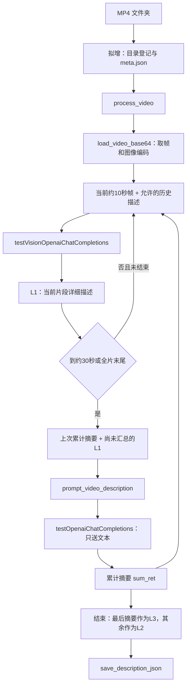
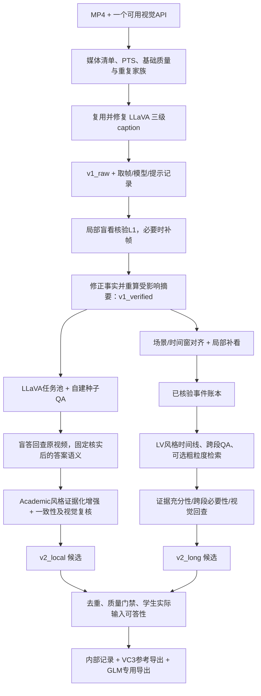

> 历史研究文档，不是当前流程；最新用户决定以[decisions.md](decisions.md)为准。

# 仅用 MP4 与模型 API：LLaVA 三级 Caption 复用及 VideoChat3 风格数据合成设计

日期：2026-10-20。目标学生：用户指定的 GLM-5.3-Flash。目标输入：自有 MP4 文件夹与可用的视觉模型 API 配置；不要求已有 QA、字幕、人工原标签或额外模型权重。

状态：官方源代码与样例已静态核查；官方 caption 控制流已做内存模拟验证；本文件中的统一入口、核验器及 v2 合成器均为**拟议实现**。未处理用户 MP4、未调用真实教师、未运行训练。

## 1. 先判别你的两个理解

| 你的理解 | 判定 | 准确表述 |
|---|---|---|
| “整个 LLaVA-Video-178K 数据管道源码都是可获取的” | **范围过大，不能这样确认** | 三级 caption、OE 与 MCQ 的核心生成脚本、提示、示例池和输入输出已获取；尚不能证明数据源获取、全库筛选去重、生产调度、质量审核和最终发布等全部环节的原始生产源码都公开且已核实 |
| “只提供视觉模型 API 和 MP4 文件夹，即可得到三级 caption” | **作为适配后系统的使用方式，成立；原脚本目前不能直接保证** | 官方脚本实际要求 `meta.json` 路径列表、特定工作目录和硬编码配置，且存在运行缺陷。补一个文件夹入口，修复代码，接好兼容 API 后，可以只让使用者提供这两类输入；不必补原 caption/QA |

你的总路线可行：**先复用 LLaVA 的三级描述算法，再用原视频回查和结构化证据，合成局部增强数据与长视频任务数据。** 两条 v2 应共享证据底座，分别承担不同能力。Academic2M/LV116K 风格描述的是任务构造方法，不能仅靠把同一份答案导出两种 JSON 来实现。

必须同时保留两个边界：

1. “只有一个 API”可以让同一视觉模型分别承担描述、文本总结、提问、回答和核验角色；不同角色不是必须部署多套模型。但同模型的重复判断会共错，不能当成独立真值。
2. “高质量”要由可答性、视觉证据、时间支持和人工抽样校准衡量。自动系统可以生成候选并筛选，不能仅凭模型给自己打高分就宣称质量已验证。

## 2. 可复用代码及版本

LLaVA HF 固定 revision：`6d8c562dc26d70042a0d9704d1cae58c94b89098`。

| 官方文件 | 本项目直接借鉴什么 | 不包含什么 |
|---|---|---|
| [GPT4o_description_prompt.py](https://huggingface.co/datasets/lmms-lab/LLaVA-Video-178K/blob/6d8c562dc26d70042a0d9704d1cae58c94b89098/gpt4o_caption_prompt/GPT4o_description_prompt.py) | 分帧输入、10/30 节奏、带历史描述的 L1、递推汇总、三级原始输出 | 完善文件夹 CLI、精确 PTS、生产恢复与原子发布、可靠视觉验真 |
| [caption README 与 meta 示例](https://huggingface.co/datasets/lmms-lab/LLaVA-Video-178K/blob/6d8c562dc26d70042a0d9704d1cae58c94b89098/gpt4o_caption_prompt/README.md) | 官方运行入口及输入/输出说明 | 任意 API 的自动兼容 |
| [gen_sft_data.py](https://huggingface.co/datasets/lmms-lab/LLaVA-Video-178K/blob/6d8c562dc26d70042a0d9704d1cae58c94b89098/gpt4o_qa_prompt/gen_sft_data.py) | caption → OE，`free_form`/`icl_once`，任务定义与 few-shot 组装 | 视频回看、独立种子真值、最终训练导出 |
| [gen_sft_data_mc.py](https://huggingface.co/datasets/lmms-lab/LLaVA-Video-178K/blob/6d8c562dc26d70042a0d9704d1cae58c94b89098/gpt4o_qa_prompt/gen_sft_data_mc.py) | caption → 题干/选项/答案 | 唯一正确选项的可靠核验、答案位置平衡 |
| [QA README](https://huggingface.co/datasets/lmms-lab/LLaVA-Video-178K/blob/6d8c562dc26d70042a0d9704d1cae58c94b89098/gpt4o_qa_prompt/README.md) | caption 字典输入；三种模式说明，polling 当前未启用 | 完整质量判定管道 |
| [OE 示例池](https://huggingface.co/datasets/lmms-lab/LLaVA-Video-178K/blob/6d8c562dc26d70042a0d9704d1cae58c94b89098/gpt4o_qa_prompt/demonstration_pool.json) / [MC 示例池](https://huggingface.co/datasets/lmms-lab/LLaVA-Video-178K/blob/6d8c562dc26d70042a0d9704d1cae58c94b89098/gpt4o_qa_prompt/demonstration_pool_mc.json) | 17/12 个任务维度及 demonstrations | 不保证任意视频都适合全部题型 |

本地源文件、哈希、函数位置和上一轮问题清单见 [代码二次检索报告](llava_video_videochat3_pipeline_code_search_2026-10-20.md)。本次刷新 HF 元数据后，LLaVA revision 未变。

## 3. MP4 → 三级 caption：清晰的实际数据链路

### 3.1 从使用者输入到脚本输入

你希望的外部输入：

```text
1. videos_dir：已有 MP4 所在目录
2. model_config：endpoint/base_url、model_id、认证凭据引用及后端类型
```

这里的 API 不只是一个 key：系统需要知道服务地址、模型名及多模态请求格式。密钥通过环境变量或受控配置传入，不写入产物。目录扫描、`meta.json`、时长、媒体 ID、抽帧参数由适配器自动产生，使用者无需提供。

官方要求的 `meta.json` 实际形状如下，路径为虚构示例：

```json
["/data/raw/a.mp4", "/data/raw/b.mp4"]
```

原始 `__main__` 读取路径列表、打乱顺序，再调用 `process_video(version,path,day)`。它没有直接接受文件夹的 CLI，文件夹到列表这一步需要补。

### 3.2 官方核心调用链与模型接入点



模型真正接入的是两个函数，而不是视频读取器或 JSON 导出器：

| 函数 | 固定源码行号 | 模型看到什么 | 输出 |
|---|---:|---|---|
| `testVisionOpenaiChatCompletions` | 173 | system prompt + 当前多帧 PNG/base64 + 历史描述文本 | `Clip Level Description`，解析后成为 L1 |
| `testOpenaiChatCompletions` | 201 | system prompt + 已有摘要/L1 文本；**无帧** | `Video Level Description`，用于中途摘要或 L3 |

原代码使用同一个 `OpenAI()` 客户端和 `gpt-4o-2024-05-13`。这表示原始实现采用该接口和教师，不表示必须由 LLaVA-Video 权重来生成数据。更换成你的服务后，应称为“复用 LLaVA 构造方法、替换教师”，不能声称严格复现原教师输出。

最低可行 API 能力是：**在一个请求中理解有顺序的多张图片，并能进行纯文本生成**。支持原生 MP4 上传不是必要条件。若服务只接受单图，或者无法承载当前窗口的图像预算，不能直接宣称等价支持；需改后端或重新设计并校准。

### 3.3 三个层级分别是什么

| 层级 | 输入 | 输出含义 | 重要限制 |
|---|---|---|---|
| L1 | 当前约 10 秒的帧；首窗无历史，后续带最近累计摘要和未汇总 L1 | 当前窗口详细描述 | 历史只辅助连续性，当前事实须在当前观察中成立 |
| L2 | 上一次累计摘要 + 新增 L1 | **从视频开始到当前时刻的累计摘要** | 不是每个 30 秒独立片段；会压缩细节 |
| L3 | 最后一次汇总，吸收已有累计摘要及尾窗 L1 | 全视频总结 | 不恢复丢失细节或精确事件边界 |

原代码按平均 FPS 取整后取模，近似 1 FPS，再按采样帧列表每 10/30 帧调度。**原代码的“秒”不是严格 PTS 时间。** 适配版建议用真实时间戳决定窗口与采样，保留 10/30 秒方法节奏；这是明确的工程修正，需要和原始模式区分版本。

### 3.4 以 95 秒视频说明递推和尾窗

以下为了讲清逻辑，假设得到 95 个约 1 FPS 的采样帧，`C1…C10` 是 L1，`S30/S60/S90` 表示累计摘要：

| 当前进度 | 产生什么 | 用什么生成 |
|---|---|---|
| 0–10 | C1 | 当前帧 |
| 10–20 | C2 | 当前帧 + C1 |
| 20–30 | C3 | 当前帧 + C1、C2 |
| 30 | S30 | C1、C2、C3；仅文本 |
| 30–40 | C4 | 当前帧 + S30 |
| 40–50、50–60 | C5、C6 | 当前帧 + S30 + 此轮新增 C4/C5 |
| 60 | S60 | S30 + C4、C5、C6；不是只总结 30–60 秒 |
| 60–90 | C7、C8、C9，之后 S90 | 同上递推 |
| 90–95 | C10 | 尾部帧 + S90 |
| 结束 | L3 | S90 + C10；仅文本 |

成功输出中：`clip_description=[C1…C10]`；`summary_description=[S30,S60,S90]`；`video_description=L3`。

若视频刚好在 60 秒结束，S60 直接作为 L3，**不会额外再调用一次总结**；此时 L2 列表只有 S30。30 秒视频有 3 个 L1、空 L2 列表、1 个 L3；10 秒视频也没有中途 L2。保留这种空列表是合理的，不应硬造摘要填齐。

本轮将官方 `process_video` 的 AST 单独取出，用内存帧和假模型/保存函数追踪，验证了 `N=0/1/10/30/35/60/65/90/95/3600`：非空成功路径的 L1/汇总数量及 60 秒递推依赖符合上述说明。此验证未涉及视频解码、真实提示效果、API 或原脚本整体可运行性。[控制流追踪证据](C:/Users/Tiachi/Documents/Dataset/x_temp/video_pipeline_design_2026-10-20/official_caption_controlflow_trace.json)

### 3.5 官方原始 JSON 与建议的可追溯封装

官方成功输出：`descriptions/{DATASET_NAME}_{version}_{video_id}.json`，键如下。文字是虚构例子；实际 token/prompt 数组按调用记录，不应为空：

```json
{
  "clip_description": ["C1", "C2", "C3", "C4"],
  "summary_description": ["S30"],
  "video_description": "S35",
  "completion_tokens": [],
  "prompt_tokens": [],
  "total_tokens": [],
  "prompts_system": [],
  "prompts": []
}
```

该原始结果没有精确时间戳、媒体路径或父依赖记录。建议适配版同时保存：

- `v1_raw`：原始模型文本、原始响应、模型/提示版本和官方三级字段，作为可追溯基线。
- `caption_index`：稳定媒体 ID、路径、真实 PTS、窗口、观测帧、摘要范围、父依赖、请求状态与费用统计。
- `v1_verified`：对 L1 回看并修正/拒绝后的版本；若 L1 被修改，重新生成受影响的 L2/L3，不能沿用旧总结冒充已核验产物。

“v1 raw”与“v1 verified”是建议新增的状态层，官方脚本没有实现。后续 v2 默认读取已核验证据，必要时仍回查原 MP4；不能把 L3 当所有问题的唯一事实源。

### 3.6 让“两类输入即可运行”成立的最小改造

| 改造 | 理由 | 属性 |
|---|---|---|
| 目录 → 媒体清单及路径列表 | 原脚本只读 `meta.json`；同名视频需区分 | 新增入口 |
| API 后端适配和能力预检 | 原模型 ID/客户端硬编码，`API_KEY` 占位变量实际未传客户端 | 适配已有代码 |
| 修复 `SAVE_FRAME_SAVE_PATH_ROOT` | 原定义被注释，取帧仍引用，会触发 `NameError` | 必须修复 |
| 结构化输出和有限重试 | 原字符串切分/`ast.literal_eval` 易失败，异常会进入 `pdb` | 必须修复 |
| 状态/恢复与原子保存 | 恢复变量拼写错误、解码后才判已完成、直接覆盖写入 | 必须修复 |
| 真实 PTS、稳定媒体 ID、流式窗口取帧 | 原平均 FPS 近似、basename 截断、全片采样 base64 占内存 | 工程修正 |
| 输入与异常边界 | 缺 `sys` 导入、空视频/尾窗/部分恢复等 | 必须验证 |

修复这些后，使用者无需手工准备标注。**当前还没有完成这份适配版，不能给出已经可运行的承诺。**

## 4. VideoChat3 标注合成代码：继续检索的结果

本轮新增了全局 GitHub 文件搜索 `Academic2M`、`LV116K`，及官方仓库内 `chat.completions.create`、`annotation synthesis` 搜索。全局命中以官网/README、数据元信息和论文汇总为主；官方仓库内的 API 命中位于 `vlmevalkit-videochat3` 的评测适配器/判分器，不是两个数据集的标注生产器。

另检查了 Academic2M、LV116k、Training-Data-Annotations、Stage3 的 HF refs：均只有 `main` 数据分支；前两者另有自动 Parquet 转换 ref，没有发现新的合成代码分支。GitHub 连接器刷新分支，仍为 `main@015f52eb2ea70b5abda30192aee18034f2c5f13b`。刷新 7 个 issue/PR 的标题与正文，也未给出标注合成入口。

此前已经检查 40 条提交及大型历史提交的完整文件树、附加 HF 数据仓库、作者相关仓库；本次复用其证据，未重复下载。**到本轮结束，仍未定位 Academic2M/LV116K 的官方合成脚本、完整提示配置和生产入口。** 这不证明互联网任何位置都没有代码，也不把搜索无结果等同于作者明确声明未开放。

| 已找到的官方入口 | 能用来做什么 |
|---|---|
| [VideoChat3 主仓库](https://github.com/MCG-NJU/VideoChat3/tree/015f52eb2ea70b5abda30192aee18034f2c5f13b) / [训练指南](https://github.com/MCG-NJU/VideoChat3/blob/015f52eb2ea70b5abda30192aee18034f2c5f13b/xtuner-videochat3/README.md) | 模型、推理、训练和数据读取；不等同于 MP4 → 新标注 |
| [Academic2M 固定数据版本](https://huggingface.co/datasets/MCG-NJU/VideoChat3-Academic2M/tree/fb79513cbbbaf402d321926ce9227f066d774746) | 目标回答风格、任务与成品外层结构 |
| [LV116k 固定数据版本](https://huggingface.co/datasets/MCG-NJU/VideoChat3-LV116k/tree/e32b78d3eb5ac5d1bf28b55a2ba295e99432be62) | 长描述、QA、定位等成品结构 |
| [全阶段标注仓库](https://huggingface.co/datasets/MCG-NJU/VideoChat3-Training-Data-Annotations/tree/35482967a67d9a3c9b485261dc3b9e2b49cb3932) | 标注来源、混合配方、路径表 |
| [Stage3 便捷发行版](https://huggingface.co/datasets/lmwang/VideoChat3-Stage3-Training-Data/tree/a7def4abd394697856be9cd6276efa98a27f23df) | sampled 成品和媒体组织 |

本轮匿名 GitHub REST 刷新遇到限流，已用 GitHub 连接器取得分支/issue 信息；不把限流当作仓库不可用。代码搜索、HF refs 与刷新证据见 [本轮证据目录](C:/Users/Tiachi/Documents/Dataset/x_temp/video_pipeline_design_2026-10-20/github_code_search.json)。

## 5. 自建部分的依据与迁移边界

原方法的核心依据可压缩为两点：[VideoChat3 论文 §3.2–3.3](https://arxiv.org/html/2607.14935v2#S3.SS2)

- Academic2M：保留原答案语义，用 Qwen3-VL-235B-A22B 补充可见证据，再判定与原标签的一致性。
- LV116K：场景切分结合时长约束，逐片段描述并核验，形成时间证据账本，再构造长任务；精确定位额外使用 grounding 专家。

你的 MP4 没有人工原答案，教师也由用户提供，因此应交付 **Academic2M-inspired 与 LV116K-inspired 的自有数据**。关键新增步骤是建立经视觉复核的种子语义；不能拿 caption 派生答案充当原学术数据的人工真值。

### 5.1 真实样例告诉我们什么

本轮重读了之前按固定 HF SHA 取到的少量原 JSONL 首行。这些是格式/内容观察，未观看其视频，不据此判断样例事实正确率：

| 样例 | 观察 | 对自建方案的影响 |
|---|---|---|
| Academic2M 的 `0_30_s.../Charades/028CE.mp4` | `id + messages`，多轮 QA；答案常为证据描述后接 `Final Answer` | 可借鉴“可见依据 + 明确结论”；不强制长答案或该标题 |
| Academic2M 的短 caption 行 | 对动作、外观、环境写长描述，也含由水印推测音乐的表述 | 发布样例不是全部规则的质量保证；视觉-only 需去掉无视觉支持的声音推测 |
| LV 的长描述行 `YUsuWPIbBus_0` | assistant 字符串内是带代码块的 JSON，含 `title/parts/start_timestamp/end_timestamp/summary/key details`；内容为韩文 | 可借鉴章节结构；不能默认所有数据为英文，也不能从格式推断所有叙述都可见 |
| LV 的 QA 行 `AInDNc5N7Ig_0` | 答案明确引用 narration 与 on-screen text | 纯视觉训练必须重新判断画面文字是否单独支持，不能照抄旁白依赖 |
| LV 的 grounding 行 | 答案是若干 `[start,end]` 秒区间的字符串；媒体有帧目录后端 | 可借鉴多区间任务；你的媒体仍是 MP4，不能沿用帧目录的 `fps=2` 等元数据 |

样例来源路径及首行文件可追溯到 [前次源清单](C:/Users/Tiachi/Documents/Dataset/x_temp/video_pipeline_audit_2026-10-20/source_manifest.json)。上述观察不是对数据集整体的统计结论。

### 5.2 纯视觉证据口径

本方案不送音轨、不做 ASR。允许画面内文字/OCR，因为文字来自可见像素；每条文字事实应关联可读帧。外部字幕文件、网页标题、原视频文件名不作为问题答案来源。若可见字幕足以支持，标记 `visible_text`，与 `visual_action` 分开统计，避免最终数据只训练读字幕。

不能从口型、背景音乐水印、常识或故事惯例补出对话/声音/内心活动。不能把叙述“可能在修理”改成确定的“修好了”。视频有音轨本身不影响纳入，只要求生成和验收实际使用的输入视图符合纯视觉合同。

## 6. 建议的完整数据流：公共 v1 + 两条 v2



原 MP4 作为不可变输入。所有片段优先保存为原片时间窗，不要求物理裁剪、重编码或另交帧文件夹。模型请求需要帧时在本地按窗解码，写入的仅是派生产物与必要缓存；临时媒体不与最终标注混淆。

本设计以下部分均为提案，不能看作作者实现或已验证产物。

## 7. 公共底座：如何把三级文本变成可靠证据

### 7.1 媒体登记与可恢复生成

系统自动发现 MP4，记录稳定 ID、相对路径、时长、尺寸、真实帧时间、可解码性、音轨存在性和重复家族。目录层级可配置；共享盘以清单驱动、有界顺序 IO 为默认，不能无界并行探测整盘。

基础筛选先处理损坏、全黑/近静态、明显模糊、严重重复等问题，阈值按视频领域校准。静态讲解不应仅因画面变化少而全部删除，需看可见文字/动作是否有任务价值；明确路由到低运动/OCR 类。

生成缓存键至少含媒体身份、窗口、真实取帧/缩放配置、模型 ID、提示版本、依赖版本。API 限流使用有限重试与退避；到预算或重试上限后明确失败/待重试，不无限循环。完成状态先于解码检查。

### 7.2 L1 验证的模型合同

先让核验角色仅看当前窗口帧，独立列出能观察到的实体、动作、状态变化与文字；第二步再比对待核验 caption。每个原子事实输出 `supported / contradicted / insufficient`，并引用帧 ID 或时间范围。不给出答案的盲看步骤用于降低照着原描述复述的倾向。

对于动作顺序、快速运动、计数和小文字，约 1 FPS 的原始取帧可能不足。系统应按问题类型局部加密取帧/提高分辨率，在记录中保留新视图；预算不允许或观察仍不足时拒绝该事实，不凭模型自信放行。核验本身也是有误差的估计。

同一 API 可以执行两次请求，但这不能称独立模型核验。若后续能提供第二个模型 API，可作为增强选项，而非首版硬性输入要求。

### 7.3 层级依赖与错误传播

L1 被改动后，标记依赖它的 L2/L3 及 QA 失效，按依赖图重算。因为官方后续 L1 也使用历史描述，若修正涉及人物身份或事件方向，需检查受影响的后续 L1，不能只重写最后总结。

L2/L3 用于规划问题和组织故事；最终事实须能回指已核验 L1/事件和原帧。任何只在总结中新出现、找不到局部支持的细节，不进入监督答案。

## 8. v2-local：Academic2M 风格的局部增强合成

### 8.1 逐步骤设计

| 步骤 | 输入 → 输出 | 复用/自建 | 模型位置 |
|---|---|---|---|
| A1 任务适配 | 已核实局部事实 → 可用任务类型 | 复用 LLaVA 示例池，增加可答性路由 | 文本生成；不适合则不产题 |
| A2 生成种子 | caption/局部事实/任务定义 → question、candidate answer、可选 options、证据 ID | 复用 OE/MCQ 提示与模式，自建结构化输出 | 原 `testOpenaiChatCompletion` 对应角色 |
| A3 盲答 | 原片窗口 + question，隐藏候选答案 → independent answer / insufficient | **自建必需步骤** | VLM 看帧 |
| A4 固定语义锚点 | 候选、盲答、证据 → accepted seed / reject / repair | 自建；必须避免只做两个文本互比 | 文本比较 + 视觉争议复核 |
| A5 证据化增强 | 视频 + question + accepted seed → 可见依据 + 简洁结论 | 借鉴 Academic2M；脚本自建 | VLM 看帧，保持答案语义 |
| A6 双项判定 | 改写答案是否与 seed 一致；新增事实是否在画面中成立 | 自建 | 一致性可只看文本；事实支持必须看帧 |
| A7 导出 | 通过者 → 局部任务内部记录及训练样本 | 自建 | 无模型 |

实际可以将 A3 的无答案盲答与一部分事实观察批量返回，降低调用数，但不要把增强答案作为盲答提示的一部分。只做 seed/改写之间的相似度检查，无法发现二者共同继承的错误。

### 8.2 复用 LLaVA QA 代码的具体方式

官方两份 QA 脚本输入不是三级 JSON 文件，而是 `{video_id: caption}`。第一版可桥接 `video_description`，复用 `icl_once` 的任务定义和 demonstrations，作为全片 QA 基线。正式局部题默认使用**相应窗口的已核实 L1/事件**，附证据 ID；局部 caption 生成需适当调整提示，不把整个 L3 当当前窗口事实。

`free_form` 可作为低成本基线，`icl_once` 作为控制任务覆盖的推荐方式；`icl_polling` 的官方主执行块未启用，首版不必恢复它。按可用事实选取题型，不对每个视频强制生成 17 类问题。

复用前还须修复官方 QA 的 `--num_of_query=-1` 被实现为 `len-1` 的漏处理、成功检查在 API 调用之后、无限错误重试、选项提示格式、固定输出上限和解析问题。最终合并结果是 `[{video_id:[QA...]}, ...]`，仍需 exporter；不是现成 `messages`。

### 8.3 推荐首版任务与拒绝规则

先做可观察动作、状态变化、事件先后、物体属性变化、局部关系与可读文字。计数只有在时间覆盖和重复实例身份足以区分时纳入；不能把采样帧里出现次数直接当事件次数。因果题只保留可见机制或有明确支持的关系，不把“先发生”自动解释为“导致”。

MCQ 首版默认单选：候选选项数可配置，所有选项逐一核验，恰有一个被问题与视频支持；随机换位后同步重算答案。相似但也成立的选项、只靠语言常识即可排除的选项、模型未看见就断言不存在的干扰项均拒绝。多选另设 `correct_option_ids` 合同和独立质量校准，首版不混用。

增强答案采用“必要的可见依据 + 明确答案”，长度由任务决定。保留内部证据引用，默认不把自由展开的隐藏推理/CoT作为训练目标；回答变长不自动代表监督更好。

### 8.4 示例：这是自拟中间记录，不是官方数据

```json
{
  "sample_id": "demo_001.local.oe.0001",
  "task": "temporal_order",
  "question_type": "oe",
  "question": "What does the person do after pouring water into the cup?",
  "candidate_answer": "They stir the water with a spoon.",
  "blind_answer": "They stir the contents of the cup.",
  "accepted_seed": "They stir the water with a spoon.",
  "evidence_ids": ["demo_001.e02", "demo_001.e03"],
  "enhanced_answer": "After pouring the water, the person moves a spoon inside the cup to stir it.",
  "verification": {
    "answer_consistency": "pass",
    "visual_support": "pass",
    "audio_required": false,
    "state": "illustration_only"
  }
}
```

`pass` 在此仅演示字段，不是实际核验结果。真实核验记录应有看过的帧、模型、提示版本与判断理由；不能只存一个 `verify=true`。

## 9. v2-long：LV116K 风格的长视频合成

### 9.1 先对齐边界，再建事件账本

用场景切换候选加时长限制生成原片窗口。可以使用 [PySceneDetect 的 `detect()` 接口](https://www.scenedetect.com/docs/latest/api.html)；场景检测是本地视频处理，不需要使用者额外提供权重/API。镜头切换不等同于语义事件边界，长单镜头仍要分窗，跨镜头同一事件也可能需要合并。

首版保留 LLaVA 的 10/30 秒作为可追溯基线；LV 窗口的最短/最长时长另做配置与小样本校准，不假冒作者未公开的参数。已有 L1 与新窗口对齐且证据足够时复用描述候选；跨边界、快速运动或粒度不足时重新看帧，而不是从 L3 猜回局部情节。

事件账本至少记录：实体候选 ID、可见属性、动作/状态变化、时间范围及精度、观察帧、来源 caption ID、支持/不确定事实。跨段人物匹配要有视觉支持；穿同色衣服或同一场景不足以无条件判为同一个人。

```json
{
  "event_id": "demo_001.e03",
  "video_id": "demo_001",
  "observation_span_sec": [20.0, 30.0],
  "event_span_sec": null,
  "temporal_precision": "window_only",
  "description": "A person moves a spoon in the cup to stir it.",
  "support_frame_ids": ["demo_001.f021", "demo_001.f024", "demo_001.f027"],
  "evidence_channel": "visual_action",
  "source_caption_id": "demo_001.c03",
  "verification_state": "illustration_only"
}
```

这里刻意区分观测窗与事件区间：在 20–30 秒看到了搅拌，不代表搅拌恰好从 20 秒持续到 30 秒。

### 9.2 三类任务的产出和验收

| 任务 | 生成输入 → 输出 | 必须补的核验 | 首版建议 |
|---|---|---|---|
| 时间线/分段摘要 | 有序事件账本 → 事件片段、章节、摘要 | 事件真实、顺序正确、相邻重复合并不过度、时间精度如实声明 | 纳入；若只有观测窗，题面明确按片段组织 |
| 跨段 QA | 全部账本 + 实体/事件关系 → QA、最小证据集 | 多段联合足够，单段不足；原视频回看；答案不依赖旁白 | 纳入，严格筛选 |
| 事件检索/时间定位 | 事件查询 → 候选窗口/区间 | 查询视觉匹配、空结果/相似重复、边界与时间基准 | 先做粗粒度片段检索；精确多区间定位后置 |

长视频标签可以由文本能力从账本生成，不要求 API 一次吞下全片。但文本账本无法保存全部视觉细节，最终问答仍需回看相关原片窗口；漏检风险也须统计，不能把“账本没写”当“全片不存在”。

### 9.3 跨段 QA：防止“长视频里的一道单帧题”

先要求生成器返回 `question, answer, evidence_ids, required_relations`。验证角色看到题目及多段证据，隐藏候选答案后作答。随后分别只给单段证据作答，并检查删除关键证据后是否仍足够：

- 联合证据仍不足：拒绝或补看。
- 某一个局部窗口本身足够：可转入局部分支，不作为跨段题计数。
- 两段或多段事实确实需要组合，例如前后状态对比、跨步骤物体状态演变：保留。
- 有多个替代证据集合：识别一个最小充分集合，不机械要求所有候选片段都不可删。

仅依靠模型解释“这题需要两段”不够；以上输入消融是操作性检查，仍是代理指标，需要抽样校准。问题若直接泄露答案或纯文本无视频就稳定答对，应降权/改写/拒绝；一次无视频猜中不单独证明它无视觉价值。

对于超长视频，按层级做候选检索和分块规划，再送相关细粒度证据，避免简单截断账本。应记录未被覆盖/未被核验的范围，覆盖不足时不能生成全片事件总次数或“所有发生区间”的强断言。

### 9.4 只有一个 API 时怎样处理 grounding

用户不必额外提供定位模型，首版即可产出时间线、跨段 QA 和粗粒度检索；但不能把“LLM给出10秒格子的起止点”冒充专家定位精度。

推荐默认：输出匹配的观测窗，任务明确为 `segment_retrieval`，保留 `temporal_precision=window_only`。此类样本不进入 `precise_temporal_grounding` 的统计。

可选 API-only 扩展：在候选附近加密取帧，分别判断动作开始/结束，保存边界不确定区间与采样间隔，再用有人工边界的校准子集评估。只有达到预先约定的误差或 tIoU 门槛后，才发布相应精度级别。首版不要求新增权重，但因此也不承诺严格复现原 grounding 专家步骤。额外专家模型/API 是以后提高精度的替代项。

时间从窗口局部映射到原片时，必须显式加偏移；内部统一秒和原片时基，建议 `[start,end)`，导出器适配实际读取器。不能把提示中的帧下标、时间文本或摄像机时间戳混成同一口径。

## 10. 一套 API 怎样承接所有模型角色

| 角色 | 实际请求输入 | 输出 | 可复用代码位置 |
|---|---|---|---|
| Caption VLM | 当前窗口帧 + 允许的历史 | L1 | LLaVA `testVisionOpenaiChatCompletions` |
| Summary LLM | 已接受描述文本 | L2/L3 | LLaVA `testOpenaiChatCompletions` |
| QA planner | 任务定义、caption/事件账本 | QA 候选、证据 ID | LLaVA OE/MCQ 的 `testOpenaiChatCompletion` 及提示组装 |
| Blind verifier | 视频帧 + 问题，不给候选答案 | 独立答案/可见事实/不足 | 自建 |
| Answer enhancer | 视频帧 + 题目 + 已核实 seed | 证据化答案 | 自建，参考 Academic 方法 |
| Consistency judge | seed/增强答案；另加视频验证新增事实 | 一致性、支持/拒绝 | 自建 |
| Long-task planner | 时间戳与已核验事件 | 时间线、跨段 QA、检索 query | 自建，参考 LV 方法 |
| Optional boundary refiner | 候选区域密集帧及 query | 估计边界与不确定性 | 自建/后置 |

这些角色可以绑定同一个 endpoint/model/key；纯文本角色也可请求该模型但不发送图片。后端必须验证多图上限、顺序表达、像素/请求大小、输出 token 上限、超时及并发限制。若只提供原生视频接口，需确认它的实际抽帧和时间输出口径；不能把服务内部未知采样当作精确观测。

建议统一 `generate_text` 与 `generate_visual` 接口，保持业务编排不依赖某一种 SDK。启动预检先验证一条纯文本和一组有顺序图片的请求格式及 JSON 可解析性；这只检查兼容性，不代表模型能力达标。

## 11. 中间记录与训练交付：保留证据，不把格式当能力

推荐内部原生记录保存 `media_id / sample_id / task_family / task / question_type / question / answer / options / evidence_ids / observation_view / language / provenance / verification`。使用原生数组保存区间和选项，不先序列化到 Markdown 再反解析。质量记录至少拆成：可答性、视觉事实支持、答案一致性、时间可靠性、任务有效性、学生视图支持。

最终训练导出只保留训练器需要的媒体引用和对话；教师 usage、审计结果、候选答案、验证结果、依赖图走旁路文件。避免把 verifier 的答案、证据账本或教师总结误放进 user 提示，导致学生凭文本读答案。

VideoChat3 参考外层可以是下列自拟例子，**不是 GLM 已验证的训练合同**：

```json
{
  "id": "demo_001.local.oe.0001",
  "messages": [
    {
      "role": "user",
      "content": [
        {"type": "video_url", "video_url": {"url": "demo_001.mp4"}},
        {"type": "text", "text": "<VIDEO_CONTEXT>\nWhat does the person do after pouring water into the cup?"}
      ]
    },
    {"role": "assistant", "content": "The person stirs the water with a spoon."}
  ]
}
```

这只是最小示意，正式 VC3 导出需补实际 loader 所需媒体元数据。不要照抄帧目录样例的 `fps=2/video_backend=frame2` 给 MP4。官方部分 metadata 存在严格 `fps*duration≈frame_count` 检查，VFR 或不同容器时长口径需要读取器适配，不能伪造元数据来凑断言。

GLM 专用 exporter 需依据实际训练框架、chat template、视频 processor、可见帧预算和 loss mask 另行实现。若局部任务只引用全 MP4，但学生读取器均匀采样后没有看到证据，样本仍不可用于该学生视图；应路由到能表达的原片时间窗或调整采样/任务。无需改动原视频，但读取器必须确实支持时间窗，否则首版选择可被实际读取视图支持的任务。

教师账单 token 与学生视频/文本 token 不是一回事；正式 token 预算及监督 token 以目标 processor/tokenizer 实测为准。首版无需把 API 的内部推理字段当 `cot` 交付；默认监督公开最终回答及必要的可见依据。

## 12. 质量门禁与小样本校准

| 检查 | 何时执行 | 失败怎么处理 |
|---|---|---|
| 可解码、路径、基础质量和重复家族 | 生成前 | 无效输入排除并记录原因；保留原片 |
| JSON/schema、区间越界、ID/引用完整 | 每阶段 | 有限修复；失败不流入下一阶段 |
| 原子事实的视觉支持、无音频依赖 | L1、seed、增强答案及长任务 | 补看/修正/拒绝，触发依赖失效 |
| 盲答与 seed、增强语义一致 | v2-local | 争议重核验，不默认 seed 正确 |
| MCQ 唯一答案、选项与答案换位一致 | MCQ 导出前 | 修题或拒绝 |
| 联合充分、单段不足、非语言先验题 | v2-long | 路由局部题、修题或拒绝 |
| 时间精度与证据覆盖 | 时间线/检索/grounding | 降低任务精度或拒绝，不补虚假小数 |
| 近重复题/视频、任务和来源多样性 | 混合前 | 去重、限额与分层采样 |
| 学生实际可见帧支持答案、监督非空 | 最终导出 | 调整视图/移除不支持样本 |

总体 quality score 可供排序，但硬性门禁不能被其他高分抵消。模型置信度不是经验错误率；同模型多次一致也不是正确率证明。

小样本阶段建议使用覆盖长短、运动快慢、OCR、多镜头、VFR、低质和近重复的视频集合；具体规模随现有视频分布确定，不把某个数量当文献规定。固定源视频家族切分，避免同视频的局部题与长题跨训练/验证泄漏。

最少比较四个有意义的基线/消融：

1. 原始 LLaVA caption → 官方 QA 风格，不加新核验。
2. 在 1 上增加原视频盲答与视觉门禁。
3. 在 2 上增加证据化增强；判断是否真的更正确/更有监督价值，而非只是更长。
4. 长任务只用 L3 与使用已核验事件账本的对照；检查跨段有效率和边界错误。

若可以人工抽查，评估题目可答率、答案正确率、额外事实错误率、跨段有效率、音频依赖率与时间误差，并报告分层样本数和不确定性。没有人工审计时只能报告自动筛选代理指标，不能声称已知真实错误率。训练收益最终还需独立 heldout 视频评估，不能从生成通过率直接推出。

扩量门槛应在试运行前结合预算和用途确定。示例：若目标要求低事实错误率，可据人工抽样的上置信界决定是否放量；出现系统性旁白依赖、遗漏快速动作或同模型共错，就停止该任务扩量并修正提示/采样/核验。此处没有擅定一个未经校准的“质量分≥某数”阈值。

## 13. 拟议工程结构、交付顺序与成本

```text
projects/video-caption-sft/          # 拟议目录，目前尚未实现
  configs/pipeline.yaml             # 非敏感配置；角色可共用一个API
  prompts/                          # 固定版本的原始/改造提示
  src/
    media_manifest.py               # MP4发现、元数据、重复家族
    api_clients.py                  # text/visual后端适配与能力预检
    sampling.py                     # PTS、原片窗口和取帧谱系
    caption_hierarchy.py            # LLaVA逻辑适配、DAG、尾窗
    caption_verify.py               # 盲看、原子事实、摘要失效
    local_qa.py                     # LLaVA任务池、seed、增强
    event_ledger.py                 # 场景对齐、事件、跨段关联
    long_tasks.py                   # 时间线、跨段QA、粗粒度检索
    verification.py                 # 视觉/语义/任务门禁
    exporters.py                    # 内部记录、VC3参考、GLM
    state_store.py                  # 请求缓存、状态、预算、恢复
  scripts/run.sh                    # 拟议短入口，分阶段PASS/FAIL
```

数据、帧缓存、状态库和全量响应在数据盘；代码、非敏感配置、测试和文档在 Git。原始输入不可变；派生输出经 no-clobber staging、验证后发布。正式服务器运行前按本仓库规则审查、提交并经 Git 同步，记录 commit SHA；本轮没有实施服务器脚本。

| 阶段 | 交付物 | 放行依据 |
|---|---|---|
| P0 接口与 I/O | 目录清单、API 预检、稳定 ID、真实 PTS | 可发现输入且无原片修改；请求兼容 |
| P1 三级 caption 适配 | raw 三级输出、可追溯记录、恢复机制 | 单视频/尾窗/空视频/限流/恢复验证；人工可查看取帧与描述 |
| P2 证据与 local QA | verified caption、seed、盲答、增强及拒绝记录 | 比原始 QA 基线质量提高；成本可接受 |
| P3 long QA/时间线 | 事件账本、最小证据集、任务验证 | 跨段有效率、视觉支持与时间精度符合事先标准 |
| P4 正式导出与扩量 | GLM 数据、旁路审计、统计、可恢复运行 | 目标读取器实测看到证据且有监督 token；完成质量校准 |
| P5 可选精确定位 | 边界细化与校准报告 | 达到单独定义的时间误差/tIoU 标准 |

难度判断：P1 是中等工程适配；P2/P3 的难点集中在事实可靠性、共错和长时证据，不在 JSON 转换；精确多区间定位单独属于高难度任务。没有视频分布/API吞吐前，不承诺跑完规模和工期。

令 `N` 是官方成功路径的采样帧数，则原 v1 的基本请求数为 `ceil(N/10)+ceil(N/30)`；约 60 秒为 8 次，约 95 秒为 14 次。扩展核验、补帧、QA、增强、judge、长任务和失败重试都另计。汇总报告应给出每原视频小时输入帧/文本量、每千**有效**样本费用、拒绝/返修率和阶段耗时，不能只报总生成条数。

若只给一个 API，默认全部角色共用它，局部按需补看而非全片无限加密。可将同窗口多题一起核验以控制成本，但应保留逐题判定和证据；达到请求/费用上限时停在可恢复状态，不能降低门禁后仍当高质量发布。

## 14. 关键决策卡

| 决策 | 证据与状态 | 迁移边界/替代项 | 什么结果会推翻推荐 |
|---|---|---|---|
| 复用官方 LLaVA 核心算法，补生产适配 | 官方源码已获取；控制流模拟已验证；完整运行未知 | 默认修复封装；完全重写是替代项。换教师/PTS 是明确改造 | 代表性视频和恢复用例持续无法可靠处理，则重构控制器 |
| v2 前建立视觉核实的 seed，而非把生成答案视为人工真值 | 官方 QA 只读 caption；原 Academic 方法依赖已有语义锚点；本方案为拟议 | 直接 VLM QA 是强替代基线；可用一个 API | 同预算下直接 VLM QA 的人工正确率显著更好，则切换/混合 |
| 长任务依赖局部事件账本，L3 只作规划参考 | 原层级汇总会压缩；真实 L3 无精确事件边界；拟议设计 | 只用 L3 更便宜；需做实质质量对照 | 账本增加成本但不提高跨段有效率/正确率，则简化 |
| 单 API 作为最低部署方案，保留核验共错风险 | 角色输入均可由同一多图/文本后端承接；质量尚未实测 | 第二教师/人工审核是可选增强；不是用户额外必需输入 | 同模型视觉核验无法压低系统性错误，则提高后端能力或缩小任务 |
| 首版不发布未经校准的精确定位 | 官方 LV 方法另用定位专家；当前仅 API、稀疏取帧 | 默认粗粒度检索；API边界细化或专家模型为替代项 | API-only 在真实边界校准集达到预设精度后，可开放精确任务 |
| 最终训练只看到原视频视图和问题，证据/候选答案旁路保存 | 避免文本泄漏，且需核对学生帧预算；拟议实现 | 另做显式证据引用输出任务需单独定义 | 学生读取器视图不含必要证据时必须改变路由/样本，不维持原导出 |

## 15. 当前完成情况与下一步

已完成：四项需求的判断与方案；官方三级生成链路重建；VideoChat3 追加检索；真实数据小样本复核；一套 API 可承接的角色、I/O、质量门禁与实现顺序设计。

已本地验证：官方三份脚本 AST、固定 JSON 样例、官方 `process_video` 内存控制流；新增 refs 与搜索响应已保存。**未做视频/API/训练运行验证，也未实现拟议生产模块。**

下一步应交付 **P0/P1 的 LLaVA 适配版**：使用者仅指定 MP4 目录和模型 API 配置，系统自动产生可恢复、可追溯的三级 caption。待代表性小样本跑通后，按 P2/P3 扩展后续合成。无须等待尚未定位的 VideoChat3 代码才能启动 P0/P1。

相关既有文档：[完整可行性分析](llava_video_to_videochat3_v1_v2_feasibility_2026-10-20.md)、[第二轮代码审计](llava_video_videochat3_pipeline_code_search_2026-10-20.md)。本文件是后续实现的综合设计基线；先前代码审计结论以其中的更正为准。
