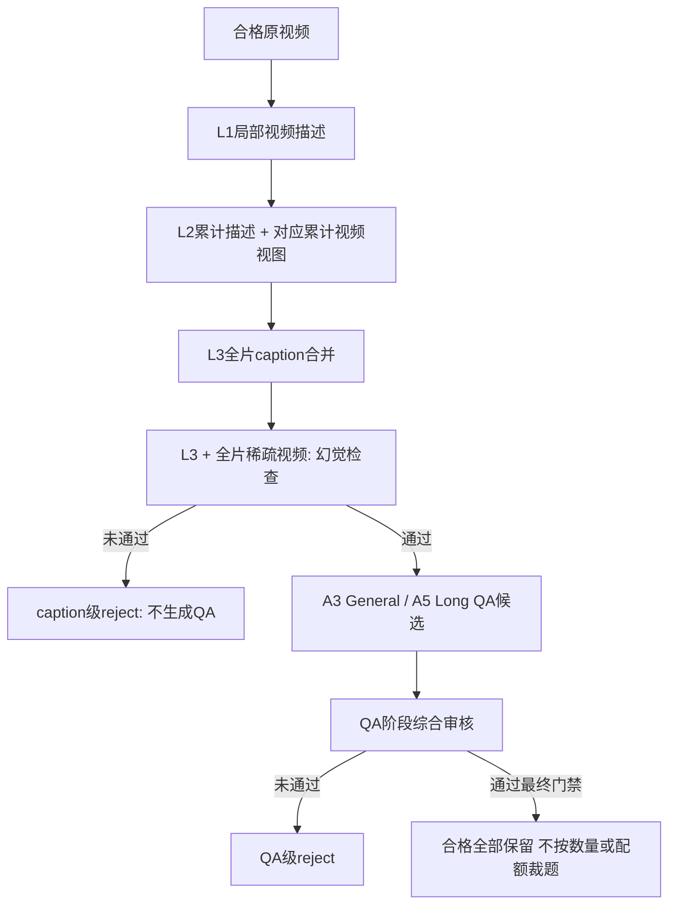

# 视频SFT项目：本阶段需求基线（整理稿）

> 2026-10-21补充：CoT已明确改为后续独立链路，以已发布QA和原视频为输入；当前四模块发布QA时cot=null，不再等待CoT。详见[独立链路合同](cot_standalone_pipeline_2026-10-21.md)。以下原始需求中的“CoT待定”仅保留为历史背景。

日期：2026-10-20。状态：保留的需求基线；L2视觉范围、L3检查门禁和Long候选/保留数已按用户澄清更新。此文记录调研前的问题，不作调研结论；本轮已完成的研究与设计见[四模块大纲](video_sft_four_module_project_outline_2026-10-20.md)及配套文件，生产管道未实现。

本稿以用户最新保留的原编号1、5、7、8、11、14、15为范围，收敛上一份新增需求稿。排序题专项、独立QA→CoT选型、完整分任务专用管道等不列为本阶段新增独立交付；不据此取消其在整个项目中的长期需求。CoT继续待定。

## 1. 本阶段目标与任务边界

当前数据构造仍保留General和Long两个分支。本阶段优先构造适合“三级caption→QA”路径、并能通过原视频审核获得高质量数据的任务，不要求覆盖所有视频理解能力。

精细计数、细节OCR等任务可能需要比三级caption更细的证据，不能仅使用通用出题prompt强行生成。本阶段需要调研后明确：哪些task可直接构造，哪些需要额外条件，哪些应延期。对于当前底座无法可靠支持的task，不新增专用视觉补标路径来凑覆盖。

既定全局配比仍为中文/英文3:7、OE/MCQ7:3、MCQ内部三/四/六选一1:7:2；MCQ全部单选，两分支均启用，General/Long之间配比未定。任务能力分类不等于题型或分支，后续均衡与统计应分别处理。

## 2. 生成阶段控制幻觉，并保存中间结果

caption阶段的幻觉检查前移到QA构造之前：**三级caption生成完成、L3合并后，使用全片稀疏视频视图检查L3；通过才进入QA构造，不通过就拒绝该视频的caption产物并停止下游。** 各阶段保存必要输入、输出、视频/帧时间引用及检查结果。L1/L2生成时加入视觉输入，不另行默认增加逐条独立幻觉检查。

三级caption的新增要求如下：

- **L1：** 输入对应局部视频画面生成描述，保存窗口、实际采样时间和视图关联。
- **L2（后续范围澄清）：** 上次累计L2文字＋本轮新增L1文字，合并时加入本轮新增完整分块的画面，如0–30、30–60、60–90秒；文字摘要依次累计到0–30、0–60、0–90秒。不反复输入0–t全前缀视频。此前把文字覆盖范围等同视觉输入范围是助手理解偏差；详见[L2纠正说明](l2_visual_scope_and_cost_correction_2026-10-21.md)。固定密度/超限blocked保持，实际数值待配置。
- **L3：** 先合并生成全片caption，再将L3与覆盖原片的稀疏采样视频视图一起用于幻觉检查。保存检查结果及实际采样依据，通过才产生QA。
- **失败对象：** L3检查未通过，拒绝该原视频本轮的caption产物及下游构造资格；原片与中间caption留作追溯，不移动/删除视频，不修复重生成。
- **阶段边界：** 此时尚未进入A3/A5，没有该视频的QA，因此不能记录为QA被淘汰。记录视频/caption级reject，QA生成数为0。

这里“视频token”在工程中应落实为实际送入教师的视频/有序帧视图，不能用文字caption或路径代替。L2引入视觉、L3额外check均属于对原开源路径的改造，应单列调用与成本。

现有v1的无A4、无A10及模块4未通过直接reject原则继续作为约束。L3检查也是只筛除，不自动补看、修复或重生成；它与QA后的A7综合审核是前后两个门禁，不是把A7拆成重复审核。

L3通过只代表这一次稀疏视图下的全片caption检查通过，不把它当作所有L1细节都已逐条核实。QA形成后仍有独立的逐题质量门禁；稀疏采样细节和不足状态的操作规则属于后续设计。

## 3. 调研视频QA分类，确定两分支的任务清单

本阶段需根据视频理解benchmark、高质量通用视频训练数据集和相关综述，建立有来源依据的视频QA能力分类，并评估其与当前构造管道的适配性。

分类表至少包含：

| 列 | 内容 |
|---|---|
| 一级/二级task | 合并同义命名，明确能力边界 |
| 定义和问题示例 | 说明具体考查什么，区分task与OE/MCQ形式 |
| 来源依据 | 可核实的benchmark、训练数据集或综述 |
| 必要证据 | 对描述粒度、时间、身份、局部/跨段覆盖的要求 |
| 管道适配性 | 可直接支持 / 有条件支持 / 本版不适合，附理由 |
| 适合分支 | General、Long、两者，或延期 |
| 本版是否纳入 | 明确纳入条件、限制与主要失败风险 |

在此基础上，给出General与Long各自的本版task清单。不能直接把所有benchmark能力标签当作当前管道的可生产任务，也不能用提示词复杂程度替代视觉证据。

**本稿定义的是调研交付要求，尚未填入未经核实的分类结论。**

## 4. 解决任务分布偏斜与问答同质化

需要专门调研并设计任务均衡策略，解决单一prompt容易只生成主体识别、场景或简单动作题，而时序、比较、关系、多事实组合和有证据推理不足的问题。

设计应先判断视频可支持哪些task，再研究任务路由、目标配额、按task组织提示及缺口控制等方法。均衡不预先等于所有task完全等量；应提供有依据的目标分布，并同时统计生成候选和最终通过数据，分析不同task拒绝率造成的偏差。

对于内容供给不足的任务，报告缺口；不放回reject数据，也不以失败重生成强行补齐。

同时，需要建立按task、OE/MCQ和语言组织的较大模板库，轮转/采样生成问答，并通过prompt对生成的问题做有限的小幅改写，降低问法和答案的模板化。

改写属于送审前的构造步骤，不是reject后的修复。改写不得改变问题对象、时间范围、正确答案或选项语义；最终检查针对实际发布的版本。模板ID、版本与使用次数外置保存，报告需反映模板集中度与重复程度，避免只有表面句式变化。

## 5. OE时间表达必须对齐原始视频时间轴

OE答案中的数值时间戳必须是相对**原始完整视频起点**的全局时间，不能是切片内部相对时间。这里不是指现实世界的日期时间。

时间戳的格式化、偏移换算和合法范围检查可由程序完成。例如切片从原片120秒开始，片内5秒对应原片125秒。但程序换算只解决坐标转换，事件定位本身仍需实际证据，不能自动把粗caption窗口当作精确动作边界。

对于只需表达开头/结尾阶段的问题，可自然使用“开头”“结尾”“beginning”“end”等表述，避免机械模板化。要求精确数值定位的题目不能用这些定性词代替时间戳；其适用边界需写入构造与检查规范。

## 6. 每视频产量控制（2026-10-21最新确认）

General预先5槽位，Long预先3槽位；实际生成的候选通过最终质量检查后全部保留，无额外最终数量上限。不硬凑，允许abstain；无合格则0，不追加补造，不救回reject。候选数不等于API数，每题仍最多一次A7。

实际生成G、最终质量通过P，则质量reject=G-P、最终保留=P、因数量/配额的selection排除=0。全局配比通过生成调度和偏差报告落实，不丢弃最终合格题凑比。

## 7. 全链路统计与每轮人工审阅信息

凡涉及筛选的环节，都必须记录输入、保留、淘汰数量及原因，支持两种查看方式：

1. 某个来源数据集在全部阶段的输入、保留、淘汰和累计变化。
2. 某个处理阶段中，各来源数据集分别输入多少、保留多少、筛掉多少及原因分布。

同时按task、General/Long、OE/MCQ、语言、时长等必要维度统计。区分视频、caption、QA、CoT和API请求等单位；一对多生成与固定对象筛选分开报告，不把“每视频多道QA”误算为保留率。

每个reject对象保留可汇总的主原因及必要辅助标签，避免多原因重复计数。技术失败、质量错误、证据不足、重复/配额排除分别统计；预算停止后未处理的pending不记为质量reject。

每轮构造完成，应输出便于人工审阅的报告与样例索引，至少包括：

- 输入来源、处理范围、代码/配置/模型/提示版本与完成状态。
- 逐阶段数量漏斗、统计单位和分母；来源数据集×阶段交叉表。
- 任务、分支、题型、选项数、语言及时长分布；目标与实际偏差。
- caption及中间幻觉检查结果、reject原因、异常来源和典型失败。
- 模板使用与重复情况、每视频候选及通过数量。
- API调用、成本与必要耗时；通过/reject样例及对应视频证据位置。

报告可采用Markdown/HTML等可读形式，具体呈现待设计。caption、中间检查和详细统计均存训练JSON之外；保存颗粒度与存储预算另在实施方案明确。

## 8. 本阶段预期交付物

| 交付物 | 应回答的问题 |
|---|---|
| 视频QA分类与适配表 | 视频QA有哪些主要类型？当前管道能否可靠构造，各有什么前提？ |
| General/Long任务分工表 | 本版分别构建哪些task，哪些条件纳入/延期？ |
| 任务均衡方案 | 如何避免简单主体/动作题主导，同时尊重视频可答性和审核拒绝？ |
| caption幻觉控制设计 | L2加入本轮新增完整分块视觉并递推累计文字，L3稀疏check作为QA前门禁；明确采样、保存与统计 |
| 时间与模板多样性规范 | 如何保证全局时间一致、表达自然、改写保持语义？ |
| 产量与统计/人审规范 | General5、Long3候选，最终合格全保留；各阶段保留量和人审报告如何定义？ |
| 漏洞分析与澄清清单 | 当前约束之间有哪些冲突、证据缺口和成本风险，需要用户明确什么？ |

## 9. 已澄清的决定与后续设计项

| 用户澄清 | 当前记录 |
|---|---|
| L2视觉范围 | 本轮新增完整分块，如0–30、30–60秒；累计的是摘要文字，不重送0–t画面 |
| caption检查位置与失败 | L3合并后稀疏视频检查；失败拒绝caption产物并停止该视频下游，此时没有QA |
| Long数量 | 预排3槽位；最终质量合格全部保留，无合格则0，不追加补造 |

后续研究/设计仍需确定：L2/L3采样密度与像素预算；稀疏检查的证据不足规则；task均衡目标与允许偏差；各任务的时间精度与适配边界。它们不影响以上三项已明确的阶段顺序与数量决定，不再重复向用户询问同一问题。

本阶段暂以本稿定义的范围和最新澄清为准，上一份完整新增需求稿保留为历史记录。本次仅更新需求记录，没有实现/运行相应流程。
