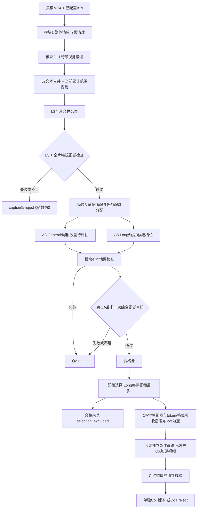

# 纯视频 SFT 数据构造：四模块设计大纲

更新：2026-10-21，本阶段设计v3（CoT后续独立链路）。目标：仅以MP4与可用视觉模型API为外部标注资源，构造面向GLM的General通用与Long长视频数据。**当前交付是有来源的设计、配置、提示合同、模板和离线一致性校验；视频生产程序未实现、未调用生产API、未在服务器运行。**

## 1. 本阶段结论与文档入口

建议先做适合三级caption证据粒度的任务：General启用9类，Long启用3类；细节OCR、计数、精确动作边界不在本版主动构造。任务权重是试产建议；用户已确认的语言/题型配比不变。四模块之间单向流动，所有失败保留外部记录、不回流修复。

| 配套文件 | 作用 |
|---|---|
| [后续CoT独立链路](cot_standalone_pipeline_2026-10-21.md) | 已发布QA+视频输入、派生CoT版本、失败隔离 |
| [需求基线](video_sft_current_phase_requirements_2026-10-20.md) | 用户当前保留的需求与三项澄清；不是新增范围清单 |
| [任务分类与适配表](phase_one_task_taxonomy_2026-10-20.md) | 32项归一化能力、来源、证据要求、是否纳入；确定9+3任务 |
| [caption与时间合同](phase_one_caption_and_time_contract_2026-10-20.md) | L2累计视觉、L3稀疏检查、原片时间与成本 |
| [均衡与模板](phase_one_balancing_and_templates_2026-10-20.md) | 任务先分配、192种子模板、Long3选1、General数量试验 |
| [General/Long题数评估](general_long_qa_density_research_2026-10-21.md) | 实时下载快照、同口径QA密度、General5候选最多3条建议；Long3候选最多1条不变，提案未启用 |
| [统计与发布合同](phase_one_metrics_and_release_2026-10-20.md) | 全阶段筛选账本、来源×阶段双视角、人审报告与12字段外置边界 |
| [机器配置](../configs/project.example.json) / [任务注册表](../configs/task_registry.json) | 未知值保持null；推荐值明确标proposed |
| [模板库](../configs/question_templates.json) / [生成提示](../prompts/task_generation.md) / [审核提示](../prompts/quality_audit.md) | 可直接用于下一步适配器实现的输入合同；尚未运行调优 |
| [合成报告示例](../examples/synthetic_run_report.md) | 虚构数量演示，不是实际处理结果 |
| [一手来源登记](phase_one_sources.json) | URL、版本、定位、公开源文件校验和与研究边界 |
| [交付验证记录](phase_one_validation_2026-10-20.md) | 已调研/已实现/本地验证/未实现的实际边界 |

## 2. 固定约束与输出

| 内容 | 当前合同 |
|---|---|
| 输入模态 | 原始MP4只读，纯视觉，忽略音轨，`modal_mask=4` |
| 分支 | `academic2m_inspired` / `lv116k_inspired`；同一JSON格式，分别输出general/long |
| 最终全局配比 | 中文/英文3:7；OE/MCQ7:3；MCQ内部3/4/6选一1:7:2；全部单选 |
| 未定配比 | General/Long混合比例；不默认1:1；小批次只报告可达比例和缺口 |
| Long数量 | 适配视频预先请求3个候选槽位，最终质量通过池中最多保留1条；无合格候选则0 |
| General数量 | 待试产评估，配置null；不是Long规则的复制 |
| 幻觉门禁 | L3全片稀疏检查前置；QA形成后一次A7综合视觉审核；失败/不足拒绝 |
| 删除角色 | A4视觉补标、A10语义/embedding API不启用；无失败后补看/改答案/重生成 |
| CoT | 之后单独搭建，不在当前四模块执行；QA发布cot=null，CoT版单独构造/核验/发布 |
| 最终字段 | 严格12个：id/source/conversations/task/question_type/media_info/media/modal_mask/quality/cot/language/tokens |
| 外置内容 | caption、事实账本、实际视图与时间、模板/提示/模型版本、调用费用、reject原因、split/去重、统计、人审 |

Academic2M的学术标签与LV116K的精确grounding不是MP4自动附带的能力。两者只作为方法参照，不能在`source`填方法名或将本项目候选称为人工GT。[VideoChat3论文§3.2–3.3](https://arxiv.org/html/2607.14935v2) 与 [已核代码入口](llava_video_videochat3_pipeline_code_search_2026-10-20.md) 支持这一区分；截至本轮未定位可复用的Academic2M/LV116K标注合成入口，相关组织、筛选与适配代码需要自建，不把训练loader当合成器。

## 3. 总链路

当前四模块只负责QA。QA在自身审核、学生适配与发布验收后可独立发布，cot=null；不等待CoT。图中虚线表示后续单独启动的链路，CoT失败不回流修改原QA。学生processor尚未验证时仍不能宣称训练兼容。

## 4. 模块1：视频预先清理

**输入：** 明确授权的MP4根/allowlist、是否递归、真实来源映射、IO与质量预算。未知目录不默认全盘扫描。

**步骤：** 建稳定video_id与原片路径映射；ffprobe探测时长/尺寸/时间基准；受控窗口解码检查损坏、黑帧、模糊/冻结等；精确/近重复分组；同源组先分split；保存基础时长与镜头候选。低运动不自动等于无价值；镜头边界不自动等于事件边界。

| 输出（派生根下） | 内容 |
|---|---|
| `01_prepare/media_manifest.jsonl` | video_id、实际source、只读原路径/发布相对路径、时长/尺寸/时间映射、身份/版本 |
| `eligible_videos.jsonl` | 可进入caption的媒体及manifest引用 |
| `media_checks.jsonl`、`groups.jsonl` | 检查依据、重复/同源组、split关联 |
| `reject.jsonl` | 视频级拒绝与原因，不移动/删除原MP4 |

**API：不需要。代码来源：** [FFmpeg/ffprobe](https://ffmpeg.org/ffprobe.html)负责媒体探测/解码；[PySceneDetect](https://www.scenedetect.com/docs/latest/api.html)可提供镜头候选。稳定ID、清单、受控IO、感知哈希/分组和统计为本项目自建，不接A10。

**验收：** 清单有界且可追溯，输入只读；可读性/部分解码检查范围明确；每次筛选产生来源×阶段统计。完整媒体检查与抽样检查分开登记。

## 5. 模块2：LLaVA三级caption与前置门禁

**输入：** 模块1合格清单、原片、API和视图配置。官方[caption脚本](https://huggingface.co/datasets/lmms-lab/LLaVA-Video-178K/blob/6d8c562dc26d70042a0d9704d1cae58c94b89098/gpt4o_caption_prompt/GPT4o_description_prompt.py)为骨架，revision `6d8c562dc26d70042a0d9704d1cae58c94b89098`。本项目不直接运行其无限重试/调试器分支。

1. **A1/L1：** 局部有序视觉帧生成描述，保存真实采样时间/窗口。
2. **A2/L2：** 累计文字与同范围视频一起合并。例如0–30秒就带该30秒，0–60秒就带该60秒；不是只送最后一段。密度与像素预算待配置。
3. **L3：** 默认复用末次全范围视觉累计合并结果，存独立版本与依赖引用，不额外重复一次同义生成。规范化L2保存末次前缀，此容器形状为项目扩展；原始响应另存。
4. **C_GATE：** L3与全片稀疏视图一次检查，支持不足/矛盾/错误即caption reject，QA数0；通过才放行模块3。

| 输出 | 内容 |
|---|---|
| `02_caption/raw/<video_id>/...` | 各次实际请求/响应与状态，不含凭据 |
| `captions.jsonl` | L1/L2所有前缀/L3，来源版本、父依赖、完整/部分状态 |
| `frame_views.jsonl` | 真实PTS、规范化原片秒数、尺寸/采样范围、视图ID |
| `caption_checks.jsonl` / `reject.jsonl` | L3检查、被核事实、视图支持、不足/矛盾/技术错误、视频级拒绝 |

**API：A1视觉、A2视觉、C_GATE视觉；L3默认无额外生成调用。** 原公开L2主要文本合并，L2视觉与C_GATE是明确的项目改造。L3通过不代表L1所有细节已核验；A7仍必需。累计视觉会增加长视频成本，估算和硬容量规则见[caption合同](phase_one_caption_and_time_contract_2026-10-20.md)。

**验收：** L2的时间覆盖与文本前缀一致；L3门禁失败的视频没有下游QA；全部中间结果、视图和调用可追溯；超容量不静默裁成末尾片段。

## 6. 模块3：分任务构造General与Long候选

完整步骤、官方来源、英文prompt全文/中文翻译、核心伪代码及输入输出JSON，见[模块三General/Long详解](module3_general_long_walkthrough_2026-10-21.md)。本节保留总体边界。

**输入：** 通过C_GATE的L1/L2/L3、媒体/原片时间索引、任务注册表、模板与全局配方。此阶段以已有caption为事实候选，不再补视觉标注。

**共同步骤：** 整理已有实体/事件/时间账本 → 证据适配集合 → 程序指定task/语言/题型/选项数/模板 → A3或A5生成与自然改写 → 本地绑定绝对时间与选项打乱 → QA候选交模块4。证据不足返回abstain，不改成简单任务顶替。

| 分支 | 本版建议任务 | 数量 / 代码依据 |
|---|---|---|
| General | 场景、实体属性、空间、动作、事件先后、状态变化、时间比较、多事实组合、可见因果 | 每视频数量待评估；借鉴[LLaVA分任务QA代码](https://huggingface.co/datasets/lmms-lab/LLaVA-Video-178K/blob/6d8c562dc26d70042a0d9704d1cae58c94b89098/gpt4o_qa_prompt/gen_sft_data.py)与示例池；路由/配额/多选项数需自建 |
| Long | 跨段QA、粗粒度事件时间线、层级全局总结 | 适配视频3候选槽位、最终最多1；参考LV116K证据账本原则，自建合成器，不接精确grounding专家 |

**时间：** 所有OE中的时间回到原MP4零点；程序可映射与格式化，不能发明事件边界。begin/end只用于自然的开头/结尾阶段指代。**任务均衡：** 不用一个自由prompt包办所有类别；按适配任务与缺口分配，具体建议权重/模板轮转见[均衡方案](phase_one_balancing_and_templates_2026-10-20.md)。

| 输出 | 内容 |
|---|---|
| `03_synthesis/{general,long}_candidates.jsonl` | 问答候选，不是正式发布数据 |
| `events.jsonl`、`evidence.jsonl` | 已有caption派生事实、必要证据与绝对时间/片段引用 |
| `generation.jsonl` | 槽位、abstain、task/配方/模板版本、自然改写与请求身份 |
| CoT输出 | 本模块不生成；由后续独立链路在自己的派生根保存 |

**API：A3/A5文本调用，可共用同一视觉后端的文本模式。** 3个Long候选可合成一次A5调用；模板改写并入同请求，无额外A4或改写调用。QA主链路没有CoT调用，未来独立链路方法/调用数另定。

**验收：** task在启用白名单且有证据引用；MCQ严格单选3/4/6项，答案字母/选项一致；同题不复制中英充数；Long不是单帧/单段题套长视频标签。所有候选/未产槽位都有统计。

## 7. 模块4：质量审核、选择与发布

**输入：** 模块3候选、原视频、已有证据/视图、最终12字段合同、QA学生配置。

1. **本地硬检查：** 格式/字段/选项、路径、纯视觉模态、时间界限、HTML/控制字符、精确重复/文本近重复、task限制。同一次样本清洗后冻结候选，再进审核；审核后不改答案。
2. **A7一次综合视觉审核：** 同时检查问答匹配、事实支持、单选唯一性、语言、时间/身份、task成立、Long多段必要性，不在本次A7中审核未来CoT。每题最多一次，SDK retries=0。局部证据可在请求前纳入固定视图；失败后不补看。
3. **单向分流：** fail/uncertain/insufficient/error→QA reject；质量通过→passed_pool。技术错误与事实失败分别计数。
4. **最终选择：** 在通过池满足配额和去重/同源约束；Long每原视频最多1。合格未选写selection_excluded，不列质量拒绝。
5. **QA发布前验收：** cot=null合法；学生采样能见必要证据、实际processor序列/监督token、长度、12字段/路径与split检查通过；外部统计报告和人审索引齐全。否则保留候选状态，不发布为已验收QA训练数据。CoT方法未定本身不阻塞QA发布。

| 输出 | 内容 |
|---|---|
| `04_quality/local_checks.jsonl`、`audits.jsonl` | 本地/视觉判定与依据 |
| `reject.jsonl` | QA级拒绝及主/附加原因，原片仍只读 |
| `passed_pool.jsonl`、`selection_excluded.jsonl` | 质量通过与选择阶段分开 |
| `release/<version>/{general,long}.jsonl` | 通过所有发布条件的统一12字段成品 |
| `audit/...`、`reports/<run_id>/...` | 外置调用/视图/血缘、来源×阶段双视角、配比/缺口、成本、人审入口 |

**API：仅A7必需；本地检查、选样、token计数与统计不用生成API。** 人审不是额外模型请求。无修答案、补标、重生成路径。

## 8. API位置总表

| 角色 | 模块 / 何时 | 模型实际看什么 | 逻辑请求范围 |
|---|---|---|---|
| A1 | 2 / L1 | 当前局部视觉+时间 | 每局部窗口；可配置预算 |
| A2 | 2 / L2含末次全片合并 | 累计文字+对应累计范围视觉 | 每累计前缀；密度/容量待探测 |
| C_GATE | 2 / L3合并后 | L3+全片稀疏视觉 | 每视频最多一次；不通过无QA |
| A3 | 3 / General | 指定任务+已有caption/事实+模板 | 可批量候选，数量待试产 |
| A5 | 3 / Long | 全片时序账本+3个分配槽位 | 建议一次批量请求；可abstain |
| CoT生成/核验 | 后续独立链路 / 已发布QA后 | QA+原视频，方法待选型 | 不计入当前四模块；未来单独配置/预算 |
| A7 | 4 / 本地检查后 | 每题+答案/选项+原片视图/时间 | 每QA最多一次，retries=0 |

可用同一API承担多个角色，但这些是不同输入和不同阶段。A7内多项检查可以合并为一次；它不能与前置C_GATE合并，因为后者决定是否允许生成QA。A4/A10均不恢复。

## 9. 最终12字段覆盖

完整字段语义沿用[JSON合同](video_sft_final_json_format_2026-10-20.md)，其中QA版本cot=null；CoT子结构在后续独立链路选型后确定。

| 字段 | 主要责任模块 | 填充/验收 |
|---|---|---|
| id | 3→4 | 稳定sample_id，外部索引连接video/证据 |
| source | 1→4 | 实际来源与原始ID，不填方法论文名 |
| conversations | 3→4 | human问题/选项，gpt最终OE答案或MCQ单字母 |
| task | 3→4 | pipeline/family/name；仅启用任务，benchmark映射外置 |
| question_type | 3→4 | oe/mcq；0或3/4/6项，唯一正确 |
| media_info | 1/2→4 | 原片时长与实际caption采样摘要；时间真实可追溯 |
| media | 1→4 | MP4相对路径；无额外图像/音频输入 |
| modal_mask | 4 | 固定4 |
| quality | 4 | 自动通过状态，分数无校准可null；详细判定外置 |
| cot | 主链路4 / 独立下游 | QA发布填null；后续核验通过的CoT填入新版本，不阻塞QA |
| language | 3/4 | zh/en，目标3:7，审核实际表达 |
| tokens | 4 | 估算/实测分开；学生视频/文本/监督token，非教师usage |

## 10. 需要确认与实现顺序

**可继续实现的部分：** 先完成只读媒体清单与PTS视图→LLaVA适配/累计视觉与C_GATE→任务注册/调度/A3A5→A7、外部事件账本与报告。最先做可控的端到端候选试产，再校准General数量、task权重与阈值，不先追求总量。

**启动真实试产前仍需用户提供：** MP4/派生根与读取范围、来源映射、实际API协议/模型/密钥环境变量、帧/上下文限制、预算/首轮范围。**需要后续决定：** 是否采用建议9+3白名单及软权重；Long资格与学生采样能力；General候选数；General/Long混合与QA学生processor；CoT方法在后续独立链路再决定。未知项不妨碍本轮设计，但不能据此启动付费任务。

实现难度：媒体清单与本地检查中等；PTS/累计视觉/断点与幂等中高；任务适配/长视频证据和可靠审核高；真实训练兼容需学生侧实测。最大风险是稀疏视图漏细节、同教师共偏差、累计视觉成本和学生看不到教师证据；详见[分类表漏洞](phase_one_task_taxonomy_2026-10-20.md)。
