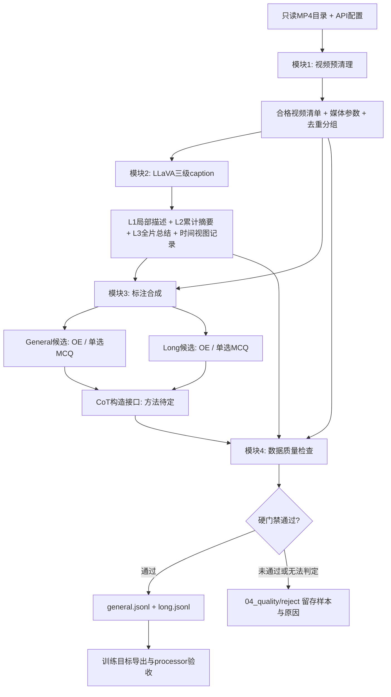

> 当前配置与v1流程以 [decisions.md](decisions.md) 为准；本文中的旧默认值、演示模型/数量或历史方案不覆盖最新用户决定。

# 纯视频 SFT 数据构造项目：四模块设计大纲

日期：2026-10-20。输入前提：自有 MP4 文件目录与可用的模型 API。目标：面向 GLM 视频 SFT，产出 General 通用数据与 Long 长视频专项数据。

**状态：设计稿（Proposed）。** 已有公开代码和论文依据经过核查；以下本项目目录、接口、模块与验收项尚未实现或运行。本文统一当前四模块架构；早期方案中“多选题”“额外训练顶层字段”等内容不再适用。CoT 必须作为构造目标被覆盖，但生成方式、阶段组织与监督策略继续调研，**不采用上一份评估中的候选路线作为已确定方案**。

**当前 v1 决定：移除 A4 视觉补标/增强，保留一次 A7 综合审核；模块 4 只产生通过或 reject，不补看、不修答案、不返工、不自动重生成。** 证据不足、无法判定同样拒绝。A10 已移除，CoT 方法仍待定。本文保留原编号方便对照，不为填补编号空缺增加调用。

**用户最新配置：Linux服务器运行，经新的私有GitHub仓库同步；中文/英文3:7，OE/MCQ7:3，MCQ内部三/四/六选一1:7:2，两分支都启用。** 配比先按最终通过记录条数的全局目标登记；General/Long之间未指定比例。MP4目录、派生目录、读取是否含子目录、真实API/凭据、预算及首轮范围待定，演示模型/10文件不作为已确认运行配置。

## 1. 项目范围与输出约束

| 项目 | 当前约束 |
|---|---|
| 任务输入 | MP4；不要求已有字幕、QA、caption 或人工答案 |
| 实际监督模态 | 纯视觉视频；MP4 含音轨也不消费音频，`modal_mask=4` |
| General 主干 | 借鉴 Academic2M 的证据化标注增强，`task.pipeline=academic2m_inspired` |
| Long 专项 | 借鉴 LV116K 的时序组织与跨段任务；v1不做额外片段补标，最终统一审核，`task.pipeline=lv116k_inspired` |
| 题型 | OE/MCQ=7:3；MCQ全部单选，内部三/四/六选一=1:7:2 |
| 统一存储 | 两分支共用一套 JSON，各输出 `general.jsonl`、`long.jsonl` |
| 最终字段 | 严格保留既定 12 个顶层字段，不增设 metadata 等兜底字段 |
| 外部存储 | caption、事件、证据、逐帧参数、模型调用、去重、划分、详细质量记录等全部外置 |
| CoT | 预留正式生成与核验子模块；具体方法待比较后冻结，不用空 CoT 冒充完成品 |
| 原片 | 只读引用；预清理以筛选清单为主，不覆盖、删除、转码原片 |

Academic2M/LV116K 是**方法参照**，不是本项目视频来源，也不是最终 JSON 的两套格式。只有 MP4 时，需自行合成候选问题与答案，并核验其语义锚点；不能把合成答案当成原学术数据集的人审标签。

现有字段定义见[最终 JSON 示例与字段表](video_sft_final_json_format_2026-10-20.md)。其中四阶段 CoT 与 `supervised=true` 是早期候选配置；本轮将其**生成方法和监督默认值恢复为待定**，不擅自改写原文件。其他 12 字段、OE/单选、3/4/6 选项约束沿用。

## 2. 总体数据链路与模块边界



模块 3 的产物是**待核验候选数据**；模块 4 才有正式发布权限。模块 1 做媒体与重复等低成本检查，模块 2/3 做各自结构自检；模块 4 统一审核后单向分流为通过或reject，不回流上游。原视频仍用于审核，只移除额外补标，不移除视觉质量检查。

| 模块 | 必需输入 | 主要输出 | 模型 API |
|---|---|---|---|
| 1. 视频预清理 | MP4 根目录、来源声明、筛选与 IO 配置 | 只读媒体清单、合格/拒绝清单、媒体参数、重复组、划分分组 | 不需要；当前不接语义分类/向量增强 API |
| 2. 三级 caption | 合格清单、实际 MP4、采样配置 | 官方原始响应、规范化 L1/L2/L3、真实时间映射、调用与完成状态 | L1 必需视觉 API；L2/L3 必需文本生成 API |
| 3. 标注合成 | 三级 caption、媒体清单、任务/语言/题型配方；CoT所需视图随选型确定 | General/Long 候选训练记录、caption派生事件账本、候选 CoT、外部合成记录 | A3/A5文本出题；不设A4补标；CoT接口必需、策略待定 |
| 4. 数据质量检查 | 候选记录、原视频、caption/证据/视图、质量与学生配置 | 通过的 12 字段 JSONL、审核/拒绝结果、质量与 token 摘要、发布报告 | v1 建议每题一次视觉综合审核，合并事实/答案/语义判断；格式/路径/token 等不需要生成 API |

### 2.1 用户需要提供的配置

完整的必填/可默认/后补清单与填写模板见[用户配置清单](video_sft_user_configuration_checklist_2026-10-20.md)。下表只保留架构级摘要。

“MP4 + API”可以作为**标注生产的最小外部资源**，但不能省略配置与目标读取器验证。

| 配置 | 内容 | 默认处理 |
|---|---|---|
| 媒体 | `video_root`、允许处理范围、真实来源名 | 无原始 ID 时分配稳定媒体 ID；未知来源不编造 |
| API | 接口协议、endpoint、模型名、密钥引用、上下文/图像限制、并发与预算 | 一个支持多帧视觉与文本的后端可承担多个角色；凭据只从环境/受控引用读取 |
| 构造配方 | 语言、任务配额、General/Long 路由、OE/MCQ 配比、3/4/6 比例 | 用配置化保守初值小试，当前不虚构精确比例或通用时长阈值 |
| 输出 | 外部数据根、相对媒体路径规则、run ID、上游技术重试上限 | 数据根与代码目录分离；模块4无质量失败重试/返工 |
| 学生训练 | 实际 tokenizer/processor、chat template、视频采样、上下文上限、CoT 监督配置 | 可在标注后补齐；缺少它只能产候选标注/估算，不能宣称真实训练兼容与精确 token 已验证 |

API 支持 OpenAI 风格协议不等于一定支持所需图像数量、顺序时间提示或严格 JSON 输出；实施时先做小样本能力探测，不写死原脚本的 GPT-4o 名称。

## 3. 模块 1：视频数据预先清理

### 3.1 输入与输出合同

**输入：** MP4 清单或明确授权扫描的目录；来源信息；探测/解码预算；媒体质量与去重配置。

| 输出文件（外部数据根下的建议名） | 一条记录代表什么 | 关键内容 |
|---|---|---|
| `01_prepare/media_manifest.jsonl` | 一个原视频 | `video_id`、只读原路径、发布相对路径、来源/原始 ID、时长、宽高、解码信息、内容身份、处理状态 |
| `01_prepare/eligible_videos.jsonl` | 允许进入 caption 的视频 | `video_id`、manifest 引用、允许窗口/路由提示 |
| `01_prepare/media_checks.jsonl` | 一次媒体检查 | 模糊/黑帧/冻结/损坏等结果、检查视图与失败原因 |
| `01_prepare/groups.jsonl` | 一组同源/近重复视频及划分关系 | 精确重复、近重复、原视频家族、split；防止同源片段跨训练/评测 |
| `01_prepare/reject.jsonl` | 未进入下一阶段的对象 | 拒绝原因，不物理删除原片 |

这些是内部接口，**不是最终训练 JSON**。所有模型、质量与帧级记录都通过媒体 ID 追溯，后续再通过 sample ID 关联。

### 3.2 处理步骤

1. **导入与身份分配：** 清单限定 IO 范围；稳定 ID 不依赖 basename，防止不同目录同名 MP4 冲突。建立原路径到发布相对路径的映射。
2. **媒体探测：** 使用 ffprobe 读取时长、尺寸、时间基准等；有限窗口解码检查可读性。探测成功不等于整片无损坏，二者分别记录。
3. **质量筛选：** 在受控采样上检查模糊、黑帧、静止/冻结、极低分辨率与可用内容。低运动不自动等于无价值：讲解板书等需按任务判断。
4. **重复与划分：** 对允许清单做有界精确哈希；采样帧感知哈希筛近重复。当前不使用语义向量 API。先形成同源/近重复组，再按组划分；模块 4 继续处理 QA 文本重复。
5. **初步路由：** 保存时长、场景复杂度与可用窗口，供模块 3 决定 General/Long。时长只是条件之一，不能把长视频中的局部属性题都算 Long 专项。

**代码来源：** [FFmpeg/ffprobe 官方工具](https://ffmpeg.org/ffprobe.html) 负责媒体探测/解码；模糊、感知哈希、筛选清单、ID/路径与分组逻辑由本项目实现。场景候选使用 [PySceneDetect 官方 API](https://www.scenedetect.com/docs/latest/api.html)，主要服务 Long 分段，可在本模块预计算，供模块 3 复用。镜头切换边界不等于事件边界。

**API：** 预清理不调用大模型；按本轮要求移除原 A10，不建设语义分类/embedding API 分支。仍保留本地哈希、感知哈希、文本近重复与分布统计，不能把移除 A10 理解为取消去重或多样性检查。

**完成条件：** 下游清单每条可定位原视频、来源/ID 不冲突、媒体可读性状态明确、重复与划分可追溯。不能用已筛清单宣称原片已被“修复”。

## 4. 模块 2：LLaVA-Video 三级 caption 管道

### 4.1 可复用的官方入口

固定来源 revision：`6d8c562dc26d70042a0d9704d1cae58c94b89098`。

- [GPT4o_description_prompt.py](https://huggingface.co/datasets/lmms-lab/LLaVA-Video-178K/blob/6d8c562dc26d70042a0d9704d1cae58c94b89098/gpt4o_caption_prompt/GPT4o_description_prompt.py)：MP4 取帧、局部描述与递推汇总。
- [caption README](https://huggingface.co/datasets/lmms-lab/LLaVA-Video-178K/blob/6d8c562dc26d70042a0d9704d1cae58c94b89098/gpt4o_caption_prompt/README.md)、[meta.json](https://huggingface.co/datasets/lmms-lab/LLaVA-Video-178K/blob/6d8c562dc26d70042a0d9704d1cae58c94b89098/gpt4o_caption_prompt/meta.json)：官方输入、输出与运行说明。

代码已定位且此前做过静态审计；**不能直接把它描述为已适配任意 API、传入一个目录就能可靠完成的本项目程序**。本轮浏览 HF 页面失败，路径/逻辑采用此前已核对版本与本地审计记录，不据读取失败判断代码缺失。

### 4.2 输入、生成逻辑与输出

**输入：** 模块 1 合格清单 + 原 MP4 + 采样/分辨率/API 配置。桥接器生成官方 `meta.json` 所需的路径字符串数组；不要求已有标签。

| 层级 | 实际逻辑 | API 输入 | 输出 |
|---|---|---|---|
| L1 | 原版约 1 FPS、每 10 个采样帧一组，带部分历史描述 | 视觉帧、顺序/时间提示、局部历史 | `clip_description` 局部描述列表 |
| L2 | 每约 30 个采样帧进行前缀累计汇总 | 已有描述/摘要文本 | `summary_description` 中途累计摘要列表 |
| L3 | 最终汇总作为全片描述，与最后一次汇总复用 | 全片已有描述/累计信息文本 | `video_description` 全片总结 |

原版“10 秒/30 秒”来自近似帧计数，不是可靠 PTS。适配时按真实时间取帧并记录映射；若改窗口大小、摘要方式或提示，应记录为项目版本，不能称与原版行为完全一致。

**重要边界：** L2 不是互不相交的每 30 秒摘要。原脚本把最后一次汇总移作 L3，所以短视频可以没有中途 L2；例如约 30 帧可能得到 3 个 L1、空 L2、1 个 L3。不要为了“三层”向短视频强填重复摘要；若后续决定强制非空，须明确另设合成策略。

| 输出 | 含义 |
|---|---|
| `02_caption/raw/<video_id>.json` | 不改写官方原始成功/部分输出；保留实际响应与完成状态 |
| `02_caption/captions.jsonl` | 项目规范化视图：`video_id`、L1/L2/L3、父依赖版本、complete/partial/failed |
| `02_caption/frame_views.jsonl` | 实际采样帧的时间、尺寸、窗口、请求引用；区分窗口范围与实际事件发生时间 |
| `audit/api_calls.jsonl` | 请求身份、模型/提示版本、调用状态与费用计数；排除凭据 |

建议规范化一条记录的示意形状如下（内部接口，非最终训练记录）：

```json
{
  "video_id": "video_001",
  "status": "complete",
  "l1": [{"window_start_sec": 0.0, "window_end_sec": 10.0, "text": "局部描述", "view_id": "view_001"}],
  "l2": [],
  "l3": "全片总结",
  "raw_ref": "02_caption/raw/video_001.json",
  "view_manifest_ref": "02_caption/frame_views.jsonl"
}
```

这是虚构的结构说明，省略了依赖/版本等实际接口字段；窗口数字不是自动获得的动作精确边界。

### 4.3 适配范围与完成条件

必做改造：目录清单桥接、统一 API 客户端、修复未定义变量及恢复字段拼写、移除解析失败后的交互式 pdb、结构化解析、稳定 ID、PTS 取帧、有界解码/内存、有限重试、断点恢复、无覆盖 staging 与发布。详见[已核代码审计](llava_video_videochat3_pipeline_code_search_2026-10-20.md)。

**API：** L1 是必需视觉调用；L2/L3 是文本生成调用，可使用同一视觉后端的文本模式，不要求第二套模型。三级 caption 每视频生成后复用，不按每一道 QA 重新跑。

**完成条件：** 每视频完成状态可判断，L1 覆盖与真实视图可追溯，L3 存在且非空；允许符合原实现的空 L2。此时“结构完成”不等于事实已通过模块 4 审核。

## 5. 模块 3：根据三级 caption 产出候选数据

### 5.1 共同输入输出

**输入：** L1/L2/L3、媒体/时间清单、任务配方、语言与题型配额；按需读取原视频。三级 caption 是生成底座，**不把仅凭 L3 作答当作全管道**。

| 输出 | 内容 |
|---|---|
| `03_synthesis/general_candidates.jsonl` | General 分支候选，按最终 12 字段结构组装；待核验/待计数部分有明确状态 |
| `03_synthesis/long_candidates.jsonl` | Long 分支候选，同一外层结构 |
| `03_synthesis/evidence.jsonl` | `sample_id`、问题所需事实、实际视图/片段引用、支持状态 |
| `03_synthesis/events.jsonl` | 有序事件、实体关联、窗口及不确定性；不混入训练 JSON |
| `03_synthesis/generation.jsonl` | 生成方法、父 caption、候选 seed、提示/模型版本、失败原因 |
| `03_synthesis/cot_generation.jsonl` | CoT 原始产物、方法标识、答案可见性与观察依据；方法待定 |

CoT 策略未落地时可以先产 **QA 中间候选**，但不将空 CoT 的记录称为本项目完整训练成品。候选结果与发布目录隔离。

### 5.2 General：Academic2M-inspired

```text
三级caption → 任务路由 → LLaVA式种子问题/答案
→ 基于已有caption组织证据表达/标准化
→ OE或固定选项的单选MCQ → CoT接口 → 模块4通过或reject
```

1. 从有证据的实体、动作、时序与关系选择任务，不要求每视频生成所有类别。
2. 复用 LLaVA 的任务定义/few-shot 和生成提示骨架，生成种子问答。官方 QA 脚本以 caption 文本为输入，需桥接而非直接传 MP4。
3. 本项目只有模型合成的 seed，直接交由模块 4 的视觉综合审核检查，不设置A4补标、独立盲答或失败分歧处理分支。是否给后续 CoT 教师看 seed 仍待定；记录候选身份，不称人工 GT。
4. 借鉴 Academic2M 的证据化表达原则，仅使用已有caption中能够引用的事实，不设单独视觉增强请求。其原方法使用已有学术标签，本项目不能原样继承其标签可靠性；真实支持性最终由模块4判断。
5. 按当前合同导出：OE 为自然语言结论；MCQ 的 `gpt.value` 为单字母，证据解释进入选定的 CoT 结构。该表达方式是本项目适配，不等于逐字复制 Academic2M 的长答案格式。

**代码复用：** [gen_sft_data.py（OE）](https://huggingface.co/datasets/lmms-lab/LLaVA-Video-178K/blob/6d8c562dc26d70042a0d9704d1cae58c94b89098/gpt4o_qa_prompt/gen_sft_data.py)、[gen_sft_data_mc.py（MCQ）](https://huggingface.co/datasets/lmms-lab/LLaVA-Video-178K/blob/6d8c562dc26d70042a0d9704d1cae58c94b89098/gpt4o_qa_prompt/gen_sft_data_mc.py) 与对应 demonstration pools。官方 QA 输入通常是 `video_id → caption字符串`，需把三级结果映射/序列化；加入 L1 时间结构是项目扩展。

**自建：** 任务路由、3/4/6 选项配方、已有caption的证据表达、统一视觉审核与JSON组装；不实现A4。不能假定原 MCQ 脚本已支持本项目全部选项数和单选门禁。

### 5.3 Long：LV116K-inspired

```text
三级caption + 原有时间视图 → 整理有序片段/候选事件账本
→ 全局/跨段任务 → OE或单选MCQ → CoT接口 → 模块4通过或reject
```

L1 以固定近似窗口描述，与语义/镜头边界可能错位。v1只使用已经产生的caption，不另做片段补标；事件账本是候选事实组织，不自动视为已核验。细节缺失、身份不连续或不能支持任务的候选在模块4直接reject。

Long 特有处理：

- 按已有L1窗口、真实采样时间和必要的本地场景候选组织片段，不新增视觉描述请求。
- 整理已有caption中的顺序、实体与不确定性；保留证据引用，缺失信息不补写。
- 构造跨段比较、时间线、全局摘要、重复事件聚合与片段检索。
- 检查单帧/孤立片段/文本先验是否就能解题；跨段 QA 必须实际需要联合证据。
- 事件检索只标出经证据支持的窗口；没有更密采样和边界审核时，不发布伪精确动作起止时间。全局计数/首次/末次需要充分覆盖，少数正例不足以证明全局量词。

**代码来源：** 三级caption复用模块2；本地镜头候选可来自PySceneDetect；账本、长任务生成与筛选参考[VideoChat3论文§3.3](https://arxiv.org/html/2607.14935v2)自建。v1省略其额外片段补标/修订过程，不称完整复现；生产合成脚本在已查官方范围仍未定位。

### 5.4 任务覆盖

以下沿用当前暂定任务全集，生产配额另写配置。General 也可使用长视频中可答的局部窗口；不是按完整文件时长硬分两类。

| 一级任务 | 二级任务 | 主要分支与表达 |
|---|---|---|
| `visual_perception` | `scene_description`、`entity_attribute`、`spatial_relation`、`visible_text` | General；描述通常 OE，其余按可答性选择 OE/MCQ |
| `action_understanding` | `action_description`、`fine_grained_motion`、`action_count` | General；快速动作/计数需足够帧覆盖 |
| `temporal_understanding` | `event_order`、`state_change`、`temporal_comparison` | General，必要时 Long；窗口与顺序明确 |
| `evidence_reasoning` | `observable_causality`、`multi_fact_composition` | General/Long；仅先后发生不能直接推出因果 |
| `long_video_understanding` | `cross_segment_qa`、`event_timeline`、`hierarchical_summary`、`recurring_event_aggregation` | Long；时间线/摘要用 OE，或设计唯一正确的 MCQ |
| `temporal_retrieval` | `segment_retrieval` | Long；OE 描述支持窗口，或单选对应窗口 |

不新增 agentic、structured 或多选题型。内部工具调用可以是生成手段，不要求最终学生训练数据出现工具角色。

## 6. 模块 4：数据质量检查与最终发布

### 6.1 输入与输出

**输入：** 候选训练记录、原 MP4、三级 caption、证据/事件/调用/视图记录、质量配方及学生 processor 配置。

| 输出 | 用途 |
|---|---|
| `04_quality/verification.jsonl` | 每题格式、视觉、答案、推导、题型等逐项审核 |
| `04_quality/caption_verification.jsonl` | caption级错误及受影响样本；用于拒绝关联候选，不自动修复 |
| `04_quality/reject/samples.jsonl` | 未通过的候选；结构可用时保留12字段并标quality.verify=reject |
| `04_quality/reject/reasons.jsonl` | sample_id、失败项、原因、证据和错误类型，训练JSON外置 |
| `04_quality/reject/invalid_records.jsonl` | 无法满足schema/解析要求的原始记录，不伪造字段填充成合格样本 |
| `04_quality/diversity_dedup.jsonl` | 文本重复、语义重复、覆盖与配额筛选 |
| `04_quality/student_views_tokens.jsonl` | 学生实际取帧、模板/监督、计数来源与结果 |
| `release/<version>/general.jsonl`、`long.jsonl` | 只含放行的 12 字段记录 |
| `release/<version>/release_manifest.json`、`quality_report.md` | 外部发布版本、摘要校验、规模、漏斗与局限 |

### 6.2 检查顺序与硬门禁

| 检查 | 实施方式 | API | 不通过时 |
|---|---|---|---|
| 结构/路径/窗口 | 12字段schema、唯一ID、媒体路径、窗口范围、占位符 | 无 | reject |
| 文本清洗与残留 | 生成后、送审前可做确定性格式清洗，保护video/CoT标签；送审记录仍有违规则不改写重试 | 无 | reject |
| Caption事实与覆盖 | 在既定审核视图中检查题目依赖的描述；记录共同错误影响 | 并入一次视觉综合审核 | reject当前题及受同一已知错误影响的候选，不修caption |
| 问答匹配/可答性 | 判断问题、证据和答案是否对应；排除音频依赖、不可见信息 | 并入一次视觉综合审核 | reject |
| MCQ单选 | 3/4/6、标签连续、顺序一致、唯一正确、干扰项排歧 | 本地规则 + 综合视觉审核 | reject，不改key/选项重答 |
| OE语义正确 | 按事实点、对象和时序判断，不要求与seed逐字相同 | 并入一次视觉综合审核 | reject |
| Long专项 | 核验所需跨段事实、顺序、窗口与任务必要性 | 并入一次视觉综合审核 | reject，不降级改写成General |
| CoT | 按选定方法检查事实支持、推导充分性及结论一致 | 规则 + 综合视觉审核 | reject；方法未实现时QA只留中间候选，不启动完整版发布 |
| 去重/多样性 | 本地文本近重复、感知哈希/同源组、已有标签/语言/时长分布；不接向量API | 无 | 按保留规则reject重复/不符合冻结配额的候选，并区分原因；不宣称全语义去重 |
| 学生可学性 | 用冻结训练采样与模板检查证据、监督、token/截断 | 本地processor，证据检查可并入A7 | reject，不为失败题重新选帧/缩写/返工 |

表中事实、答案、CoT、语义等审核项是同一次A7综合审核的分项，不要求分别请求。审核前按冻结策略准备必要视频视图；任何适用必需项未通过、证据超出上下文或无法判定，都直接进入reject，不追加补看、第二教师或失败后重生成。

同一API可以承担生成与核验，但两者可能共错。审核使用新上下文，仍可见候选答案与CoT，所以不称独立盲答；自动通过率不等于真实正确率。质量统计抽审只用于校准与报告，不是失败样本的救回通道。

### 6.3 发布约束

- v1审核输出只使用`auto_pass`或`reject`，正式JSONL只收auto_pass。现有格式词表里的human_pass/needs_review保留兼容但本版不用；pending仅表示尚未审核，不是审核后的第三种归宿。
- `quality.score` 仅是校准后的排序摘要；尚未定义可靠评分时允许 null，不用高分抵消硬门禁失败。真实正确率来自抽审统计。
- `cot` 内容和监督配置在方法冻结后完成；MCQ 的 conclusion、gpt.value、correct_option_id 一致，OE 两处结论一致。
- `tokens` 至少如实区分 estimated/measured；只有真实学生预处理才叫 measured。无法估算时停留 pending 候选，不能填看似精确的常数。
- 发布前先写新staging、验证再发布到新版本；不覆盖原片或既有正式版本。reject仅保存候选/原因并引用原片，不移动或删除MP4；同一run不会自动再次处理它。

## 7. 模型 API 接入总表

这是**职责数**，不等于独立服务/权重数，也不等于每样本固定请求次数。

| API 角色 | 所属模块 | 输入 → 输出 | 必需程度 |
|---|---|---|---|
| A1 视觉局部描述 | 2 | 有序帧/窗口 + 历史 → L1 | 必需 |
| A2 文本汇总 | 2 | L1/已有摘要 → 累计 L2、最终 L3 | 必需；同一后端可用 |
| A3 通用出题 | 3，General 分支 | caption/事实 + 任务配方 → Q、候选答案、可选3/4/6选项、依据引用 | General 必需文本能力；不负责读原视频 |
| A5 长视频出题 | 3，Long 分支 | 有序多段事件/描述 + 长任务配方 → 跨段/全局Q、候选答案、支持片段、可选选项 | Long 必需文本能力；与A3是分支关系，不默认串行重复出题 |
| A6 CoT 构造 | 3 | 证据与 Q/O，是否含 seed 待定 → 推导与结论 | 最终构造必需，调用形态待定 |
| A7 视觉综合审核（合并原A7/A8/A9的可合并职责） | 4 | 视频证据 + Q/选项/答案/CoT → 分项判定 + pass/reject | 每题最多一次模型审核；本地硬检查先失败可直接reject；未通过不补看或返工 |

统一API层提供视觉/文本请求、结构校验、限流/预算、缓存与错误隔离。上游生成可配置网络/限流等技术重试；模块4按本版每题最多一次审核，超时、API错误、无合法结果也进入reject并记`audit_error`等技术原因，不伪称内容错误。质量未通过不触发重试。密钥与签名URL不入持久日志。

模块2原版在非空、无重试路径中，对N个采样帧约需`ceil(N/10)`次视觉描述、`ceil(N/30)`次文本汇总；最终L3复用最后一次汇总，不额外加一次。费用按实际帧/长度/计费统计；出题、CoT及一次审核另计，v1不再预留A4或审核失败补看的预算。

### 7.1 A3、A5两条出题分支，A4移除

**A3根据已有描述出通用题；A5根据已有多段事件出长视频题。v1不再设置A4，也不在出题后增加别名相同的视觉补标调用。**

| 角色 | 输入 | 任务 | 输出 |
|---|---|---|---|
| A3 | 时间化L1、必要L2/L3；任务、语言、OE/MCQ与选项数 | 从描述中选择有依据的事实出通用题 | Q、候选答案、选项（若有）、任务/语言、证据引用 |
| A5 | 按时间排列的已有描述/候选事件；Long任务配方 | 组合多段/全局事实，出跨段比较、时间线、聚合等题 | Q、候选答案、支持片段、任务；MCQ另有选项 |

两者生成的答案均为候选，事实支持由A7统一看原视频审核。caption含糊时不强行出精细问题；若仍形成错误/证据不足候选，模块4直接reject。

例如，A3根据“倒水后搅拌”出动作顺序题；A5根据“开头喷壶、结尾水瓶”出跨段比较题。若视频中并非如此，reject该题，不回头补标修正。

```text
General：三级caption → A3通用出题 → A6（CoT待定） → A7综合审核 → 通过 / reject
Long：   三级caption → 整理已有事件 → A5长视频出题 → A6（CoT待定） → A7综合审核 → 通过 / reject
```

账本可由本地代码整理既有事件；文本结构化可并入A5输入处理，不额外调用视觉教师补事实。A3以LLaVA官方OE/MCQ脚本和示例池为基础，A5参考LV116K方法自建，两者可共用生成器代码与API。

### 7.2 A7/A8/A9 能否只调用一次

**能合并为一次“看视频审核已有候选”的调用。v1建议采用它以控制请求数；但它不能同时保留原A7的独立盲答设计。**

原三项职责里，A8的视觉事实/推导审核与A9的语义一致性判断可以自然合并：同一视觉模型既看得到帧，也能读题、选项、答案和CoT。原A7则刻意不让模型看到候选答案与CoT；合并后这些内容已经在输入中，仅要求“先独立思考，再检查答案”不能让它真的没见过答案。因此合并版去掉“盲答”名义，改为候选审核。

**一次综合审核输入：** 原视频相关视图/全局覆盖、时间信息、完整Q与选项、候选答案、最终选定格式的CoT，以及逐项审核规则。只提供题目所需caption/事件作定位辅助，不能用它们替代原视频。

**一次返回的检查项：**

1. 问题是否能由当前视觉证据回答、是否问答匹配。
2. 候选答案是否正确，MCQ是否恰好一个正确选项。
3. 引用的视觉事实是否真实，推导是否受这些事实支持。
4. 答案、选项语义与CoT结论是否一致；不强制与未核实seed一致。
5. Long任务是否具备所需多段/全局证据，还是仅凭局部/常识可答。
6. 给出pass或reject及具体原因；不足、矛盾、无法判定均reject，不输出复查队列。

建议外部审核结果形状如下（虚构示例，不增加训练JSON字段；CoT尚未生成时不得填supported）：

```json
{
  "sample_id": "sample_001",
  "audit_mode": "candidate_aware_visual_review",
  "checks": {
    "question_answerable": "supported",
    "answer_correct": "supported",
    "visual_facts": "supported",
    "reasoning_supported": "supported",
    "conclusion_consistent": "supported",
    "single_correct_option": "supported",
    "long_evidence_requirement": "not_applicable"
  },
  "verdict": "pass",
  "issues": []
}
```

分项状态使用`supported/contradicted/insufficient/not_applicable`；不适用仅用于该题确无对应要求的项。所有适用必需项均supported且本地检查通过才放行；contradicted、insufficient、缺项、非法输出均reject。程序的判定优先于模型总状态，不能让pass掩盖分项失败。

pass映射到`quality.verify=auto_pass`；reject候选进入`04_quality/reject/`，保存原候选、sample_id及分项原因。无法解析的候选单独保存原始记录，不强行补齐字段。未提交审核的QA中间候选可为pending；一旦提交完整版审核却缺CoT/必要媒体，则reject。

**调用次数边界：** 每题最多一次综合模型审核，本地硬检查先失败可直接reject且不消耗该调用。证据放不进上下文、全局覆盖不足或接口异常也reject；不追加补看、复核、独立盲答或修复生成。不为了满足一次调用而截断关键证据后假报通过。接口异常与内容错误分开记原因，统计质量错误率时不得混算。

发现caption共性错误时，通过依赖记录拒绝受影响候选，而不是自动重跑上游。本轮不建立人工救回/第二教师复活队列。预期简化编排与追加成本，但可能降低样本保留率；实测只报告通过率、reject原因分布、抽审正确性与每合格样本成本，不以数量弥补质量。

### 7.3 本轮明确取消的 API

取消原 A10 语义域分类/embedding增强分支，删除其API配置与调用配额。当前去重采用本地精确/感知哈希和文本近重复；多样性依据已有task、时长、语言及caption/出题阶段已有标签统计，不另发分类请求。本版不把这些措施宣称为全语义去重。

## 8. 代码来源、复用深度与自建边界

| 组件 | 来源与固定入口 | 本项目动作 | 证据状态 |
|---|---|---|---|
| 媒体探测 | FFmpeg/ffprobe 官方工具 | 包装清单与检查规则 | 工具公开；包装待实现 |
| 场景候选 | PySceneDetect 官方 API | 与时长/事件约束组合 | 工具公开；非 LV116K 官方生产实现 |
| 三级 caption | 上述 LLaVA HF revision 下的 `gpt4o_caption_prompt/` | 复用控制思路/提示并修复适配 | 文件已定位、静态核过；本项目未跑 |
| OE/MCQ 候选 | 同 revision 的 `gpt4o_qa_prompt/` 两脚本及示例池 | 桥接三级结果，改题型/语言/输出接口 | 文件已定位；不自带全部本项目质量门禁 |
| Academic2M 增强 | [论文 §3.2](https://arxiv.org/html/2607.14935v2)、[成品标注](https://huggingface.co/datasets/MCG-NJU/VideoChat3-Academic2M/tree/fb79513cbbbaf402d321926ce9227f066d774746) | 仅参考证据表达与一致性原则，v1不加独立视觉增强请求 | 生产合成代码仍未定位；v1是简化适配 |
| LV116K 合成 | [论文 §3.3](https://arxiv.org/html/2607.14935v2)、[成品标注](https://huggingface.co/datasets/MCG-NJU/VideoChat3-LV116k/tree/e32b78d3eb5ac5d1bf28b55a2ba295e99432be62) | 基于已有caption自建账本/组合/审核，省略额外补标 | 生产合成代码仍未定位；不称完整复现 |
| VideoChat3 loader | [官方 `vlm_jsonl.py`](https://github.com/MCG-NJU/VideoChat3/blob/015f52eb2ea70b5abda30192aee18034f2c5f13b/xtuner-videochat3/xtuner/v1/datasets/vlm_jsonl.py) | 参考成品消费方式 | 训练读取器，不能替代标注合成器，也不是 GLM 格式适配证明 |
| CoT | 第 12 节四个候选项目 | 先比较公开方法/数据与可复用代码，再选择 | 方法待决，不预先承诺某项目端到端生成脚本齐全 |
| 质量/发布/学生适配 | 项目接口与真实训练框架 | 自建及本地/目标运行验证 | 待实现 |

VideoChat3 代码判断依据是已完成的[扩大检索与入口审计](llava_video_videochat3_pipeline_code_search_2026-10-20.md)；这里复用其结论，不声称本轮重新遍历所有历史仓库。Academic2M 论文的增强与一致性 judge 使用 Qwen3-VL-235B-A22B；本项目将教师做成 API 配置，不要求同款权重。[方法依据](https://arxiv.org/html/2607.14935v2)

## 9. 最终 12 字段覆盖表

下面逐项定位产出者与发布检查者，保证所有要求都有负责模块。外部记录可拥有更多内部字段，最终训练 JSON 只有这 12 项。

| # | 顶层字段及需覆盖内容 | 主要产出位置 | 发布检查 |
|---:|---|---|---|
| 1 | `id`：全局唯一 sample ID | 3；引用模块 1 的稳定 video ID，加任务/候选身份 | 4 查重与外部关联完整性 |
| 2 | `source.dataset/original_id` | 1 导入，3 继承真实来源 | 4 不把生成方法误填来源 |
| 3 | `conversations[].from/value`：human/gpt、完整问题/选项与最终答案 | 3 | 4 题答匹配、视频占位符、CoT 结论一致；导出真实监督 |
| 4 | `task.pipeline/family/name/benchmark_refs` | 3 任务路由 | 4 校验第 5.4 节任务；benchmark_refs 只作能力参照，不借用评测真题 |
| 5 | `question_type.type/num_options/options/correct_option_id` | 3 | 4 仅 OE/MCQ；OE 固定 0/[]/null，MCQ 仅 3/4/6 且唯一正确 |
| 6 | `media_info`：原片时长、样本窗口、caption 抽帧数与尺寸、audio_duration_sec | 1 时长尺寸；2 实际 caption 视图；3 窗口 | 4 区分原片与教师/学生视图；不同帧数/尺寸不编造；纯视觉音频时长 null |
| 7 | `media.videos/audios/images` | 1 建映射，3 引用 | 4 恰好一个 MP4 相对路径，audios/images=[]；教师帧不另算图片样本 |
| 8 | `modal_mask` | 3 固定为 4 | 4 验证实际消费为纯视觉，不因音轨存在改成 6 |
| 9 | `quality.score/verify` | 4 | v1正式仅auto_pass；失败记reject并外置；score可null或校准后0–100 |
| 10 | `cot`：公开推导标注、最终结论及监督配置 | 3 生成接口；方法/内部组织待定 | 4 视觉事实、推导、结论与训练监督；未完成不放行完整版 |
| 11 | `language.question/answer` | 3 生成/识别 | 4 主语言与题干一致；MCQ 字母答案沿用问题语言 |
| 12 | `tokens.status/video/audio/image/text_input/text_output/supervised/total` | 4 学生适配器 | 估算与实测区分，音频/独立图片为0；按真实监督计算，避免重复计数 |

`caption_sampling.num_frames`统计该样本范围用于底座caption的不同帧，重复请求同帧不重复计数；统一宽高未知/不统一时填null，逐帧尺寸外置。审核视图与学生视图单独记录，不混入此摘要；v1不做QA补看。

`media_info.video_start_sec/end_sec` 只有在目标读取器实际执行窗口裁取时才代表学生输入范围；若读取器只接受全片，应改用全片记录或实现窗口适配后再发布，不能只写时间字段却给学生整段无关输入。

### 9.1 必须外置的内容

三级 caption、额外描述/事件账本、实际帧时间与分辨率、证据位置、详细质量结果、原始模型输出、候选 seed、CoT 生成模式、代码/模型/提示版本、调用费用、去重家族、split、配额、错误与重试都放外部数据根。

外部样本记录以 `sample_id = id` 关联；视频级记录以稳定 `video_id` 关联；用外部 `sample_index.jsonl` 连接两者。训练 JSON 不添加 video_id、split、schema_version 等新顶层字段。额外 caption 若另做描述训练样本，作为 OE 新记录独立审核，不复制为额外顶层字段。

## 10. 建议工程结构与复跑规则

以下路径均为**待创建的工程建议**，不表示当前已有实现。

```text
projects/video-sft-builder/               # 代码仓库内
  configs/                              # 配方与API角色映射，不含凭据
  src/
    prepare/                            # 模块1
    caption/                            # 模块2
    synthesis/general/                  # 模块3通用
    synthesis/long/                     # 模块3长视频
    synthesis/cot/                      # 模块3待决策略接口
    quality/                            # 模块4
    adapters/                           # API、媒体视图、训练目标
    contracts/                          # 内部/最终schema
  prompts/                              # 可追溯提示版本
  scripts/                              # 模块/全流程入口
  tests/                                # 关键合同、恢复、标签/媒体一致性

<external_data_root>/<run_id>/            # 数据区，不入Git
  01_prepare/
  02_caption/
  03_synthesis/
  04_quality/
  audit/
  sample_index.jsonl
  release/<version>/
```

统一调度层负责 run/sample 状态、请求缓存、预算、重试与发布，不另算第五业务模块。缓存身份包括媒体/实际视图、提示与模型版本、父产物版本；修改 L1 后不能继续使用依赖旧 L1 的 L2/L3/QA。

建议计算状态为`pending → running → completed/partial/failed`；v1审核终态仅`auto_pass/reject`，审核前可pending。审核失败不在同一run自动变更输入、修正或重新审核；上游生成的技术恢复状态与质量reject分开统计。

代码与配置按项目 Git 规则管理；大数据、媒体、原始响应、缓存与完整日志不提交。正式服务端运行前需要完成代码审核、版本提交与既定同步流程；本文仅写设计，不启动服务端任务。

## 11. 分期实施、难度与验收

| 阶段 | 工作 | 难度 | 验收重点 |
|---|---|---|---|
| P0 接口冻结 | 12 字段合同、内部 ID/时间/路径、API 角色与配置 | 中 | 模块间不靠文件名猜关联；明确 pending 与成品 |
| P1 预清理 + caption 小试 | 模块1、官方脚本修复/封装、少量不同长度视频 | 中 | 短片空 L2、同名文件、VFR/损坏、API失败恢复、真实时间与账单 |
| P2 General | LLaVA种子 + 已有caption证据表达 + 统一审核 | 中高 | OE/单选3/4/6、可答性、错误seed直接reject |
| P3 Long | 既有片段/账本/跨段任务，无额外补标 | 高 | 覆盖与身份连续、尾部/重复事件、跨段必要性与上下文成本 |
| P4 CoT 选择并接入 | 比较第12节路线，再冻结接口/监督 | 中高至高 | 不能只比较文风和长度；检查事实与最终正确性 |
| P5 发布闭环 | 模块4、学生适配、质量抽审与新版本发布 | 高 | 真正可训练、无错误放行/截断、覆盖分组与成本产出 |

每期先用有代表性的少量视频闭环，记录输入数、通过率、失败分布、正确性抽审、每合格样本成本；再决定扩量。模糊阈值、Long 时长门槛、题量、题型比例和质量分权重均需小试校准，不把论文参数当通用默认值。

| 关键决策 | 当前建议与依据 | 替代/迁移边界 | 会改变建议的证据 |
|---|---|---|---|
| 保留三级 caption 底座 | 官方代码可复用，符合用户路线 | v1只用既有caption，不救回失败题 | 漏关键事实导致过高reject时先报告，再另议新版本采样，不在本run补标 |
| General/Long 共用 schema | 用户既定合同，差别在任务和证据范围 | 不是两套互不兼容训练格式 | 目标学生读取器无法表达窗口时需适配 |
| 模块4保留原视频核验 | 文本生成可能继承 caption 错误 | 文本judge便宜但不能验证实际动作 | 核验无效时改采样/后端，不把结构通过当真值 |
| CoT策略留接口不冻结 | 用户本轮要求，视频项目存在不同路线 | 四阶段、文本初稿+视频修订、观察轨迹均候选 | 同题质量/成本对照及学生监督验收后再定 |
| 移除A4，未通过统一reject | 用户明确决定；当前v1范围 | 不自动补看/修复/重生成，原片仍供A7审核 | 保留率/错误分布若不满足目标，只报告并另议后续版本，不自动恢复A4 |

## 12. CoT：相近高质量项目的初步筛选，暂不定案

本节是**方法初筛**，不声称已完整审计这些项目所有生产代码。选入理由为输入/构造机制接近且有一手资料：Alibaba 的公开项目，以及公开数据与训练代码的顶会项目。**不把顶会接收等同于获奖，也未验证下载量足以满足最早调研的“获奖且高下载量”门槛。** 本轮不依据未核实的热度或奖项替你定路线。

文献里的视觉修订/回查是原项目机制，仍可用于CoT选型研究；不代表当前v1已启用A4或质量失败返工。任何会新增这种行为的未来CoT方案须单独明确，不能借选型重新引入已移除步骤。

| 项目与依据 | 构造方式（已文献记载） | 与本项目的贴合点 | 迁移局限与代码状态 |
|---|---|---|---|
| [LLaVA-CoT-100k](https://arxiv.org/html/2411.10440v2)、[固定生成代码](https://github.com/PKU-YuanGroup/LLaVA-CoT/blob/081cc3fe3670fbff7b30fa22cbcafe031a2077bc/dataset_generation/generate.py) | 给图像、Q和已有答案，生成四阶段；过滤结论不一致 | 可复用明确的生成入口、解析和监督结构 | 图像且有答案；本项目无人工锚点。不是答案盲推导的直接依据 |
| [Video-R1](https://github.com/tulerfeng/Video-R1)（官方仓库标记 NeurIPS 2025） | 用 Qwen2.5-VL-72B 为已有图像/视频题集生成推导，规则过滤，形成冷启动 CoT 数据 | 视觉教师直接生成，可作简单基线 | 图像视频混合、已有题集；仓库/成品公开不等于本轮已核验标注脚本与答案可见性 |
| [VideoRFT §2.2](https://arxiv.org/html/2505.12434v1)、[官方代码](https://github.com/QiWang98/VideoRFT)（NeurIPS 2025） | 结构化视频文本表示→推理模型初稿→视觉模型对照视频修订→参考答案筛选 | **很贴近“已有caption底座，再补视觉回查”**；可分离文本推导与视觉纠错 | 表示包含帧级结构信息，三级caption需补时间/实体；末端依赖参考标签，MP4-only需自建可信核验。生产合成代码完整性待审 |
| [Alibaba ReWatch-R1 §2](https://arxiv.org/html/2509.23652v1)、[官方仓库](https://github.com/alibaba/ReWatch-R1)（仓库标记 ICLR 2026） | 分层caption→较难QA→Reasoner/Observer文本交互轨迹→CoT转换 | **最接近分层caption、时序证据、跨段问题的项目结构** | 论文中的Observer从详细caption检索，不等于每步重新读视频；仍需核实底座并补视觉检查。官方仓库提供训练代码，不能直接当作全部合成脚本已齐备 |

VideoRFT 原文明确把视觉修订作为解决文本推导视觉幻觉的步骤；这支持预留“初稿/观察 → 视频复查 → 推导修订”接口，但不证明修订模型不会共错。它还使用原标签筛选，本项目不能凭 API 自动获得同等标签可靠性。[原论文](https://arxiv.org/html/2505.12434v1)

ReWatch 的分层描述与观察检索很适合借鉴 Long 中间表示；其中“多角色”是构造方法，**不意味着当前项目必须导出 agentic 题型或调用轨迹**。若选择这条路线，内部轨迹外置，最终仍导出 OE/单选与选定的 cot。[原论文 §2.3](https://arxiv.org/html/2509.23652v1)

### 12.1 决定前需要补齐的证据

1. 精读候选项目的 prompt/实际样例，核实教师是否看到已有答案、推导来自视觉还是文本表示、最终筛选依赖什么真值。
2. 审计真正的标注合成入口，区分训练loader、推理demo、奖励函数与生产生成器；固定代码/数据revision，不依据 README 的“full pipeline”一句话承诺可直接运行。
3. 对同一批视频题比较：视觉直接四阶段、caption/事件文本初稿+视频修订、观察检索轨迹；有可信标签的子集再比较答案条件化。
4. 比较事实支持、答案正确、跨段证据充分性、学生可见性、成本和合格样本数；最后决定存储组织、监督开关与生成顺序。

**当前仅冻结接口能力：** CoT 构造器能接收 Q/选项、证据/视图及可选参考答案，输出可核验的观察/推导/结论及外部过程记录；具体策略使用哪个输入、如何组织 cot、是否拆多次 API 均待决。若最终改动现有四阶段子结构，应同步修订格式文档与版本，不静默改合同。

## 13. 本轮交付与后续入口

本轮已完成四模块职责、输入输出、API位置、代码来源与12字段覆盖设计，以及 CoT 相近项目的方法初筛。没有实现生产管道、调用用户视频/API、修改原数据、启动训练或验证目标学生兼容性。

建议下一步先冻结 P0 的内部接口与 API 适配协议，开展 P1 小样本；CoT 继续完成第12.1节代码/样例核查后再选型。模块1/2与基础QA接口可以先实现，不依赖先决定 CoT 顺序。

相关本地证据：

- [最终字段表](video_sft_final_json_format_2026-10-20.md)：字段定义；CoT默认配置在本轮恢复待定。
- [LLaVA/VideoChat3代码入口审计](llava_video_videochat3_pipeline_code_search_2026-10-20.md)：固定来源与已发现适配问题。
- [原完整General/Long方案](video_sft_general_long_data_construction_plan_2026-10-20.md)：历史设计；冲突项以本文及当前字段合同为准。
- [CoT先行评估](cot_first_answer_generation_evaluation_2026-10-20.md)：候选顺序的条件、反例与实验，不作为本轮已采纳决策。
