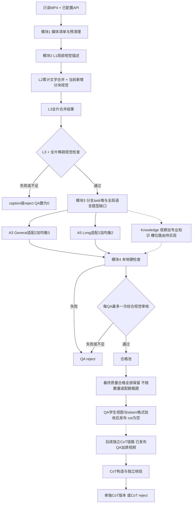

# 纯视频 SFT 数据构造：四模块设计大纲

**2026-10-22 最新设计v7：模块3扩展为General / Long / Knowledge。** General参考Video-MME与Video-MME-v2；Long参考Video-MME long与LVBench；Knowledge参考Video-MMMU与MMVU。Knowledge允许专业知识推理，但视频观察必须是解题所必需；用户同时允许Long长上下文单段检索。详见[三管线设计及参考样例索引](three_branch_caption_qa_design_2026-10-22.md)。**本次更新设计与离线提取；运行仍是旧两分支9+3任务。Knowledge、新task及Long单段校验尚未实现。** 下方历史v6仅在不冲突时沿用。

2026-10-22 模块三/四时间协议修复：[video1_test3 A7 区间定位](video1_test3_time_window_diagnosis_2026-10-22.md)。每条 A7 支持区间须被同一事实声明窗口的并集完整覆盖，相邻窗口可联合覆盖，空隙和真实越界仍拒绝；整片题干采用自然范围表述，局部 TIME 不重复添加介词。未新增调用或改判旧数据；真实新模型输出未验证。

2026-10-22 模块二局部修复：[video1_test2 对应论文依据与实现](video1_test2_minimal_caption_repairs_research_2026-10-22.md)。历史 L2 现在以完整记录传给下一块，保留不确定性和来源；L1 限制字幕拼句，L2 明确核对当前块并保留关键阶段，C_GATE 拆分事实、区分反证与证据不足并校验枚举。保持四模块、当前块视觉范围、API 次数和拒绝不回流合同。局部合成验证通过，真实模型改进未验证；旧版下文的运行状态表述记录当时边界。

更新：2026-10-21，本阶段设计v6（task堆、General适配2＋均衡3、Long适配1＋均衡2、合格全保留）。目标：仅以MP4与可用视觉模型API为外部标注资源，构造面向GLM的General通用与Long长视频数据。**v0.1已实现并完成合成样例离线验证；真实API、真实媒体和服务器运行未验证。实际代码结构/I/O、执行配置和证据见[实现说明](implementation_v1_2026-10-21.md)、[运行手册](runtime_runbook.md)、[验证记录](implementation_validation_2026-10-21.md)。下文保留设计合同，不将历史文件路径当作已运行产物。**

整体风险与未闭合验收接口见[全方案评估及逐项决策](full_pipeline_critical_evaluation_2026-10-21.md)。评估建议尚待逐项讨论，不将其当作已生效的采样、审核或发布配置。

Q1补充：[按A7审核API官方推理配置建立审核基线](q1_audit_api_inference_profile_evaluation_2026-10-21.md)。此方向与GLM训练视图验收分开；具体API、实际生效参数及学生兼容均未实测冻结。

Q2用户确认：首轮先只产自动审核候选，暂不安排人审。每轮可阅读统计报告仍需生成，但人工核验状态记未执行，真实正确率/错误接受率未知；人审暂不作为本轮候选构造门禁，不等于已批准扩量或完成训练发布验收。

Q3最新更新：Long不设最低原片时长；用户允许长上下文单段检索。跨段/时间线/全局任务仍按各自要求核必要证据，不将多段要求套到所有检索题。短片可适配，长片不自动适配；报告时长/证据模式与跨度，不新增最低跨度阈值。运行校验待同步改造。

Q4用户确认：事件时间线/层级全局总结仅OE，跨段QA允许OE/MCQ。balance选task后才在合法题型中算全局缺口；fit的预分配题型限制可选task，Long的MCQ fit只能选跨段QA。已知不兼容组合调用前排除，不交给模型弃答。

Q6固定密度/超限blocked保持；后续视觉范围澄清为本轮新增不重叠分块，如0–30、30–60秒，而非反复重送0–t画面。历史范围通过L2文字递推承接。保存中间结果，完整bundle/C_GATE通过前不产QA，blocked不计质量reject。数值待配置，C_GATE/A7保持独立合同；详见[L2纠正说明](l2_visual_scope_and_cost_correction_2026-10-21.md)。

Q7用户确认：首版不预留独立验证视频，全部先作训练候选；保留原片/剪辑/同源或重复组血缘，不执行train/validation划分。仍做全部质量门禁；不将此版本称为经过独立验证或已排除全部benchmark重合。

## 1. 本阶段结论与文档入口

最新设计为三管线；先筛选适合caption粒度的来源类别与具体题目，再映射生产能力task。General9类/Long3类是现有运行基线，新benchmark类别尚未接入。细节OCR、计数、精确动作边界、缺额外查询图/音频等暂缓。Knowledge不允许用常识补视频事实。原配比、四模块单向流动及拒绝不修复不变。

| 配套文件 | 作用 |
|---|---|
| [三管线最新设计](three_branch_caption_qa_design_2026-10-22.md) / [96分类统计](three_branch_reference_category_summary_2026-10-22.md) | 新来源范围、条件保留/专项暂缓、原题参考库与实现边界；优先于旧9+3建议 |
| [后续CoT独立链路](cot_standalone_pipeline_2026-10-21.md) | 已发布QA+视频输入、派生CoT版本、失败隔离 |
| [数量与保留决定](qa_generation_retention_decision_2026-10-21.md) | General5、Long3、最终合格全保留，当前执行合同 |
| [需求基线](video_sft_current_phase_requirements_2026-10-20.md) | 用户当前保留的需求与三项澄清；不是新增范围清单 |
| [任务分类与适配表](phase_one_task_taxonomy_2026-10-20.md) | 32项归一化能力、来源、证据要求、是否纳入；确定9+3任务 |
| [caption与时间合同](phase_one_caption_and_time_contract_2026-10-20.md) | L2新增分块视觉/累计文字、L3稀疏检查、原片时间与成本 |
| [均衡与模板](phase_one_balancing_and_templates_2026-10-20.md) | 任务先分配、192种子模板、General5/Long3、合格全保留 |
| [General/Long题数评估](general_long_qa_density_research_2026-10-21.md) | 实时下载快照、同口径QA密度、来源/密度分析保留；旧5→3/3→1上限提案已被最新用户决定替代 |
| [统计与发布合同](phase_one_metrics_and_release_2026-10-20.md) | 全阶段筛选账本、来源×阶段双视角、人审报告与12字段外置边界 |
| [机器配置](../configs/project.example.json) / [任务注册表](../configs/task_registry.json) | 未知值保持null；推荐值明确标proposed |
| [模板库](../configs/question_templates.json) / [生成提示](../prompts/task_generation.md) / [审核提示](../prompts/quality_audit.md) | 可直接用于下一步适配器实现的输入合同；尚未运行调优 |
| [合成报告示例](../examples/synthetic_run_report.md) | 虚构数量演示，不是实际处理结果 |
| [一手来源登记](phase_one_sources.json) | URL、版本、定位、公开源文件校验和与研究边界 |
| [交付验证记录](phase_one_validation_2026-10-20.md) | 已调研/已实现/本地验证/未实现的实际边界 |

## 2. 固定约束与输出

| 内容 | 当前合同 |
|---|---|
| 输入模态 | 原始MP4只读，纯视觉，忽略音轨，`modal_mask=4` |
| 分支 | 设计General/Long/Knowledge统一12字段、分别输出；运行仍为`academic2m_inspired` / `lv116k_inspired`；Knowledge枚举待实现 |
| 最终全局配比 | 中文/英文3:7；OE/MCQ7:3；MCQ内部3/4/6选一1:7:2；全部单选 |
| 未定配比 | 三分支混合比例不默认等量；Knowledge候选数、fit/balance和预算待定；小批次报告缺口 |
| Long数量 | 适配视频预先请求3个候选槽位，最终合格全部保留；无合格则0 |
| General数量 | 适配视频预先请求5个候选槽位，最终合格全部保留；证据不足可abstain |
| 幻觉门禁 | L3全片稀疏检查前置；QA形成后一次A7综合视觉审核；失败/不足拒绝 |
| 删除角色 | A4视觉补标、A10语义/embedding API不启用；无失败后补看/改答案/重生成 |
| CoT | 之后单独搭建，不在当前四模块执行；QA发布cot=null，CoT版单独构造/核验/发布 |
| 最终字段 | 严格12个：id/source/conversations/task/question_type/media_info/media/modal_mask/quality/cot/language/tokens |
| 外置内容 | caption、事实账本、实际视图与时间、模板/提示/模型版本、调用费用、reject原因、split/去重、统计、人审 |

Academic2M的学术标签与LV116K的精确grounding不是MP4自动附带的能力。两者只作为方法参照，不能在`source`填方法名或将本项目候选称为人工GT。[VideoChat3论文§3.2–3.3](https://arxiv.org/html/2607.14935v2) 与 [已核代码入口](llava_video_videochat3_pipeline_code_search_2026-10-20.md) 支持这一区分；截至本轮未定位可复用的Academic2M/LV116K标注合成入口，相关组织、筛选与适配代码需要自建，不把训练loader当合成器。

## 3. 总链路

当前四模块只负责QA。QA在自身审核、学生适配与发布验收后可独立发布，cot=null；不等待CoT。图中虚线表示后续单独启动的链路，CoT失败不回流修改原QA。学生processor尚未验证时仍不能宣称训练兼容。

## 4. 模块1：视频预先清理

**输入：** 明确授权的MP4根/allowlist、是否递归、真实来源映射、IO与质量预算。未知目录不默认全盘扫描。

**步骤：** 建稳定video_id与原片路径映射；ffprobe探测时长/尺寸/时间基准；受控窗口解码检查损坏、黑帧、模糊/冻结等；精确/近重复分组并保留同源血缘；Q7首版全部先作训练候选，不分训练/验证集；保存基础时长与镜头候选。低运动不自动等于无价值；镜头边界不自动等于事件边界。

| 输出（派生根下） | 内容 |
|---|---|
| `01_prepare/media_manifest.jsonl` | video_id、实际source、只读原路径/发布相对路径、时长/尺寸/时间映射、身份/版本 |
| `eligible_videos.jsonl` | 可进入caption的媒体及manifest引用 |
| `media_checks.jsonl`、`groups.jsonl` | 检查依据、重复/同源组血缘；首版用途为训练候选，无验证划分 |
| `reject.jsonl` | 视频级拒绝与原因，不移动/删除原MP4 |

**API：不需要。代码来源：** [FFmpeg/ffprobe](https://ffmpeg.org/ffprobe.html)负责媒体探测/解码；[PySceneDetect](https://www.scenedetect.com/docs/latest/api.html)可提供镜头候选。稳定ID、清单、受控IO、感知哈希/分组和统计为本项目自建，不接A10。

**验收：** 清单有界且可追溯，输入只读；可读性/部分解码检查范围明确；每次筛选产生来源×阶段统计。完整媒体检查与抽样检查分开登记。

## 5. 模块2：LLaVA三级caption与前置门禁

**输入：** 模块1合格清单、原片、API和视图配置。官方[caption脚本](https://huggingface.co/datasets/lmms-lab/LLaVA-Video-178K/blob/6d8c562dc26d70042a0d9704d1cae58c94b89098/gpt4o_caption_prompt/GPT4o_description_prompt.py)为骨架，revision `6d8c562dc26d70042a0d9704d1cae58c94b89098`。本项目不直接运行其无限重试/调试器分支。

1. **A1/L1：** 局部有序视觉帧生成描述，保存真实采样时间/窗口。
2. **A2/L2：** 上次累计L2文字＋本轮新增L1文字＋本轮新增完整分块画面一起合并。例如第二次仅看30–60秒画面，输出文字摘要覆盖0–60秒；不重送0–60秒画面。按Q6固定密度，数值/像素预算待配置；超限blocked，不降密度或截断当前块。
3. **L3：** 默认复用末次累计L2文字，存独立版本与依赖，不额外重复同义生成。末次L2只看新增块，不能充作全片视觉复核；全片稀疏复核在C_GATE。规范化L2保留末次文字摘要，原始响应另存。
4. **C_GATE：** L3与全片稀疏视图一次检查，支持不足/矛盾/错误即caption reject，QA数0；通过才放行模块3。

| 输出 | 内容 |
|---|---|
| `02_caption/raw/<video_id>/...` | 各次实际请求/响应与状态，不含凭据 |
| `captions.jsonl` | L1/L2所有前缀/L3，来源版本、父依赖、完整/部分状态 |
| `frame_views.jsonl` | 真实PTS、规范化原片秒数、尺寸/采样范围、视图ID |
| `caption_checks.jsonl` / `reject.jsonl` | L3检查、被核事实、视图支持、不足/矛盾/技术错误、视频级拒绝 |

**API：A1视觉、A2视觉、C_GATE视觉；L3默认无额外生成调用。** 原公开L2为文本递推合并，当前分块视觉与C_GATE是项目改造。L1与L2同密度下各约一遍视觉帧输入，两层合计约两遍；文字与检查成本另计。L3通过不代表L1全部细节已核验，A7仍必需；见[caption合同](phase_one_caption_and_time_contract_2026-10-20.md)。

**验收：** L2视觉覆盖本轮新增完整分块、历史摘要与本轮L1文字依赖完整；输出累计文字不等于本轮视觉范围。L3门禁失败无下游QA；中间结果/视图/调用可追溯；超容量不截断当前分块。

## 6. 模块3：General / Long / Knowledge三管线候选

当前调度与接口见[task小根堆及2＋3评估设计](task_heap_scheduler_evaluation_2026-10-21.md)，新中英prompt见[阶段提示](../prompts/task_scheduler/README.md)。[原模块三详解](module3_general_long_walkthrough_2026-10-21.md)保留单批生成与输入输出/后处理历史示例，不是新运行入口。

**输入：** 通过C_GATE的L1/L2/L3、媒体/原片时间索引、任务注册表、模板与全局配方。此阶段以已有caption为事实候选，不再补视觉标注。

**共同步骤：** 已有caption/时间索引 → 各分支能力适配，MMVU学科单列 → fit选最适配task，General最多2条、Long最多1条 → 当前分支入账 → 按能力task堆和全局语言/题型缺口调度，General最多3个、Long最多2个QA → 保存候选/事实与规则/证据 → 模块4。Knowledge候选数与fit/balance待定，不默认继承5或3。fit不足不转balance；产题前弃答可有界改派，产题被拒不补造。Long允许长上下文单段检索，跨段任务仍需多段必要证据。不要把27个学科和因果/动作等能力混进同一个task堆。

| 分支 | 本版建议任务 | 数量 / 代码依据 |
|---|---|---|
| General | Video-MME12类+v2的33叶类先筛选，再映射实体/动作/空间、变化/顺序、定性运动、因果/叙事等能力 | 仍2+3候选；来源类别不自动启用；LLaVA分任务代码继续作工程参照，新参考库待接入 |
| Long | Video-MME long与LVBench6类：长上下文单段检索、跨段关联/比较、粗时间范围、时间线/全局总结 | 仍1+2候选；新增检索校验待实现，不接精确grounding专项 |
| Knowledge | Video-MMMU6类逐类判断；MMVU27学科逐题筛选，保留现象/概念/机制/原理/知识应用 | 允许专业知识但必须依赖视频事实；精密读取/数理结构/缺图音频则弃答；槽位、prompt、API路由待实现 |

**时间：** 所有OE中的时间回到原MP4零点；程序可映射与格式化，不能发明事件边界。begin/end只用于自然的开头/结尾阶段指代。**任务均衡：** 默认各分支内task等量，用有效供给小根堆调度，随后按全局缺口选语言/题型；旧非均匀权重不再使用，具体见[小根堆设计](task_heap_scheduler_evaluation_2026-10-21.md)，模板轮转见[均衡方案](phase_one_balancing_and_templates_2026-10-20.md)。

| 输出 | 内容 |
|---|---|
| `03_synthesis/{general,long,knowledge}_candidates.jsonl` | 逻辑产物规划；Knowledge尚未实现，均非正式发布数据 |
| `events.jsonl`、`evidence.jsonl` | 已有caption派生事实、必要证据与绝对时间/片段引用 |
| `generation.jsonl` | 槽位、abstain、task/配方/模板版本、自然改写与请求身份 |
| CoT输出 | 本模块不生成；由后续独立链路在自己的派生根保存 |

**API：General仍A3、Long仍A5；Knowledge拟用独立文本逻辑路由`QA_KNOWLEDGE`，实际映射/模型/预算待定。** General通常1次fit批量2条＋3次均衡单条，Long通常1次fit单条＋2次均衡单条；弃答改派增加调用且有界。Knowledge新增文本与A7费用必须显式预检；三分支共享caption。模板改写、事实/规则记录合并进生成，无A4/A10/CoT。

**验收：** task在启用白名单，有证据引用；MCQ严格单选3/4/6项；同题不复制中英充数。Long检索需长上下文辨识目标，不能任意单帧题套标签；跨段题仍需多段必要事实。Knowledge区分视频观察与专业规则，不能新增未观察的参数/体征。所有候选和未产槽位有统计；新合同实现前不声称运行验收通过。

## 7. 模块4：质量审核、合格保留与发布

**输入：** 模块3候选、原视频、已有证据/视图、最终12字段合同、QA学生配置。

1. **本地硬检查：** 格式/字段/选项、路径、纯视觉模态、时间界限、HTML/控制字符、精确重复/文本近重复、task限制。同一次样本清洗后冻结候选，再进审核；审核后不改答案。
2. **A7一次综合视觉审核：** 每题直接发送原始完整视频文件/URL＋对应文本，检查问答匹配、事实支持、单选唯一性、语言、时间/身份和task成立。v7设计中Long按检索/跨段/全局分别核必要证据，Knowledge额外核专业规则适用性、视频事实必要性和不确定性；新提示/校验待实现。每题最多一次，SDK retries=0；失败后不补看，不审核未来CoT。API有效采样/像素/思考配置仍需冻结，不默认256张独立图片。详见[A7输入与费用](a7_native_video_input_and_cost_2026-10-21.md)。
3. **单向分流：** fail/uncertain/insufficient/error→QA reject；质量通过→passed_pool。技术错误与事实失败分别计数。
4. **最终保留：** 去重/同源等要求纳入质量门禁；通过全部最终质量检查的候选全部保留，不按每视频数量或配额二次裁题。配比只用于生成调度与偏差报告；当前selection_excluded因数量/配额的计数必须0。
5. **QA发布前验收：** cot=null合法；学生采样能见必要证据、实际processor序列/监督token、长度、12字段/路径、原片/同源组血缘与本轮适用的用途检查通过；Q7首轮不划验证集，划分检查记不适用。外部可阅读统计报告齐全，Q2首轮不要求实际执行人审。否则保留候选状态，不发布为已验收QA训练数据。CoT方法未定本身不阻塞QA发布。

| 输出 | 内容 |
|---|---|
| `04_quality/local_checks.jsonl`、`audits.jsonl` | 本地/视觉判定与依据 |
| `reject.jsonl` | QA级拒绝及主/附加原因，原片仍只读 |
| `passed_pool.jsonl` | 保存质量通过记录；最终合格者全保留。selection_excluded仅兼容历史统计，当前不因上限/配额产生 |
| `release/<version>/{general,long,knowledge}.jsonl` | 统一12字段的逻辑规划；运行尚无Knowledge发布实现 |
| `audit/...`、`reports/<run_id>/...` | 外置调用/视图/血缘、来源×阶段双视角、配比/缺口、成本、人审入口 |

**API：仅A7必需；本地检查、选样、token计数与统计不用生成API。** 人审不是额外模型请求。无修答案、补标、重生成路径。

## 8. API位置总表

逐请求输入、次数、视觉/文字用量、弃答改派、失败停止与预算缺口，以[API调用清单与成本边界](api_call_inventory_and_cost_contract_2026-10-21.md)为细化说明。L3复用末次L2不另调生成；以下是逻辑角色，不能据角色数量推算账单。

| 角色 | 模块 / 何时 | 模型实际看什么 | 逻辑请求范围 |
|---|---|---|---|
| A1 | 2 / L1 | 当前局部视觉+时间 | 每局部窗口；可配置预算 |
| A2 | 2 / L2含末次累计文字摘要 | 上次L2文字＋新L1文字＋当前新增完整分块视觉 | 每新增分块一次；固定密度，块视觉/文字/总预算分别预检 |
| C_GATE | 2 / L3合并后 | L3+全片稀疏视觉 | 每视频最多一次；不通过无QA |
| A3 | 3 / General | 仅文字caption/模板；fit白名单选task，balance固定task | 1次fit最多2题；balance正常3次各1题。按现有建议含弃答最多1+12次生成，仍最多5题 |
| A5 | 3 / Long | 仅文字caption时序证据；fit白名单选task，balance固定task | 1次fit最多1题；balance正常2次各1题。按现有建议含弃答最多1+5次生成，仍最多3题 |
| QA_KNOWLEDGE（拟定逻辑名） | 3 / Knowledge | caption观察＋领域任务/学科＋专业规则约束 | 未接入，次数/槽位/预算待定，不能自动启用 |
| CoT生成/核验 | 后续独立链路 / 已发布QA后 | QA+原视频，方法待选型 | 不计入当前四模块；未来单独配置/预算 |
| A7 | 4 / 本地检查后 | 原始完整视频文件/URL＋该题审核文本/时间；API负责抽帧缩放 | 每QA最多一次，retries=0；有效采样及费用待核验 |

可用同一API承担多个角色，但这些是不同输入和不同阶段。A7内多项检查可以合并为一次；它不能与前置C_GATE合并，因为后者决定是否允许生成QA。A4/A10均不恢复。

**只开旧General/Long两分支**无弃答、8题均送审时为`n1+n2+16`次；含旧有界改派提案时上界`n1+n2+28`。Knowledge启用后还需增加其文本请求和每候选最多一次A7，不能沿用旧总额；槽位未配置不能自动启用。n1/n2为L1/L2次数，C_GATE/A7实际帧量与费用仍需冻结；每题一次A7不等于多题合为一次。

## 9. 最终12字段覆盖

完整字段语义沿用[JSON合同](video_sft_final_json_format_2026-10-20.md)，其中QA版本cot=null；CoT子结构在后续独立链路选型后确定。

| 字段 | 主要责任模块 | 填充/验收 |
|---|---|---|
| id | 3→4 | 稳定sample_id，外部索引连接video/证据 |
| source | 1→4 | 实际来源与原始ID，不填方法论文名 |
| conversations | 3→4 | human问题/选项，gpt最终OE答案或MCQ单字母 |
| task | 3→4 | pipeline/family/name；仅启用任务，benchmark映射外置 |
| question_type | 3→4 | oe/mcq；0或3/4/6项，唯一正确 |
| media_info | 1/2→4 | 原片时长与实际caption采样摘要；时间真实可追溯 |
| media | 1→4 | MP4相对路径；无额外图像/音频输入 |
| modal_mask | 4 | 固定4 |
| quality | 4 | 自动通过状态，分数无校准可null；详细判定外置 |
| cot | 主链路4 / 独立下游 | QA发布填null；后续核验通过的CoT填入新版本，不阻塞QA |
| language | 3/4 | zh/en，目标3:7，审核实际表达 |
| tokens | 4 | 估算/实测分开；学生视频/文本/监督token，非教师usage |

## 10. 需要确认与实现顺序

**可继续实现的部分：** 先完成只读媒体清单与PTS视图→LLaVA适配/累计视觉与C_GATE→任务注册/调度/A3A5→A7、外部事件账本与报告。最先做可控的端到端候选试产，再评估适配/均衡阶段的贡献、尝试预算与阈值，不先追求总量。

**启动真实试产前仍需用户提供：** MP4/派生根与读取范围、来源映射、实际API协议/模型/密钥环境变量、帧/上下文限制、预算/首轮范围。**需要后续决定：** 建议9+3白名单与分支内均匀目标的试产适配性；Long资格与学生采样能力；General/Long混合与QA学生processor；CoT方法在后续独立链路再决定。未知项不妨碍本轮设计，但不能据此启动付费任务。

实现难度：媒体清单与本地检查中等；PTS/累计视觉/断点与幂等中高；任务适配/长视频证据和可靠审核高；真实训练兼容需学生侧实测。最大风险是稀疏视图漏细节、同教师共偏差、累计视觉成本和学生看不到教师证据；详见[分类表漏洞](phase_one_task_taxonomy_2026-10-20.md)。
