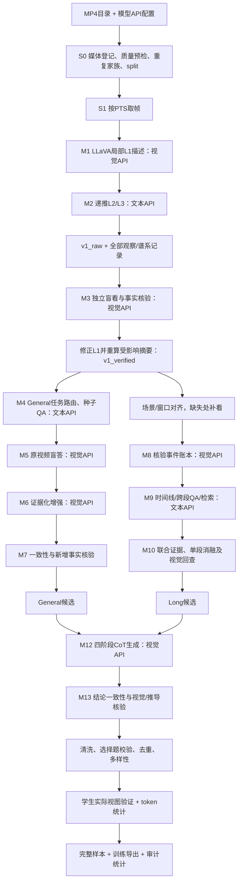

> 当前配置与v1流程以 [decisions.md](decisions.md) 为准；本文中的旧默认值、演示模型/数量或历史方案不覆盖最新用户决定。

# 纯视频 SFT 数据构造完整方案：通用主干与长视频专项

日期：2026-10-20。目标：仅输入 MP4 文件目录和模型 API 配置，为用户指定的 GLM-5.3-Flash 构造高质量视频指令数据。本文承接已核查的 LLaVA 三级 caption 代码及 VideoChat3 方法分析，将用户提出的字段、质量与处理要求落实成数据合同和工程链路。

> **最终训练格式更新：** 按用户后续要求，最终训练 JSON 收敛为 12 个顶层字段；其他追溯/证据/日志外置。题型当前只有 `oe` 与 `mcq`，MCQ 全部单选，以 ABCD 四选一为主、少量 ABC 三选一和 ABCDEF 六选一；本文旧多选/structured/agentic 产出建议暂不采用。CoT 改为参考 LLaVA-CoT-100k 的四阶段正式构造产物，OE/MCQ 都生成，见 [CoT 构造方案](llava_cot_video_construction_2026-10-20.md)。以 [最终 JSON 格式说明](video_sft_final_json_format_2026-10-20.md) 为最新字段合同。本文下述完整记录和旧五条示例是此前内部设计，不再直接用作最终训练 JSON；构造链路仍可参考。

**状态说明：这是待实现方案，不是已经运行的数据生产系统。** 已有证据包括官方源码静态核查、少量发布标注抽样、LLaVA caption 控制流的内存模拟；没有真实视频/API/训练运行结果。字段、任务分类、配比与验收规则中标注为“建议”的内容均为本项目设计，不冒称作者原始配方。

## 1. 最终要得到什么

建议发布两个数据产品，共享原始媒体、三级 caption 和核验证据：

| 产品 | 构造参考 | 主要用途 | 包含的任务 |
|---|---|---|---|
| `OwnVideo-General` | Academic2M 风格 | 通用视频 SFT 主干 | 描述、实体/场景、动作、局部时序、状态变化、可见文字、可证据化问答；OE、单选、多选 |
| `OwnVideo-Long` | LV116K 风格 | 长视频理解专项 | 全片层级摘要、事件时间线、跨段对比/聚合 QA、重复事件检索；精确定位作为后续独立等级 |

两个名称是项目建议名，不表示它们属于官方 Academic2M/LV116K。通用分支不等于只处理短视频：长视频的有效局部窗口也可贡献通用任务。专项分支也不以“视频够长”自动成立：标注需要体现全局结构或跨段证据需求。

每个产品交付三类文件：

1. **完整样本记录 JSONL**：包含用户要求的全部业务字段，用于筛选、混合、追溯与审计。
2. **训练导出 JSONL**：仅输出目标训练器需要的对话、媒体和必要元数据；通过 `id` 关联完整记录。
3. **证据与统计旁路文件**：三级 caption、实际取帧、事件账本、核验结果、模型/提示版本、token 统计、拒绝原因、去重映射和数据说明。

使用者提供的是 MP4 目录和 API 配置，路径清单、取帧、caption、QA、语言标签、质量记录由系统产生。一个支持有序多图和文本生成的视觉 API 可以承担全部模型角色；第二个核验 API 是可选增强项。

## 2. 已有依据和实现边界

LLaVA 的 [三级 caption 脚本](https://huggingface.co/datasets/lmms-lab/LLaVA-Video-178K/blob/6d8c562dc26d70042a0d9704d1cae58c94b89098/gpt4o_caption_prompt/GPT4o_description_prompt.py)、[OE 生成器](https://huggingface.co/datasets/lmms-lab/LLaVA-Video-178K/blob/6d8c562dc26d70042a0d9704d1cae58c94b89098/gpt4o_qa_prompt/gen_sft_data.py)、[MCQ 生成器](https://huggingface.co/datasets/lmms-lab/LLaVA-Video-178K/blob/6d8c562dc26d70042a0d9704d1cae58c94b89098/gpt4o_qa_prompt/gen_sft_data_mc.py) 已定位。可复用其提示、任务示例和核心生成逻辑，但需修复目录入口、API 配置、变量、解析、恢复与时间轴等问题。

本轮沿用前次检索结论：**尚未定位 VideoChat3 的 Academic2M/LV116K 标注合成生产入口**；已取得的是论文、成品标注、训练读取和配方。构造原则参考 [VideoChat3 §3.2–3.3](https://arxiv.org/html/2607.14935v2)：Academic2M 用原标签约束证据化增强并判定一致性；LV116K 用经核验的带时间片段描述组织长任务，精确定位另有专家步骤。你的原 MP4 没有学术原标签，因此必须新增种子答案的视觉验证。

已有完整证据见 [代码审计](llava_video_videochat3_pipeline_code_search_2026-10-20.md) 和 [前一版链路设计](mp4_api_llava_caption_videochat3_synthesis_design_2026-10-20.md)。本文新增的是统一字段合同、任务体系、通用/专项产品配方、清洗与验收规则。

**格式边界：** 本次按当前 GLM 目标及用户最新字段要求设计，完整记录允许 task、quality、cot 和 token 统计。已完整重读本机 [data_format.md](C:/Users/Tiachi/Downloads/data_format.md)，但该文件的 UniMoE 交付禁止新增 token 等字段，且内嵌音轨的模态口径不同；未来如需 UniMoE 交付，须使用独立严格 exporter，不能将本合同直接宣称为该模板合规。当前不生成 UniMoE 数据、不改该模板。

## 3. 用户要求逐项落地

| 用户要求 | 建议字段/产物 | 定义及处理方式 |
|---|---|---|
| 1. id | `id`、`video_id`、`duplicate_group_id` | 区分样本、媒体、近重复家族；同视频多任务分别有样本 ID |
| 2. 来源 | `source_dataset`、`source_type`、`original_id`、`source_split`、`provenance` | 自有 MP4 的真实来源与构造谱系；不把启发方法写成原视频来源 |
| 3. conversations | `conversations` | `from` 为 `human/gpt`；默认一题一条样本，必要时支持经核验多轮 |
| 4. task | `task.family`、`task.name`；另存 `generation_recipe` 与 `benchmark_refs` | 能力分类、合成方法、评测参照分开；详见 §5 |
| 5. 题型 | `question_type` | `oe`、`mcq_single`、`mcq_multi`、`structured`、后续 `agentic`；选择题保存原生选项和正确集合 |
| 6. 时长、帧数、分辨率 | `video_duration_sec`、`audio_duration_sec`、`video_start/end`、`media_metadata` | 分开原片参数、教师实际视图、核验视图和学生视图，不用一个 fps/帧数代替全部 |
| 7. 媒体路径 | `videos/audios/images` 列表 | 样本中为相对媒体根路径；当前视频样本只引用 MP4，原件不裁剪 |
| 8. 模态分类 | `modal_mask`、`media_metadata.audio_used` | 当前纯视觉路线为 4；不把教师请求中的抽帧图片误记成学生图像样本 |
| 9. 质量得分/verify | `quality`、`verification_ref` | 硬性检查、分项指标、模型判断、人工校准和总体排序分分别保存 |
| 10. cot | `cot` | 必须生成 summary/caption/reasoning/conclusion 四阶段标注；supervised 决定该次训练是否组装监督，不决定是否生成 |
| 11. 语言 | `language` | 问题、答案、画面文字语言分别标记；翻译有独立版本与核验 |
| 12. token 估算 | `token_stats`、旁路逐视图统计 | 分媒体/文本/监督 token；教师计费与学生 token 分开，未知用 null |
| 模糊/损坏 | 媒体预检与 `quality.media_checks` | 先筛明显坏样本；边界样本按领域分层处理 |
| 去重/多样性 | 家族清单、去重映射、采样报告 | 媒体级、片段级、问题级去重；按领域/时长/任务等分层 |
| 问答不匹配/答案错误 | 盲答、视觉支持、语义一致性、学生视图检查 | 不只比较两个生成文本，必须回看原片证据 |
| HTML 清洗 | `normalization_ref`、原始响应旁路 | 字段级清洗；保护 OCR 原文、代码和选项边界 |
| 额外 caption | `caption_ref`、三级 caption/事件账本文件 | 默认作为构造与审计底座；选取合格 caption 另出描述任务，防止输入泄漏 |

## 4. 数据合同：哪些必须保存，哪些不要混在一起

### 4.1 ID、来源和谱系

`video_id` 关联媒体清单；不要直接用 `basename.split('.')[0]`，因为重名及带点文件名会冲突。建议使用冻结清单中的稳定 ID，后续可补内容指纹。`id` 用产品名、媒体 ID、任务 ID 和版本组合生成；完整语义内容变化产生新版本。

来源至少包括：

- `source_dataset`：如 `own_mp4` 或经确认的真实数据源名。
- `source_type`：如 `user_provided_video`；`original_id/source_split` 不明则显式未知。
- `generation_recipe`：如 `academic2m_inspired.v1` / `lv116k_inspired.v1`，属于合成配方，不是媒体来源。
- `provenance`：源清单 revision、代码 commit、LLaVA 源码 revision、模型 ID/revision、prompt hash、请求记录引用和父产物 ID。
- `split`：本项目实际 `train/dev/heldout`；与原数据的 `source_split` 分开。

近重复家族在生成前尽早分组，再按家族划分 split。两条分支同一原视频必须保持同一 split；后续发现跨 split 重复时，隔离相关样本并重发清单，不能只删一个题后继续宣称独立。

### 4.2 对话和媒体

默认每题一条 `human → gpt` 对话，便于逐题筛选和长度控制。一个 `<video>` 对应 `videos` 中一个引用；多轮只在前文确实构成对话上下文时采用。不能把互不相关的若干问题随意串成多轮，使上一答案泄露下一题。

当前 v1 产品限定单个原 MP4；局部题通过 `video_start/video_end` 表达原片窗口。`video_duration_sec` 始终是原视频完整时长，窗口时长另算，不混用。能否消费窗口须由 GLM 实际读取器验证；不能只写字段而读取器仍抽全片。

模态编码保留用户指定的 0/1/2/4/6 词表；其中 0=文本、1=图像、2=音频、4=视频、6=音视频。当前产品限定 `modal_mask=4`，`audios=[]`、`images=[]`，音频不参与模型输入；音轨存在性单独存储。此处按**当前 GLM 逻辑输入模态**定义，不宣称等同于 UniMoE 对内嵌音轨的编码口径。视频帧用于教师 API 请求，不会因此把视频样本改成 mask=1。

### 4.3 原片、教师、核验和学生视图

至少区分以下四层：

| 层 | 必存参数 | 用途 |
|---|---|---|
| 原片 | 时长、宽高、帧率口径、时间基准、可解码性、音轨存在性 | 真实媒体身份与边界 |
| caption/QA 教师视图 | 实际帧 ID/PTS、数量、每帧实际尺寸、窗口、采样策略、缩放配置 | 解释教师究竟看到了什么 |
| 核验视图 | 相同信息，可能更密集/更高清 | 证明核验所依据的输入，记录补看 |
| 学生视图 | 目标 processor、采样/resize 配置、实际帧与 token、窗口消费结果 | 判断训练时能否回答该题 |

实际 PTS、逐帧尺寸等大数组放清单，通过引用关联；完整样本内保留摘要及清单路径。配置中的“请求 1 FPS”不等于实际帧数，源分辨率也不等于送 API 的分辨率。

变帧率视频不强行用 `帧数/标称FPS` 冒充真实时间；原片容器时长与 PTS/解码口径分别记录。抽帧和窗口统一原片秒时间轴，内部建议 `[start,end)`。任何第三方读取器的特殊口径由适配层处理。

## 5. 任务二级分类、benchmark 和题型

### 5.1 推荐能力分类

| `task.family` | `task.name` 示例 | 主产品 | 关键证据要求 |
|---|---|---|---|
| `visual_perception` | `scene_description`、`entity_attribute`、`spatial_relation`、`visible_text` | General | 当前帧/窗口可见，OCR 可读 |
| `action_understanding` | `action_description`、`fine_grained_motion`、`action_count` | General | 运动顺序与覆盖足够，计数不重复 |
| `temporal_understanding` | `event_order`、`state_change`、`temporal_comparison` | General | 真实前后帧/事件，不凭文本推演 |
| `evidence_reasoning` | `observable_causality`、`multi_fact_composition` | General | 可见机制或可组合事实；不把先后直接当因果 |
| `long_video_understanding` | `cross_segment_qa`、`event_timeline`、`hierarchical_summary`、`recurring_event_aggregation` | Long | 全局覆盖、跨段关联或事件结构 |
| `temporal_retrieval` | `segment_retrieval`、后续 `precise_temporal_grounding` | Long | 查询匹配；精确定位需额外边界校准 |
| `agentic_video` | 后续 `evidence_seeking_trajectory` | 独立扩展 | 真实执行工具并保存观测，详见 §10 |

分类由输入证据和验证结果确认；生成器可以建议，但不由“使用哪个提示文件”直接决定任务真值。General 和 Long 通过 `generation_recipe`、`product` 区分，不占用能力二级分类。

### 5.2 benchmark 单独记录

`benchmark_refs` 用于标注参考的能力体系或关联评测，不是训练来源，也不表示样本是该 benchmark 真题。可参考 [Video-MME](https://github.com/MME-Benchmarks/Video-MME) 的视频理解评测、[MVBench](https://arxiv.org/abs/2311.17005) 的时序任务、[MLVU](https://github.com/JUNJIE99/MLVU) 和 [LongVideoBench](https://longvideobench.github.io/index.html) 的长视频任务。

例如 `task=temporal_understanding/event_order`，可以有 `benchmark_refs=[{"name":"MVBench","role":"capability_reference"}]`。这只说明能力参照；不复制测试题、答案或视频用于合成，不把 benchmark 名当默认训练任务类别。

纯视觉评测应明确无音频、无外部字幕等输入设置；不能拿多模态全输入分数直接判断当前视觉路线的收益。

### 5.3 题型与答案合同

| `question_type.family/subtype` | 原生结构 | 对话中的答案形式 | 首版状态 |
|---|---|---|---|
| `oe/short_answer` 或 `oe/explanatory` | 问题、答案、证据引用 | 直接回答，可带必要可见依据 | 主力 |
| `mcq/single` | `options`、一个 `correct_option_id` 对应的集合 | 题目指定单选；答案与映射一致 | 纳入 |
| `mcq/multiple` | `options`、`correct_option_ids` 集合 | 题目明确“选择所有符合项”；答案稳定排序 | 纳入，但单独校准 |
| `structured/timeline`、`structured/summary`、`structured/intervals` | 内部 JSON 对象/数组 | exporter 按任务序列化为合法 JSON 字符串 | Long 为主 |
| `agentic/tool_trajectory` | 实际 action/observation 轨迹 | 由工具训练模板导出 | 后置，不混入普通 QA |

题型不决定能力：一条 MCQ 可以考时序，一条 OE 可以只问颜色。多选、单选用同一个大类但子类型必须明确，不能仅凭答案里有几个字母猜类型。

## 6. 全部数据链路及 API 接入位置



| 模型调用点 | 看到的输入 | 输出 | 是否必须看帧 |
|---|---|---|---|
| M1 局部 caption | 当前窗口帧 + 允许的历史 | L1 细节 | 是 |
| M2 汇总 | L1/上次累计摘要 | L2、L3 | 否，同一视觉服务可纯文本调用 |
| M3 caption 核验 | 原片窗口；先盲看，再比对 caption | 支持/矛盾/信息不足及事实证据 | 是 |
| M4 General 规划/提问 | 已核实 caption、任务池、语言/题型要求 | seed QA、选项、证据 ID | 可只看文本 |
| M5 盲答 | 原片视图 + 问题，隐藏 seed | 独立答案/不足 | 是 |
| M6 增强 | 原片视图 + 题目 + 已接受 seed | 简洁的证据化答案 | 是 |
| M7 一致性/事实 judge | seed 与增强答案；另给相关帧 | 语义一致性、新增事实支持、拒绝原因 | 一致性可文本；视觉支持必须看帧 |
| M8 事件账本 | 边界对齐片段 + 候选描述 | 带证据的事件、实体关联及不确定项 | 是，能复用已核实结果时减少调用 |
| M9 Long 合成 | 有序事件账本、时间与关系 | 时间线、全局摘要、跨段 QA、检索候选 | 可只看文本 |
| M10 长任务核验 | 多段证据 + 问题；单段/去证据对照 | 充分性、跨段必要性、答案支持 | 是，并结合文本判定 |
| M11 可选边界细化 | 候选区间更密集帧 + query | 边界估计、不确定范围 | 是；未校准不发布精确标签 |
| M12 四阶段 CoT | 已核实 QA、固定选项/答案、实际视频证据 | summary/caption/reasoning/conclusion | 是；参考 LLaVA-CoT-100k 生成逻辑 |
| M13 CoT 核验 | 四阶段、原片证据、已接受答案 | 结构、结论一致性、视觉事实和推导支持 | 结论可文本；视觉过程检查须看帧 |

M1–M13 是职责，不要求 13 套权重；可以全部绑定一个 API。统一后端提供 `generate_visual` 与 `generate_text`，业务层只处理结构化输入输出。局部问题可批量核验以减少请求，但仍逐题保存结果，且盲答请求不泄露候选答案。

无模型步骤包括：文件清单、媒体探测、PTS 采样、场景候选、哈希/文本近重复、schema、路径/时长断言、HTML 清洗和统计。语义去重可选用额外 embedding 后端；首版不要求额外模型。

## 7. 公共 v1：LLaVA 三级 caption 与可靠证据

### 7.1 媒体预检与 split

先按清单逐个登记 MP4，检查存在性、可解码性、时长和视觉质量；明显坏媒体先拒绝以节省 API。仅做有界取样预检不能证明全片无损坏，正式使用的窗口解码时仍要检查。共享存储限制并发、缓存和 IO 范围，不在大根目录做无界递归探测。

在媒体级建立精确重复/近重复家族，再分 train/dev/heldout；使用视觉指纹与持续时间等候选筛选，局部匹配防止长短裁剪版跨 split。不同版本字幕、水印或码率不自动表示不同视频。原片不覆盖、不重命名、不转码，输出经 staging 验证后发布。

### 7.2 三级生成逻辑

复用官方方法节奏：约 1 FPS 的基线观察，每约 10 秒生成一个 L1；每约 30 秒结合旧摘要和新 L1 递推累计 L2；最后一次汇总作为 L3。后续 L1 会带历史描述，L2 覆盖从开头到当前，而非独立 30 秒块。

成功原字段为 `clip_description`、`summary_description`、`video_description`。最后汇总从中途摘要列表中移出成为 L3：30 秒视频可能没有中途 L2，60 秒通常有 6 个 L1、1 个中途 L2、1 个 L3。保存真实 PTS 和观察窗，不把列表序号当精确动作时间。

原脚本的平均 FPS 取整采样需要改为时间戳实现，并修复未定义变量、错误解析、调试器中断、恢复拼写与持久化问题。换教师或采样实现记录新 recipe 版本，不声称严格复现 GPT-4o 原输出。

### 7.3 caption 核验和依赖失效

M3 先不看原 caption，独立观察当前片段，再对原 caption 的原子事实分类。对不确定细节做局部更密集取帧/放大；仍不足则删除该事实或拒绝该描述。约 1 FPS 不足以保证快速动作、完整计数或小文字正确。

修正 L1 后重算依赖它的 L2/L3/QA；若错误影响人物连续性或后续 L1 历史，还须回查这些后续描述。缓存键包含媒体、实际视图、模型、提示及父版本，不能让失效摘要继续参与生成。

caption 自带的详尽措辞不代表准确。只接受可见支持的实体、动作、状态与文字；旁白、音效、内心活动、动机或从水印猜音乐均不作为纯视觉答案。

### 7.4 “额外 caption”的两种用途

默认全部三级 caption 作为旁路底座，通过 `caption_ref` 关联，避免每条 QA 复制同一份长文本。经核验的 L1/L3 可另生成 `scene_description/action_description` 等描述训练样本。其来源家族与原 QA 相同，计入重复和 token 配方，不能当成独立视频扩大规模。

L3 可帮助规划，但最终答案必须回指局部事实/原帧。把完整 caption 填入 user 问题会让学生读文本答案，因此默认只给原视频和问题；“给 caption 作答”若需要应单独命名为文本任务。

## 8. General：以 Academic2M 风格作为通用主干

通用产品追求覆盖、可答和证据化表达；不要求每个视频都生成所有题型。

| 阶段 | 输入 | 输出与门禁 |
|---|---|---|
| G1 任务路由 | 已核实局部/全片描述、领域、证据覆盖 | 选择可答任务；没有证据不硬出题 |
| G2 种子生成 | LLaVA 任务定义与 few-shot、对应事实、题型/语言 | question、candidate answer、证据 ID、可选选项 |
| G3 原视频盲答 | 视频窗口/全片可支持视图 + question，隐藏候选答案 | 独立答案与不足标记；不一致进入补看或拒绝 |
| G4 接受语义锚点 | seed、盲答、原帧证据 | 形成暂时接受的 seed；它仍不是人工 GT |
| G5 证据化增强 | 视频 + 问题 + accepted seed | 可见依据 + 明确结论，不为凑长度补事实 |
| G6 双项判定 | seed/增强答案与相关原视频 | 语义不变且新增事实可见；任一失败不得通过 |
| G7 CoT 构造与核验 | 通过的 QA、固定选项及实际视频视图 | 四阶段 CoT；检查结论、事实和推导支持 |
| G8 题型/清洗/导出 | 通过的 QA + CoT | 对话、四阶段标注、训练目标组装及外部审计 |

LLaVA 的 QA 脚本可以桥接 `{video_id: caption}` 输入。先以 `icl_once` 组织任务覆盖，`free_form` 作为基线；其 polling 主执行块未启用，首版不依赖。正式版本用已核实局部证据生成局部题，用完整已核实范围生成全片题，不只送最终 L3。

单帧可答题在 General 中有价值，不一概删除；但“通用视频”也应控制动作、变化与顺序等真正时间任务的比例，避免退化成抽帧图像问答。任务覆盖由分层统计和配方约束，而非生成器自报难度决定。

对因果/意图类题保持可观察边界；对计数记录覆盖与重复身份，采样图里的出现次数不等于全视频动作次数。对 OCR 任务保留原文和帧支持；翻译输出另验，避免强制英文翻译损坏原意。

## 9. Long：以 LV116K 风格作为长视频专项

### 9.1 从三级 caption 到事件账本

对长视频做镜头候选与时间窗约束，原 L1 与新窗口对齐且事实足够时复用；边界冲突、快速运动或信息不足则补看。场景切换可参考 [PySceneDetect API](https://www.scenedetect.com/docs/latest/api.html)，但镜头不等于事件，跨镜头连续事件可合并，长单镜头也要分窗。

每条事件保存：`event_id`、原片观察范围、可见描述、实体关联、支持帧、来源 caption、判断状态、时间精度。必须区分：

- `observation_span`：系统看了哪个窗口。
- `event_span`：确知事件实际发生的区间；不足时为 null。
- `temporal_precision`：`window_only / estimated_boundary / calibrated_boundary`。

同服装/同背景不足以自动确认跨段同一人物；全片事件总次数、反复出现区间等任务需要相应覆盖，不能把账本没写当成事件不存在。

### 9.2 专项任务

| 任务 | 合成与验收 | 首版范围 |
|---|---|---|
| `hierarchical_summary` | 从有序账本生成章节和全片摘要；核验关键事件、覆盖与顺序 | 纳入；不是简单复制未经核验 L3 |
| `event_timeline` | 事件归并、顺序和时间范围；边界只到观测窗时，题面/字段如实表达 | 纳入 |
| `cross_segment_qa` | 至少需要多处事实组合，联合可答、单段不足，答案回查视频 | 纳入，作为核心专项 |
| `recurring_event_aggregation` | 跨段同类事件检索/比较；身份与全局覆盖足够 | 条件纳入，不强造全局计数 |
| `segment_retrieval` | query 对应一个或多个已核实观测窗 | 纳入；标粗粒度 |
| `precise_temporal_grounding` | 细化真实起止边界，校准精度/召回和多区间合并 | 后续独立放行 |

M9 在账本上生成 `question/answer/evidence_ids/required_relations`。M10 用实际多段视频视图隐藏候选答案盲答，再做单段与去证据对照：联合不足则拒绝或补看；单段足够则路由 General；存在替代证据集合则识别一个最小充分集合，不机械要求每条候选都不可删除。

无视频文本基线、单帧和单段对照用于识别语言先验题及伪跨段题，但一次猜中不是充分证据；用可重复对照与人工抽样校准。General 可以接受单帧题，Long 的跨段 QA 不能靠一帧或一个孤立局部就完成。

长摘要、时间线和跨段 QA 是不同任务，不能套用同一个“删一段后答案是否变化”验收：摘要检查覆盖与遗漏，时间线检查事件/顺序/时间精度，跨段 QA 才重点检查联合必要性。

### 9.3 仅用 API 时的定位边界

默认交付粗粒度 `segment_retrieval`，题目问“哪些片段”，答案是相应观测窗。时间窗 20–30 秒中看到了动作，不代表动作持续整个 20–30 秒。

可选 M11 在候选处密集采样，让 VLM 估计开始/结束并存不确定范围；没有边界校准前，不输出虚假小数精度或改名为精确定位。若未来提供 grounding 专家模型/API，可接入独立模块，但首版不要求使用者新增权重。

超长账本用层级规划与相关证据检索，不简单截断尾部。补看片段保留原始绝对时间；请求中的局部秒数要显式映射回原片，不能混淆帧下标与时间。

## 10. MCQ、多选及 agentic 的完整处理

### 10.1 单选与多选

选项保存为 `[{"id":"A","text":"..."}, ...]`，正确答案统一存 `correct_option_ids` 集合：单选集合长度恰为 1；多选必须符合多选合同。不要用一串未经解析的 `A/B/C` 文本充当原始标注。

逐选项输出 `satisfies_query=true/false/unknown` 并回查视频。`unknown` 不当成 false；选项有歧义或完整正确集合无法判定时补看/拒绝。多选提示明确“选择所有符合项”，答案集合去重、稳定排序。首版避免“以上全是/以上皆非”等容易制造逻辑歧义的选项。

随机换位后同步更新选项 ID、正确集合和 assistant 答案，验证唯一性/集合一致性；统计答案位置与组合分布。干扰项要对当前问题不成立，而非仅在画面中没被稀疏采样看到；文本常识直接排除全部干扰项的题降权或重写。

选择题转 OE 时，先恢复正确选项的语义，再生成自然语言答案；不把选项字母当语义锚点。OE 与其 MCQ 变体关联同一语义家族，不当成彼此独立证据重复放大。

### 10.2 agentic 怎样做

agentic 需要模型实际决定“去哪里看”，系统执行工具并返回观测。建议后续新增工具：`read_video_window`、`sample_frames`、`read_visible_text`；输入仍是 MP4 和同一模型 API，可用结构化 JSON 动作协议，不强制后端支持某厂商原生 tool calling。

一条轨迹记录：问题 → 模型 action/参数 → 工具实际执行状态 → 返回的帧/观测引用 → 后续 action → 最终答案。保存 `executed=true`、真实窗口与观察结果，限制最大步数和预算。必须校验工具动作与最终答案有真实证据关系。

不能从三级 caption 事后编出“我先检索再查看”的轨迹当真实执行数据。普通 `human/gpt` 对话也不能直接冒充完整工具训练：首版可保留轨迹作为审计，并只导出最终视频 QA；真正 agentic SFT 需 GLM 工具模板、tool 消息和 action/observation mask 的独立 exporter，因此后置为第三个产品，不挤进本次 General/Long 主干。

## 11. 质量体系：score、verify 和清洗

### 11.1 质量记录结构

建议 `quality` 包括：

- `status`：`candidate / auto_verified / human_verified / needs_review / rejected`；示例用 `example_only`，避免误称真实结果。
- `checks`：路径/解码、可答性、视觉支持、语义一致性、题型有效、时间支持、无音频依赖、学生视图支持；各项 `pass/fail/pending/not_applicable`。
- `scores`：可答性、事实可靠性、时间可靠性、任务有效性、表达/信息量等分项；尚无有效评估时用 null。
- `judge_confidence`：原始模型置信单独存，不当经验正确率。
- `overall_score`、`scoring_version`、`calibration_ref`：仅用于排序/抽样，权重经校准后冻结，不预设“满分即正确”。
- `verification_ref/rejection_reasons`：关联输入视图、核验 prompt/模型和具体失败原因。

答案错、视觉不支持、信息不足或学生看不到证据是硬门禁，不能被文笔/多样性高分抵消。`auto_verified` 代表通过自动规则，不能直接解释为人工确认正确。

分项分数建议统一到 `[0,1]` 的已定义量表。只有所有适用维度已取得有效分数、且硬门禁通过，才可计算 `overall_score = 100 × sum(w_i × score_i) / sum(w_i)`；权重由校准集确定并记录版本。不适用项排除，缺失项不能跳过后仍给高总分，未校准时总分保持 null。该分数是排序指标，不是答案正确的概率。

### 11.2 媒体级清洗

损坏、全黑、低分辨率、明显模糊、频繁异常闪烁等先做低成本筛查。模糊程度、可见信息量按领域和任务处理：静态讲解、监控、夜间视频不能仅因运动少或亮度低被统一删除。明显无用样本淘汰，边界样本单独分层审计。

检查使用的窗口实际解码成功；不能因 ffprobe 有时长就判可训练。涉及动作/计数/OCR的样本按需要补帧或提高尺寸，超过预算则不产相应题。

### 11.3 标注级脏数据

| 错误类型 | 检测方式 | 处理 |
|---|---|---|
| 问题与视频/窗口不匹配 | 原片盲答、证据引用校验 | 修窗口/修题/拒绝 |
| 答案错误或过度具体 | 盲答争议、原子事实回看 | 补看，不能默认 seed 正确 |
| 旁白/声音依赖 | 去音轨输入合同与可见性核验 | 仅可见文字支持时保留，否则拒绝 |
| 推测身份、意图、因果 | 原子事实分解、可见机制检查 | 降为可观察陈述或拒绝 |
| 幻觉 OCR/数值 | 高清原帧逐项核对 | 修正/删除该事实 |
| 时间越界/精度伪造 | 原时基断言、时间等级、边界校准 | 降级或拒绝 |
| 多选漏选/多选歧义 | 逐选项真值与集合校验 | 修正后再验证 |
| 伪长视频题 | 单段/联合对照 | 路由 General 或拒绝 |
| 标签/答案泄漏 | 检查 user 消息、选项、文件名暴露、caption 注入 | 移除泄漏并重核验 |
| 教师拒答、模板套话、截断响应 | 结构解析、结束原因、规则及语义核查 | 有限重试，失败隔离 |

### 11.4 HTML 与文本清洗

保留原始响应，训练文本从清洗副本生成；先解析结构，再对自然语言字段做清洗。移除无语义 HTML 包装、脚本/样式、重复空白与多余模板；HTML entity 解码须幂等，避免反复转换损坏文本。

不要用一个正则全量删 `<...>`：`<video>/<image>/<audio>` 是媒体占位符，代码/数学比较符号及原始 OCR 也可能合法。内部结构化字段先解析成 JSON，再按目标答案格式序列化；只有任务要求代码块才保留代码围栏。选项换行、编号、语言字符和时间戳在清洗前后做对应校验。

### 11.5 去重与多样性

依次做精确媒体重复、近重复/裁剪版、局部事件重复、问题文本/语义重复和答案模板重复。首版可用内容摘要、感知哈希、时间匹配、规范化文本与 n-gram 候选；边界相似样本用同一 API 判定或人工审计，不要求额外 embedding 模型。

去重优先聚类再择优，保留家族映射和选择理由。相同视频不同能力题可保留，但限制重复曝光；同一问题的翻译、OE/MCQ 改写和不同答案措辞都关联 `semantic_group_id`，防止重复计数和跨 split 泄漏。

多样性报告至少覆盖来源/领域、原片时长、有效窗口时长、镜头/运动、任务二级分类、题型、语言、OCR 占比、监督 token、质量层级及拒绝原因。按缺口选择后续任务/视频，不靠对同一片段多问近义题来填满配额。

## 12. CoT、语言和 token 统计

### 12.1 CoT

CoT 是管道必须生成的正式产物，OE 和单选 MCQ 都采用 LLaVA-CoT 风格的 summary、caption、reasoning、conclusion。先用原片盲答核实种子，再给教师视频证据、问题与已接受答案生成四段，随后检查结论一致性、可见事实和推导支持。详见 [专项方案](llava_cot_video_construction_2026-10-20.md)。

推荐 cot.supervised=true：存储 JSON 的 gpt.value 保留最终答案，训练适配器把四段组装成真正的 assistant 目标并监督；false 仅用于答案监督对照，CoT 仍生成保存。只有 cot 字段而读取器忽略它，不会训练 CoT。需核验四段的 mask、截断及实际监督 token，不能只统计单选字母。显式阶段标注不依赖访问 API 未公开的内部推理。

### 12.2 语言

`language.question/answer` 保存主语言代码，`visible_text` 记录可见文字语言，`translated` 与源样本 ID 单独标记。中文、英文或其他语言由输出配置决定；建议先校准一个主语言，再扩展第二语言，不在未试验前强定中英比例。

跨语言变体保留实体、数字、时序、正确选项和证据引用；翻译后做语义与答案集合复核。它们共享语义/媒体家族。原画面文本不因目标语言不同被覆盖；OCR 原文与解释分开。

### 12.3 token 估算的四种口径

| 统计 | 计算方法 | 何时可用 |
|---|---|---|
| 教师 usage/费用 | API 返回 usage 和实际计价口径 | 请求后；不同厂商口径各自保留 |
| 学生文本 token | 目标 tokenizer + 完整 chat template | 目标模板确定后 |
| 学生视觉 token | 实际视频 processor 的帧、尺寸、patch/压缩逻辑及展开 | 目标 processor 接通后；不能统一用“每帧固定常数” |
| 监督 token | 最终训练样本中 `labels != -100` 的数量 | 真实预处理与 mask 验证后 |

`token_stats` 至少含 `status/model_id/processor_revision/method`，以及 `input_video/input_image/input_audio/text_prompt/text_answer/sequence_total/supervised`。当前纯视觉未使用图片/音频输入时相应值为 0；未知视频/文本长度为 null，不伪造为 0。

要区分估算值与实测值；学生因截断、模板、EOS、CoT 或多轮 mask 变化而有不同监督长度，不能把 API completion token 直接复制为 `supervised`。`sequence_total` 的定义需随 processor 固定，避免媒体占位符和展开视觉 token 重复计数。

同一完整记录可关联不同学生视图的 token 报告；换 GLM processor、采样预算或模板后重算，不能沿用旧值宣称已适配。

## 13. 完整 JSON 样例与长专项差异

完整可解析样例见 历史34字段示例（不迁移；当前以[12字段格式](video_sft_final_json_format_2026-10-20.md)为准）。文件内五条记录覆盖通用 OE、单选、多选、长视频跨段 QA 和时间线，全部为虚构说明，媒体/证据路径不代表本地或服务器已有数据，质量状态是 `example_only`，token 是 pending。示例外层包装仅便于阅读，正式 JSONL 每行直接存一条 record。

核心训练视图可以缩成以下形状；它只是目标适配示例，不代表 GLM 读取器已经验证：

```json
{
  "id": "OwnVideo-General_demo001_eventorder_v1",
  "conversations": [
    {"from": "human", "value": "<video>\n向杯中倒水后，这个人接着做了什么？"},
    {"from": "gpt", "value": "他用勺子搅拌杯中的水。"}
  ],
  "videos": ["videos/OwnVideo/demo001.mp4"],
  "audios": [],
  "images": [],
  "modal_mask": 4,
  "video_duration_sec": 60.0,
  "video_start": 0.0,
  "video_end": 60.0
}
```

完整记录中的来源、任务、题型、质量、CoT、语言、token 和 caption 引用没有被丢弃，而是通过同一个 `id` 保存在完整记录与旁路文件。目标训练器若允许保留额外元数据，也可以不裁减；是否进入模型输入由适配器控制。

Long 使用相同外层合同，但更换 `product/generation_recipe/task`，保存 `requires_cross_segment`、最小证据集与时间等级。结构化时间线在内部存 JSON 数组/对象，`gpt.value` 是 exporter 生成的合法序列化字符串。不要先把 JSON 包进任意 Markdown 后再反解析。

## 14. 发布文件和运行状态

建议的**派生输出根**如下，位置待用户实际存储决定，不擅自移动原片：

```text
<derived_output_root>/
  manifests/
    media.jsonl                  # video_id、原件映射、参数、指纹
    splits.jsonl                 # 家族与split；冻结revision
    views.jsonl                  # 每次实际观察的帧/PTS/尺寸
  captions/
    v1_raw.jsonl
    v1_verified.jsonl             # 三级字段和依赖版本
  evidence/
    events.jsonl                 # Long事件账本
  records/
    general.jsonl                # 完整字段记录
    long.jsonl
  train_exports/
    general_train.jsonl
    long_train.jsonl
    general_dev.jsonl
    long_dev.jsonl
  audits/
    verification.jsonl
    api_usage.jsonl
    token_stats.jsonl
    dedup_groups.jsonl
    normalization.jsonl
    rejected.jsonl
  reports/
    dataset_card.md
    quality_report.json
    coverage_report.json
    release_manifest.json
```

实际媒体仍在用户原片根，清单负责映射；若导出需要 `videos/...` 相对布局，应先确定可解析的逻辑媒体根和映射方式，不自行复制/移动/改名原件。发布前同时校验 JSON 引用与真实解析路径。

dataset card 记录来源、配方、任务、模态口径、语言、视频/样本/监督 token 数、质量规则、已知限制、字段说明、处理步骤和路径对应。若另交 UniMoE 产品，必须重新按其模板生成 README 和字段，当前文档不是替代模板。

运行状态建议为 `discovered → prechecked → captioned → caption_verified → candidates → verified → view_checked → exported`，另有 `rejected/retryable_failed`。每一步写输入版本、输出校验、拒绝原因，防止半成品被当发布样本。

数据、媒体缓存、状态库、全量 API 响应和日志留在数据存储，不能进 Git；代码、非敏感配置、测试与文档留在本仓库。多步逻辑由仓库脚本承载，正式服务器运行按既有 Git 同步规则交付。本轮没有新建生产模块、运行服务器或调用教师。

API 请求审计只保存必要输入引用、模型/提示身份、状态与 usage；发布记录与版本库不保存 API key、认证头或带凭据的临时 URL。

## 15. 配比、预算与验收

### 15.1 通用为主、专项增强

两套产品先独立发布，保留可调混合清单。作为**项目初始试验候选**，可从 General:Long = **80:20 的有效监督 token** 开始，并用纯 General 基线与 90:10 对照；这不是论文规定，也不是已经验证的最优比例。

配比同时报告样本数、视频曝光次数、监督 token 和视觉输入成本。长视频样本在帧数与上下文上更贵，不能仅按 8:2 样本数理解算力；长回答也不能靠灌水扩大配比。若通用能力回退或专项增益不足，调整任务质量和比例后再扩量。

各产品内按任务、题型、领域、语言及质量分层采样；不强制每视频题数相同。长分支缺少真正跨段证据的视频可以不产专项样本，不把短视频简单拼接来凑长时长。

### 15.2 成本估算

若官方基线产生 `N` 个约 1 FPS 帧，成功无重试时 caption 请求为：`ceil(N/10)` 次视觉 L1 + `ceil(N/30)` 次文本汇总。约 60 秒通常 8 次请求。这仅是 raw caption，尚未包含核验、加密取帧、种子、增强、judge、长任务和失败重试。

预算追踪每阶段请求数、实际帧/像素/文本量、usage、延时、拒绝/返修率，以及每原视频小时和每千**有效**样本成本。设置每视频/窗口/阶段的有限重试和预算上限；到上限时保留可恢复状态，不能降低质量门禁后当成合格样本发布。

### 15.3 验收门禁

| 门禁 | 检验内容 | 放行/失败后果 |
|---|---|---|
| A 接口/工程正确 | 目录、API 多图/文本能力、JSON、ID、路径、窗口、恢复、预算 | 有边界/恢复错误则不扩量 |
| B 原片证据 | caption/答案有视觉支持，无音频依赖；单选/多选正确 | 失败修正/拒绝，不能靠总体分放行 |
| C Long 专项有效 | 跨段证据、摘要覆盖、时间线顺序、时间等级 | 伪长题路由 General；精度不够降级任务 |
| D 学生可学 | 真实取帧含必要证据，未截断答案，监督 token 非空 | 视图适配或移除该样本 |
| E 统计与抽样质量 | 按任务/领域/时长/题型分层审计，报告不确定性 | 系统性错因修复后再扩大 |
| F 收益验证 | 固定独立 heldout；通用与长任务同时比较 | 专项收益不抵消严重通用退化；据结果调配方 |

先冻结少量分层校准视频，覆盖长短、快动作、OCR、多镜头、VFR、低质量和近重复边界。至少比较：官方 caption-to-QA 基线、加视觉核验、再加增强；Long 比较只用 L3 与事件账本。训练混合对照保持可比的监督曝光并单列视觉成本，不用不等预算下的涨分证明配方更优。

质量阈值在试运行前按用途设定，并通过人工校准的错误率/置信区间或明确代理指标判定；本文不凭空规定一个“模型质量分≥80”。无人工审计时只报告自动规则通过率，不冒称已知真实正确率；同 API 生成与核验存在共错，需要在限制中写明。

## 16. 实现顺序与难度

| 阶段 | 实现内容 | 主要验收产物 | 难度 |
|---|---|---|---|
| P0 数据合同与 API 适配 | 完整记录、媒体/视图清单、目录入口、text/visual client、限次重试 | 一组兼容性与边界报告 | 中 |
| P1 LLaVA 三级底座 | 修复官方脚本、真实 PTS、raw/verified、依赖重算与恢复 | 可追溯三级 caption 小样本 | 中 |
| P2 General | 任务路由、LLaVA QA 适配、盲答、增强、OE/单选、四阶段 CoT | 逐题证据、CoT 与质量报告 | 中–高 |
| P3 Long | 事件账本、摘要/时间线、跨段 QA、粗检索、四阶段 CoT 与对照核验 | 专项有效率、CoT 支持及时间等级报告 | 高 |
| P4 发布与 GLM 适配 | 清洗、去重、多样性、学生视图、token、导出与数据说明 | 可解析且确实有监督的训练导出 | 中–高，依赖训练器合同 |
| P5 可选扩展 | 精确定位、agentic、多语言规模化 | 独立精度/轨迹/翻译校准 | 高，单独放行 |

首版默认：纯视觉、一个 API 可运行；只产 OE 和单选 MCQ，MCQ 以四选一为主、少量三选一/六选一；两条分支都生成四阶段 CoT，推荐组装监督；Long 先做摘要/时间线/跨段 QA/粗检索。具体 API 型号、GLM processor 和训练模板是实施时需要填入的配置，不妨碍当前完整方案成立。

尚未确认的比例与超参数不阻塞方案评审；上线前必须冻结的是 API 输入合同、数据 schema 版本、split/去重家族、实际学生视图、质量阈值和预算。没有真实时长分布/API吞吐前，不给出“几天产几百万条”的承诺。

## 17. 决策依据与可推翻条件

| 推荐 | 依据/状态 | 迁移边界及强替代项 | 何时改变 |
|---|---|---|---|
| 一套完整记录、两条能力产品、独立训练导出 | 用户字段需求、官方成品结构；拟议 | GLM loader 未验证；直接保留全部元数据是替代 | 训练器可安全消费全记录时可合并物理文件，但仍禁止信息泄漏 |
| 复用 LLaVA 核心、补生产适配 | 已获取源码、AST/控制流已本地核查 | 完整真实运行未知；完全重写是替代 | 修复后边界/恢复仍不可控则重构控制器 |
| seed 要经原视频盲答，再增强 | 原 QA 只看 caption；MP4 无原人工标签；拟议 | 同模型核验共错；直接 VLM QA 为基线 | 同预算下直接 VLM QA 人工质量显著更好则切换/混合 |
| General 与 Long 分任务验收 | 能力目标不同；真实样例/方法提供参考 | 不是作者精确生产实现 | 联合/单段对照显示无专项价值，则重新设计长题 |
| 精确定位、agentic 单独放行 | 稀疏帧不足以证明精确边界；轨迹须实际执行 | API边界细化/专家模型或真正工具协议为替代 | 校准达到门槛后开放相应产品 |
| 主干优先，80:20 监督 token 为试验候选 | 用户目标的项目设计；未验证 | 纯 General、90:10 是对照；视觉成本不同 | 长收益不足或通用退化则调质量/配比 |
| token 以实际学生视图测量，未知保留 null | tokenizer/processor/mask 决定真实长度 | 粗估只能做初步容量规划 | processor 或模板变化时必须重算 |

## 18. 当前交付状态

本文覆盖全部 12 项字段要求、模糊/去重/多样性/脏标注/HTML 清洗、额外 caption、通用与长视频两条链路、API 角色、题型与 agentic 路线、质量验收、混合配方和实施阶段。

配套 JSON 为**虚构合同示例**；当前仅核查文档与结构，不存在本轮正式生成数据。未修改原视频、未调用教师、未部署服务、未宣称 GLM 或 UniMoE 格式运行验证通过。后续第一交付应是 P0/P1 适配器及小样本可追溯输出，再按 P2/P3 扩量。
